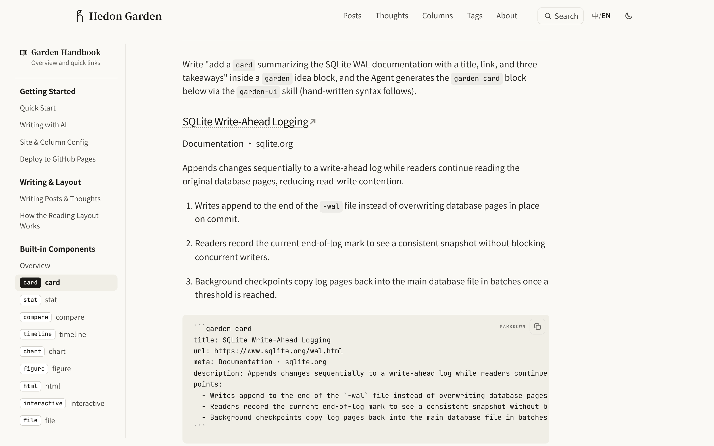

# Garden

**English** · [简体中文](README.zh-CN.md)

Garden is a personal blog framework for writing long-form posts, short thoughts, and ordered columns in Markdown inside your own Git repository. Your site repo holds only `site.config.yaml` and `content/`, while `hd-garden` handles typography, static export for GitHub Pages, and local checks. When a paragraph calls for a chart, a comparison card, or an interactive calculator, you can write a single plain-language sentence in the draft and let your coding Agent compile it with the same CLI that guards your commits.


|  |  |
| :--- | :--- |
| **Long-form reading**: `740px` prose column, tables and figures that widen into the margins, semantic callouts, and a floating table of contents. | **Built-in components**: 9 `garden` block types (`card`, `stat`, `compare`, `timeline`, `chart`, `figure`, `html`, `interactive`, `file`) written by hand or compiled from a one-sentence idea. |
|  |  |
| **Dark mode**: warm charcoal surfaces with automatic `#faf9f5` paper backing behind transparent dark-line diagrams. | **Mobile layout**: responsive typography, collapsible navigation and table-of-contents drawers, and zero-CLS image sizing. |

## Quick Start

Requires **Node.js `>= 22.13.0`**, **Git**, and **GNU Make**:

```bash
npx hd-garden init my-blog
cd my-blog
npm install
make dev
```

The published npm package is `hd-garden`; once installed inside a site, you can run `npx garden` (do not run `npx garden init` directly, as `garden` on npm is an unrelated package). Running `make dev` for the first time creates `.env.local`, installs the three AI skills under `.agents/skills/`, installs the pre-commit check in `.git/hooks/pre-commit`, and starts the local server at `http://localhost:3000` (with the built-in handbook at `http://localhost:3000/garden/en`).

If you use a custom npm mirror locally, keep `registry` in `~/.npmrc` so mirror hostnames are not written into `package-lock.json` (you can verify before committing with `node node_modules/hd-garden/scripts/check-lockfile-registry.mjs`).

### Common Commands

| Command | Description |
| :--- | :--- |
| `make new SLUG=writing-pace TITLE="Writing Pace"` | Create a draft post in `content/posts/` |
| `make dev` | Sync content and start the local server |
| `CONTENT_INCLUDE_DRAFTS=1 make dev` | Preview drafts and future `publishAt` posts |
| `make check` | Run `npx garden sync` and `npx garden build` |
| `make update MESSAGE="Add writing-pace post"` | Check, commit, and push to `origin` |
| `npx garden check content/posts/writing-pace.md` | Validate front matter, components, and assets |
| `npx garden ui check --staged` | Check staged posts for uncompiled ideas or UI errors |
| `npx garden ui catalog` | Generate an offline component gallery at `.garden/ui-catalog.html` |

## Features

### 1. Reading Layout and Typography

- **Three-tier adaptive widths**: prose stays in a `740px` column (`17px` body copy), wide figures expand up to `1040px`, and wide tables expand up to `1340px` without overlapping the `200px` floating table of contents.
- **Two-line title splitting**: write ` | ` (with spaces on both sides) inside a title to split it across two lines and scale the heading to fit the wider line.
- **Build-time image sizing and dark backing**: `npx garden sync` records intrinsic `width` and `height` for local images to prevent layout shift, and dark mode places a `#faf9f5` paper backing behind transparent diagrams so dark strokes remain legible without CSS filter inversion.
- **Technical Markdown out of the box**: KaTeX math (`$...$` and `$$...$$`), Mermaid diagrams, syntax-highlighted code blocks with copy buttons, adjacent `diff` fences that merge into a `Code / Diff from previous` toggle, CJK-friendly bold, `<u>` highlighter strokes, and Open Graph link cards (`{card}`).

### 2. Describe Components in One Sentence

Where a post needs a structured block or an interactive formula, write an unnamed `garden` fence describing what the reader should adjust and see:

````markdown
```garden
Let the reader drag daily word count and writing days per week to see how many weeks an 8,000-word article takes.
```
````

Ask your Agent to compile the post using the bundled `garden-ui` skill:

1. The Agent runs `npx garden ui scan` to locate uncompiled or failing blocks and reads the component rules from `npx garden ui prompt`.
2. It compiles the idea into `garden interactive` (where `<State>`, `<Let>`, `<Slider>`, `<Choice>`, `<Toggle>`, `<Stat>`, `<Chart>`, and other tags compose and nest freely) or into `card`, `stat`, `compare`, `timeline`, `chart`, `figure`, `html`, `file`, or an adjacent `diff` fence, then writes only that fence back via `npx garden ui apply`.
3. If you run `git commit` before compiling, the pre-commit hook runs `npx --no-install garden ui check --staged --quiet`, stops the commit, and prints a ready-to-paste fix prompt (also saved to `.garden/ui-fix-prompt.md`).

### 3. Content Types, Static Export, and Optional Admin

- **Posts, thoughts, and columns**: write long-form posts in `content/posts/`, short notes with image grids or audio/video/link attachments in `content/thoughts/` (paginated at `/thoughts/page/<n>/` with infinite scroll), and ordered series in `content/columns.yaml`.
- **Client-side search and feeds**: builds a two-stage Fuse.js + IndexedDB full-text search index (`⌘K` / `Ctrl K`), RSS (`rss.xml` and `posts.xml`), `sitemap.xml`, and Webmention sending.
- **Static export for GitHub Pages**: `STATIC_EXPORT=1 npx garden build` prerenders every route to `dist/client/`, and `npm run pages:validate` verifies the output before deployment (supporting either a single public repository or a private source repository pushing to a public Pages repository).
- **Optional `/admin` service**: deployable locally (`npm run admin:local`), with Docker, or on Cloudflare Workers (`npm run admin:cloudflare`) for GitHub OAuth sign-in, posting thoughts from the browser, direct Alibaba Cloud OSS uploads, and the `/admin/ui` component workbench.

## Handbook and Reference Docs

Start `make dev` and open `/garden/en`, or read the Markdown sources in this repository:

- **[Garden Handbook](docs/handbook/en/index.md)**: [Quick Start](docs/handbook/en/start.md), [Writing with AI](docs/handbook/en/ai-writing.md), [Site & Column Config](docs/handbook/en/config.md), [Deploy to GitHub Pages](docs/handbook/en/deploy.md), [Writing Posts & Thoughts](docs/handbook/en/writing.md), [How the Reading Layout Works](docs/handbook/en/design.md), [Components Overview](docs/handbook/en/components.md), and [Checks & Shortcuts](docs/handbook/en/workflow.md).
- **[Quick Start Guide](docs/quick-start.md)** and **[GitHub Pages Deployment](docs/github-pages.md)**: single public repository or private source + public Pages repository workflows, plus Giscus comments.
- **[Admin Service](docs/admin-service.md)**: `/admin` configuration, environment variables, and deployment options.

## Credits

- **Visual style**: inspired by Claude's blog — its reading layout, warm paper palette, and card surfaces.
- **Component model**: one unified interface where components compose and nest freely and can embed self-contained HTML and scripts in a sandboxed `iframe`, inspired by ChatGPT's generative UI, now called [Intelligent UI](https://openai.com/index/gpt-6-for-everyone/).

## License

[MIT](LICENSE). Sites built with Garden should keep the Garden attribution link in the footer.
