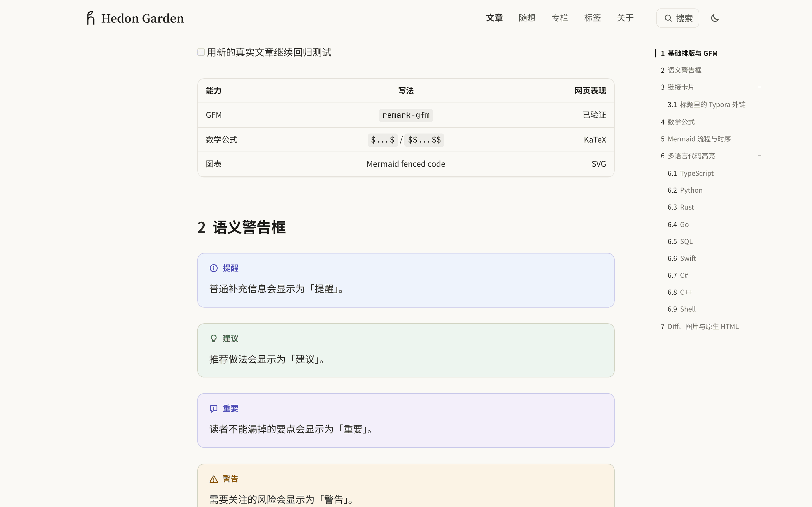
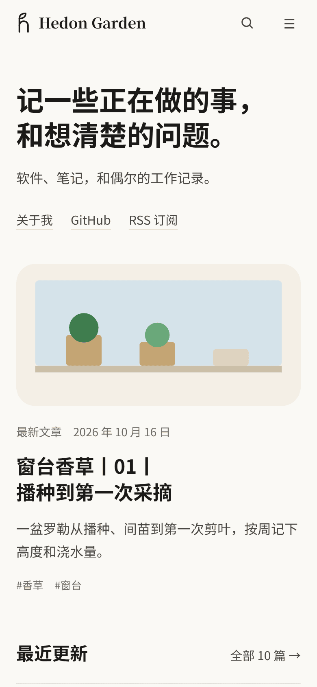

# Garden

[English](README.md) · **简体中文**

Garden 是一个用 Markdown 写作、用 Git 管理稿件的个人博客框架，支持长文、随想与专栏连载。你的站点仓库只保留 `site.config.yaml` 和 `content/`，阅读排版、GitHub Pages 静态导出与本地检查都由 `hd-garden` 包提供；正文中需要放图表、对比卡片或可调公式时，只需在稿件里写一句自然语言描述，交给编码 Agent 用与提交前钩子同一套 CLI 编译写回。


|  |  |
| :--- | :--- |
| **长文阅读排版**：`740px` 正文阅读列、向两侧对称外扩的宽表与宽图、语义提示框以及右侧浮动目录。 | **内置结构化组件**：9 种 `garden` 组件（`card`、`stat`、`compare`、`timeline`、`chart`、`figure`、`html`、`interactive`、`file`），可手写也可由一句话想法编译生成。 |
|  |  |
| **深色模式**：暖炭灰背景搭配透明深色线条图自动铺设的 `#faf9f5` 暖纸衬底。 | **移动端适配**：响应式字号、可收起的导航与目录抽屉，以及构建期写入图片尺寸带来的零布局跳动。 |

## 快速开始

需要 **Node.js `>= 22.13.0`**、**Git** 与 **GNU Make**：

```bash
npx hd-garden init my-blog
cd my-blog
npm install
make dev
```

公开包名是 `hd-garden`，装进站点后可使用 `npx garden`（不要直接运行未安装的 `npx garden init`，npm 上的 `garden` 是另一个包）。首次运行 `make dev` 会生成 `.env.local`、补齐 `.agents/skills/` 下的三个 AI skill，并在 `.git/hooks/pre-commit` 安装提交前检查，默认预览地址是 `http://localhost:3000`（使用说明在 `http://localhost:3000/garden`）。

如果在本地使用了 npm 镜像，请把 `registry` 留在 `~/.npmrc`，不要让镜像域名写进 `package-lock.json`（提交前可运行 `node node_modules/hd-garden/scripts/check-lockfile-registry.mjs` 检查）。

### 常用命令

| 命令 | 说明 |
| :--- | :--- |
| `make new SLUG=writing-pace TITLE="慢慢写"` | 在 `content/posts/` 下创建文章草稿 |
| `make dev` | 同步内容并启动本地预览 |
| `CONTENT_INCLUDE_DRAFTS=1 make dev` | 连同草稿和未来 `publishAt` 定时文章一起预览 |
| `make check` | 运行 `npx garden sync` 与 `npx garden build` 验证全站 |
| `make update MESSAGE="新增一篇文章"` | 检查通过后提交并推送到远端仓库 |
| `npx garden check content/posts/writing-pace.md` | 单独检查一篇文章的标题、组件与资源路径 |
| `npx garden ui check --staged` | 检查暂存区稿件中的想法块与交互组件 |
| `npx garden ui catalog` | 在 `.garden/ui-catalog.html` 生成离线组件清单 |

## 核心特性

### 1. 阅读排版与技术写作

- **三档自适应宽度**：正文段落保持在 `740px` 阅读列（字号 `17px`），宽幅配图最大展开到 `1040px`，多列宽表格最大展开到 `1340px`，并与右侧 `200px` 浮动目录自动避让。
- **双行标题拆分**：在标题中写入前后带空格的 ` | ` 或 `丨`，即可在分隔处拆成两行并按较长一行的字符宽度自动缩放字号。
- **构建期图片尺寸与深色衬底**：`npx garden sync` 在构建期读取本地图片宽高以消除加载跳动；深色模式下自动为透明底深色线条图铺上 `#faf9f5` 暖纸衬底，无需反色滤镜即可看清线条。
- **开箱即用的技术 Markdown**：支持 KaTeX 数学公式（`$...$` 与 `$$...$$`）、Mermaid 图表、带复制按钮的代码高亮、紧跟在完整代码下方自动合并为「代码 / 对比上一版」切换卡的 `diff` 围栏、中文友好的加粗解析、`<u>` 荧光笔下划线与 `{card}` 外链预览卡片。

### 2. 用一句话写组件（人和 Agent 共用同一套 CLI）

在正文需要结构化展示或交互公式的位置放一个不带名字的 `garden` 围栏，写清楚想让读者调节什么、看到什么：

````markdown
```garden
让读者拖动每天写的字数和每周写几天，看写完一篇 8000 字的长文要几周。
```
````

让编码 Agent 按仓库内置的 `garden-ui` skill 处理稿件：

1. Agent 运行 `npx garden ui scan` 读取未编译或有错误的块，并通过 `npx garden ui prompt` 读取组件目录与约束。
2. Agent 将想法编译为 `garden interactive`（支持 `<State>`、`<Let>`、`<Slider>`、`<Choice>`、`<Toggle>`、`<Stat>`、`<Chart>` 等标签自由组合与嵌套），或编译为 `card`、`stat`、`compare`、`timeline`、`chart`、`figure`、`html`、`file` 及完整代码下方的 `diff` 围栏，再用 `npx garden ui apply` 精确替换对应围栏。
3. 若在编译前直接 `git commit`，pre-commit 钩子会运行 `npx --no-install garden ui check --staged --quiet` 拦下提交，并在终端输出（同时写入 `.garden/ui-fix-prompt.md`）可直接粘贴给 AI 的修复提示词。

### 3. 内容组织、静态发布与可选后台

- **博文、随想与专栏**：长文放在 `content/posts/`，带多图网格或音视频、链接附件的短随想放在 `content/thoughts/`（构建期按 `/thoughts/page/<n>/` 预生成分页并支持滚动加载），按顺序串联的系列文章配置在 `content/columns.yaml`。
- **全站搜索与订阅**：构建期生成 Fuse.js + IndexedDB 两段式全文搜索索引（`⌘K` / `Ctrl K`）、RSS 订阅源（`rss.xml` 与 `posts.xml`）、`sitemap.xml` 与 Webmention 发送脚本。
- **GitHub Pages 静态导出**：`STATIC_EXPORT=1 npx garden build` 将全部路由预渲染到 `dist/client/`，并由 `npm run pages:validate` 校验产物完整性，支持「单公开仓库」或「私有源码仓库推送公开页面仓库」两种部署方式。
- **可选的 `/admin` 独立后台**：可通过本地（`npm run admin:local`）、Docker 或 Cloudflare Workers（`npm run admin:cloudflare`）部署，提供 GitHub OAuth 登录、网页端写随想并直接提交到 GitHub、阿里云 OSS 浏览器直传，以及 `/admin/ui` 组件工作台。

## 使用说明与深入文档

本地运行 `make dev` 后访问 `/garden`（英文版在 `/garden/en`），或直接阅读仓库内的文档：

- **[Garden 使用说明（中文）](docs/handbook/index.md)** · **[Garden Handbook (English)](docs/handbook/en/index.md)**：[快速开始](docs/handbook/start.md)、[用 AI 写作](docs/handbook/ai-writing.md)、[站点与专栏配置](docs/handbook/config.md)、[发布到 GitHub Pages](docs/handbook/deploy.md)、[写文章与随想](docs/handbook/writing.md)、[阅读排版是怎么工作的](docs/handbook/design.md)、[组件总览](docs/handbook/components.md) 与 [语法检查与快捷输入](docs/handbook/workflow.md)。
- **[从零开始](docs/quick-start.md)** 与 **[GitHub Pages 部署](docs/github-pages.md)**：单公开仓库或「私有源码仓库 + 公开页面仓库」的 Actions 配置与 Giscus 评论接入。
- **[独立管理后台](docs/admin-service.md)**：`/admin` 的环境变量配置与部署说明。

## 致谢与灵感来源

- **视觉风格**：受 Claude 博客启发，包括文章阅读版式、暖纸配色与卡片表面质感。
- **组件模型**：统一接口、组件可自由组合与嵌套、可在沙盒 `iframe` 中嵌入独立 HTML 与脚本的设计，受 ChatGPT 生成式 UI（现称 [Intelligent UI](https://openai.com/index/gpt-6-for-everyone/)）启发。

## 许可证

[MIT](LICENSE)。使用 Garden 构建的站点请保留页脚中的 Garden 署名链接。
