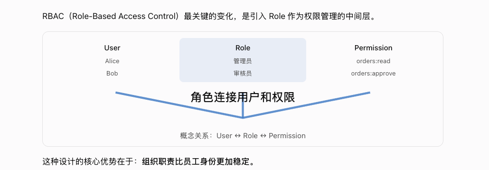
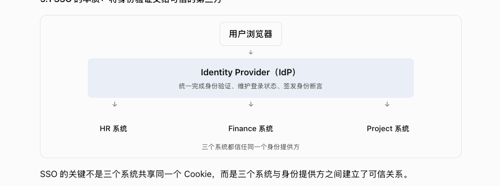
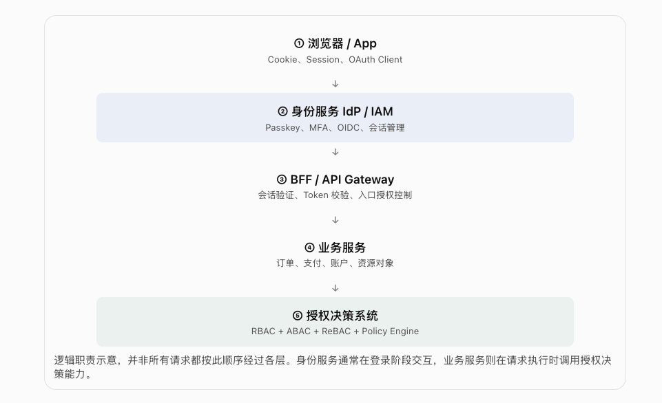
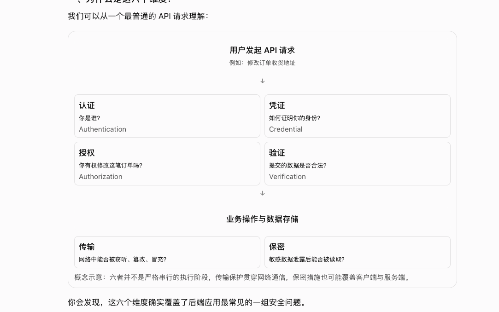
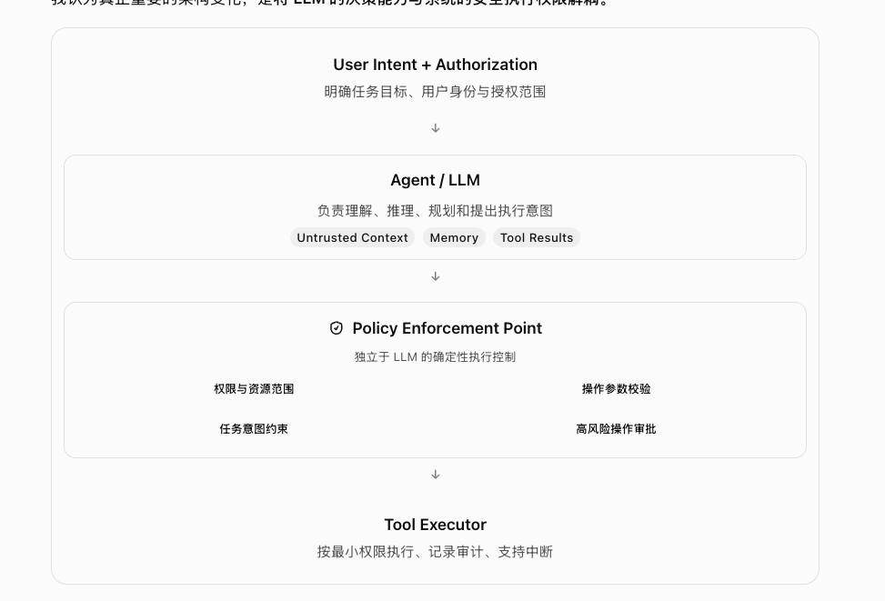
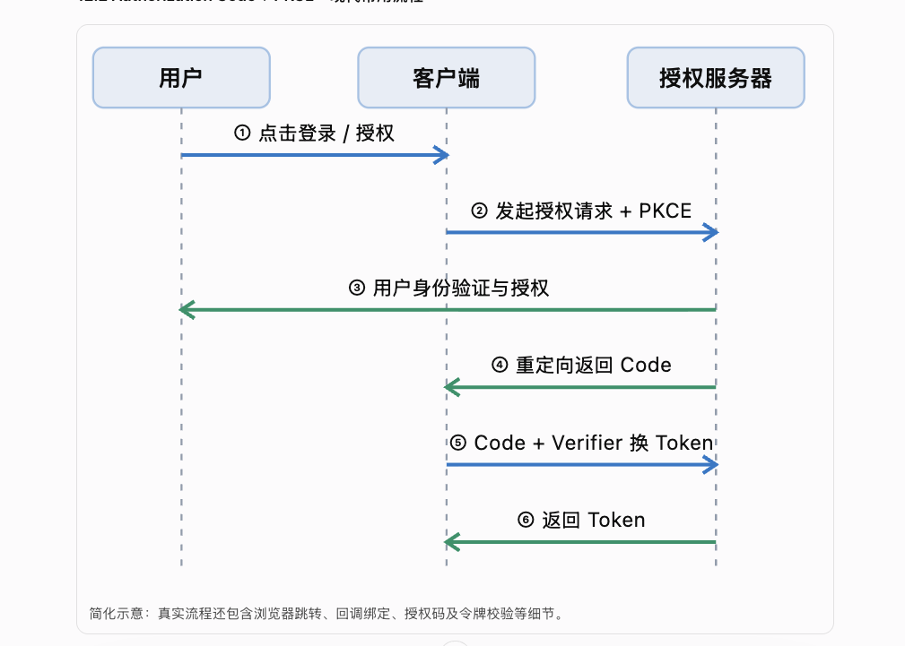

这些图只在这篇 tip 对照里点验。左边是原来的示意，右边是 `garden compose`。颜色走主题变量，浅色和深色都用同一张卡片。窄屏先上下叠，再把图里的横排收成一列。

## RBAC



```garden compose
<intent>
三列：User 下面是 Alice 和 Bob，Role 下面是管理员和审核员，Permission 下面是 orders:read 和 orders:approve。Role 在中间，把用户和权限接起来。Role 是要先看见的一层。
</intent>
<row align="center">
  <stack align="center">
    <title>User</title>
    <text>Alice</text>
    <text>Bob</text>
  </stack>
  <band tone="accent" align="center">
    <title>Role</title>
    <text>管理员</text>
    <text>审核员</text>
  </band>
  <stack align="center">
    <title>Permission</title>
    <text>orders:read</text>
    <text>orders:approve</text>
  </stack>
</row>
<join>角色连接用户和权限</join>
<text tone="muted" align="center">概念关系：User ↔ Role ↔ Permission</text>
```

## SSO



```garden compose
<intent>
用户浏览器先到身份提供方。身份提供方再同时连到 HR、Finance、Project。三个系统信任同一个身份提供方。身份提供方是要先看见的一层。
</intent>
<stack align="center">
  <pill>用户浏览器</pill>
  <arrow dir="down"/>
  <band tone="accent" align="center">
    <title>Identity Provider（IdP）</title>
    <text>统一完成身份验证、维护登录状态、签发身份断言</text>
  </band>
  <fan n="3"/>
  <row align="center">
    <title>HR 系统</title>
    <title>Finance 系统</title>
    <title>Project 系统</title>
  </row>
  <text tone="muted" align="center">三个系统都信任同一个身份提供方</text>
</stack>
```

## 认证分层



```garden compose
<intent>
从上到下五层：浏览器、身份服务、BFF、业务服务、授权决策。身份服务和授权决策是要强调的两层，其余是经过的路径。不是每次请求都按这个顺序走完。
</intent>
<stack align="center">
  <box frame="text" align="center">
    <badge>①</badge>
    <title>浏览器 / App</title>
    <text>Cookie、Session、OAuth Client</text>
  </box>
  <arrow dir="down"/>
  <band tone="accent" align="center">
    <badge>②</badge>
    <title>身份服务 IdP / IAM</title>
    <text>Passkey、MFA、OIDC、会话管理</text>
  </band>
  <arrow dir="down"/>
  <box frame="text" align="center">
    <badge>③</badge>
    <title>BFF / API Gateway</title>
    <text>会话验证、Token 校验、入口授权控制</text>
  </box>
  <arrow dir="down"/>
  <box frame="text" align="center">
    <badge>④</badge>
    <title>业务服务</title>
    <text>订单、支付、账户、资源对象</text>
  </box>
  <arrow dir="down"/>
  <band tone="tip" align="center">
    <badge>⑤</badge>
    <title>授权决策系统</title>
    <text>RBAC + ABAC + ReBAC + Policy Engine</text>
  </band>
  <text tone="muted" align="start">逻辑职责示意：并非所有请求都按此顺序经过各层。身份服务通常在登录阶段交互，业务服务则在请求执行时调用授权决策能力。</text>
</stack>
```

## API 的六个维度



```garden compose
<intent>
用户要改订单地址。先分成认证、凭证、授权、验证，每块一个问题。然后再看传输和保密。这六块不是严格的先后步骤。
</intent>
<stack align="center">
  <title>用户发起 API 请求</title>
  <text tone="muted">例如：修改订单收货地址</text>
</stack>
<arrow dir="down"/>
<row>
  <box>
    <title>认证</title>
    <text>你是谁？</text>
    <text tone="muted">Authentication</text>
  </box>
  <box>
    <title>凭证</title>
    <text>如何证明你的身份？</text>
    <text tone="muted">Credential</text>
  </box>
</row>
<row>
  <box>
    <title>授权</title>
    <text>你有权修改这笔订单吗？</text>
    <text tone="muted">Authorization</text>
  </box>
  <box>
    <title>验证</title>
    <text>提交的数据是否合法？</text>
    <text tone="muted">Verification</text>
  </box>
</row>
<arrow dir="down"/>
<stack align="center">
  <title>业务操作与数据存储</title>
</stack>
<row>
  <box>
    <title>传输</title>
    <text>网络中能否被窃听、篡改、冒充？</text>
  </box>
  <box>
    <title>保密</title>
    <text>敏感数据泄露后能否被读取？</text>
  </box>
</row>
<text tone="muted">概念示意：六者并不是严格串行的执行阶段，传输保护贯穿网络通信，保密措施也可能覆盖客户端与服务端。</text>
```

## Agent、策略点与工具



```garden compose
<intent>
用户意图经过 Agent，再经过策略执行点，最后到工具执行器。策略点里是四条约束。策略点是要先看见的一层。
</intent>
<stack align="center">
  <title>User Intent + Authorization</title>
  <text tone="muted">明确任务目标、用户身份与授权范围</text>
  <arrow dir="down"/>
  <band align="center">
    <title>Agent / LLM</title>
    <text>负责理解、推理、规划和提出执行意图</text>
    <row align="center">
      <badge>Untrusted Context</badge>
      <badge>Memory</badge>
      <badge>Tool Results</badge>
    </row>
  </band>
  <arrow dir="down"/>
  <box align="center" mark="shield">
    <title>Policy Enforcement Point</title>
    <text tone="muted" align="center">独立于 LLM 的确定性执行控制</text>
    <row align="center">
      <text>权限与资源范围</text>
      <text>操作参数校验</text>
    </row>
    <row align="center">
      <text>任务意图约束</text>
      <text>高风险操作审批</text>
    </row>
  </box>
  <arrow dir="down"/>
  <title>Tool Executor</title>
  <text tone="muted">按最小权限执行、记录审计、支持中断</text>
</stack>
```

## OAuth 授权码 + PKCE



```garden compose
<intent>
用户、客户端、授权服务器三条泳道，六步授权码加 PKCE。
</intent>
<lanes>
  <actor>用户</actor>
  <actor>客户端</actor>
  <actor>授权服务器</actor>
  <message from="1" to="2" tone="forward">点击登录 / 授权</message>
  <message from="2" to="3" tone="forward">发起授权请求 + PKCE</message>
  <message from="3" to="1" tone="back">用户身份验证与授权</message>
  <message from="3" to="2" tone="back">重定向返回 Code</message>
  <message from="2" to="3" tone="forward">Code + Verifier 换 Token</message>
  <message from="3" to="2" tone="back">返回 Token</message>
</lanes>
<text tone="muted">简化示意：真实流程还包含浏览器跳转、回调绑定、授权码及令牌校验等细节。</text>
```

## 两行流程


上面一行是无框标题，下面一行是胶囊。中间一条 `divider`。

```garden compose
<intent>
上面一行是交付顺序：理解需求、设计方案、开发上线。下面一行才是要强调的决策循环：提出假设、低成本验证、迭代或放弃。上面是背景，下面是重点。
</intent>
<row align="center">
  <title align="center">理解需求</title>
  <arrow dir="right"/>
  <title align="center">设计方案</title>
  <arrow dir="right"/>
  <title align="center">开发上线</title>
</row>
<divider/>
<row align="center">
  <pill tone="muted">提出假设</pill>
  <arrow dir="right"/>
  <pill tone="muted">低成本验证</pill>
  <arrow dir="right"/>
  <pill tone="muted">迭代或放弃</pill>
</row>
<text tone="muted" align="start">第二行才是产品探索更强调的决策循环。</text>
```
