本页是 Garden Compose 对齐 ChatGPT Intelligent UI（底层 DIL 协议）的**长期验收表**，仅作为 tip 内部点验，不进入公开的 `/garden/` 用户说明书。单张整图并排对照见 [说明图对照](/blog/compose-compare)。

- **第二列（ChatGPT 渲染效果）图片来源**：基于 [OpenUI 对 GPT-6 Intelligent UI 的抓包拆解](https://www.openui.com/blog/how-chatgpt-intelligent-ui-works) 与 [Disdjj/intelligent-ui-demo ANALYSIS.md](https://github.com/Disdjj/intelligent-ui-demo/blob/main/ANALYSIS.md)（协议版本 14）整理的静态 DIL 对照渲染，以及少量在 ChatGPT 图例中出现的连接结构。
- **第四列（我们的效果图）图片来源**：在同一 tip 上由当前 `ui/compose/` 真实编译渲染后截图（Claude 博文纸色底面 `--paper` + 透明线框卡片）。
- **统计总览**：共 **30** 行；**已实现 26 行**（含 icon、grid/grid-item、token 化表面，以及 play 模式下的 DIL `{@body}` / `{expr}` / `{#if}` / `{#each}`、slider、button·choice、pie/chart），**部分实现 0 行**，**未实现 4 行**（通用表单控件、内建 table 标签、宿主业务卡片、流式截断恢复）。
- **运行时说明**：表末四行里，`{@body}` / `{expr}` / `{#if}/{#each}` 已在 `garden compose` **play** 路径用 ChatGPT 同款 DIL 作者面落地（白名单表达式求值，非 Worker `eval`）；`recoveryDiagnostics` 仍未实现。映射见仓库 [`docs/compose-dil.md`](https://github.com/hedon954/garden/blob/cursor/garden-compose-c115/docs/compose-dil.md)。下方「tip 实测」有可拧的 live 演示。

## 逐项验收总表

| ChatGPT 支持的组件 / 链接方式 | ChatGPT 的渲染效果截图 | 我们是否已经实现 | 我们的效果图（tip 实测） |
| :--- | :--- | :--- | :--- |
| **`text`（正文叶子）**<br>段落或列表项转成的文本节点，内含 `**bold**`、`*em*`、`` `code` `` 行内结构。 |  | **是**<br>Markdown 段落直接编译为 `text` 节点，或显式写 `<text tone="plain\|muted" align="start\|center">`。 |  |
| **`title`（标题叶子）**<br>块或卡片的主标题，在抓包统计中高频出现（`size="sm\|md\|lg"`）。 | 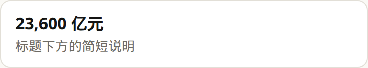 | **是**<br>Markdown `# / ## / ###` 标题或 `<title align="start\|center">`。 | 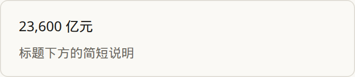 |
| **`caption`（底部弱化说明）**<br>图底或卡片内的辅助小字说明。 |  | **是**<br>`<caption>` 或 `<text tone="muted">`；图底注脚与卡内辅助说明。 | 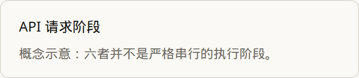 |
| **`badge`（徽章标签）**<br>圆角小标签，常用于标记状态、编号或上下文芯片。 | 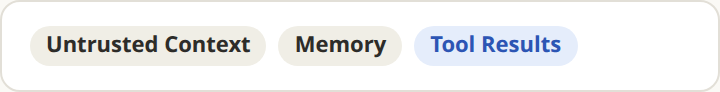 | **是**<br>`<badge tone="accent\|tip\|muted\|plain">`，可独立并排或放进 `<box>` 头部。 | 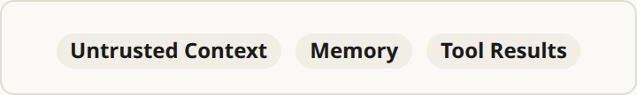 |
| **`icon`（矢量图标）**<br>抓包中出现 26 次的内建图标节点，常配合标题强调语义。 |  | **是**<br>`<icon name="check|check-circle|lock|shield|…" size="sm|md|lg|xl"/>`，具名 SVG；`mark="shield"` 仍可用。 |  |
| **`box`（线框容器） / `card`**<br>带边框、圆角与内边距的通用容器（抓包出现 54 次）。 |  | **是**<br>`<box padding gap radius background border size align>`；默认 Claude 纸面 + `--rule-strong` 边框。 |  |
| **`box` 强调色带变体（`background="surface-secondary"`）**<br>无描边或弱描边的整行浅色底通栏，用来突出关键层。 |  | **是**<br>`background="surface-secondary|surface-accent|…"`，或 `<band tone="…">` / `<box frame="band">`。 | 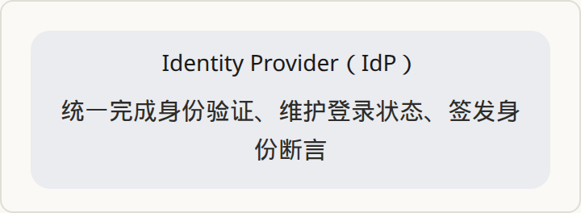 |
| **`box` 胶囊变体（紧凑短词框）**<br>按文字宽度收缩的圆角胶囊，用于流程节点或角色头。 |  | **是**<br>专用标签 `<pill tone="plain\|muted\|accent\|tip">`。 |  |
| **`row`（横向并排）**<br>子项沿水平方向等宽或居中排列（抓包出现 35 次）。 |  | **是**<br>`<row align="start\|center">`，窄屏自动折成单列。 |  |
| **`stack` / 纵向 `box`（垂直堆叠）**<br>子项自上而下按固定间距排列。 | 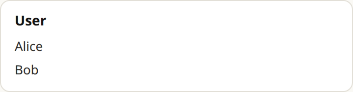 | **是**<br>`<stack align="start\|center">`。 |  |
| **`grid` + `grid-item`（多列网格）**<br>按列数对齐的二维卡片网格（抓包中 `grid` 2 次、`grid-item` 12 次）。 |  | **是**<br>`<grid cols={2|3|…}>` + `<grid-item span={n}>`，间距走 `gap` token。 | 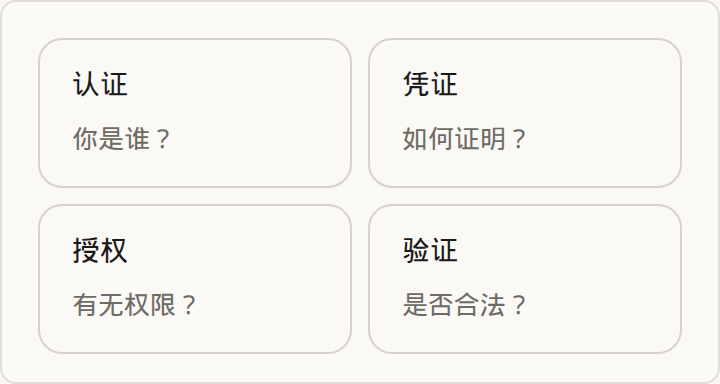 |
| **`divider`（水平分隔线）**<br>切分上下两个逻辑区域的细横线。 |  | **是**<br>自闭合标签 `<divider/>`。 | 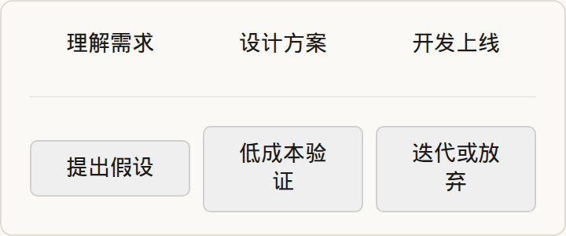 |
| **单向连接箭头（`↓` / `→`）**<br>ChatGPT 常靠 `box` + 字符或小图标拼出上下/左右流向。 |  | **是（专用标签）**<br>`<arrow dir="down\|right"/>`，内置统一尺寸 SVG 箭头，窄屏自动把右箭头转为向下。 | 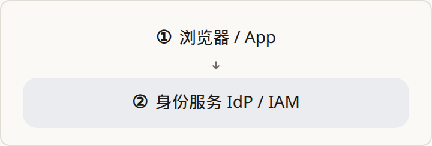 |
| **一分多扇出连接（Fan-out）**<br>从一层同时指向下方多列的并列箭头（见 SSO 图例）。 | 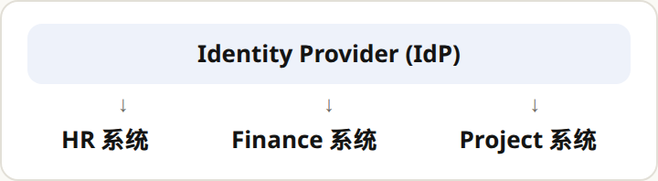 | **是（专用标签）**<br>`<fan n="2\|3\|4"/>`，与下方 `<row>` 的列数对齐。 | 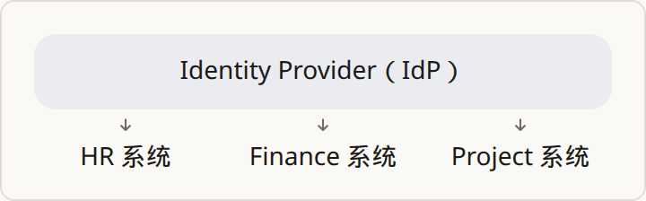 |
| **多合一汇聚连接（V 形 Join）**<br>左右两列斜线汇到中间底部并压一行粗体结论（见 RBAC 图例）。 | 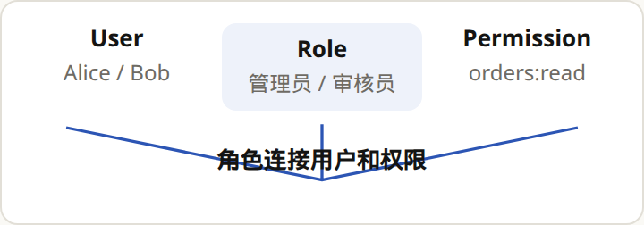 | **是（专用标签）**<br>`<join>一句话结论</join>`，单路径 SVG 斜线加居中文字。 | 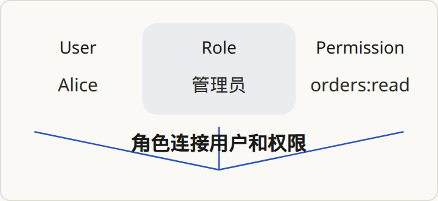 |
| **多角色时序泳道（Sequence Lanes）**<br>顶部角色胶囊、纵向虚线生命线、带编号的往返箭头（见 OAuth+PKCE 图例）。 |  | **是（专用标签）**<br>`<lanes>` + `<actor>` + `<message from to tone="forward\|back">`。 | 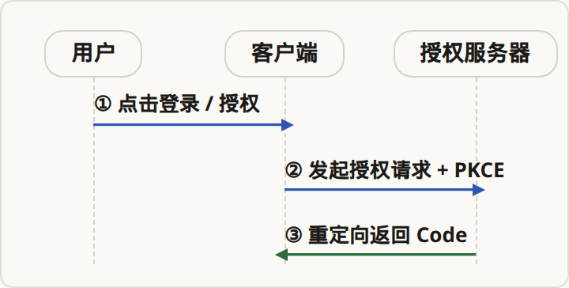 |
| **可展开步骤 / 披露说明（Steps / Disclosure）**<br>点击某一步或卡片展开对应的补充说明。 | 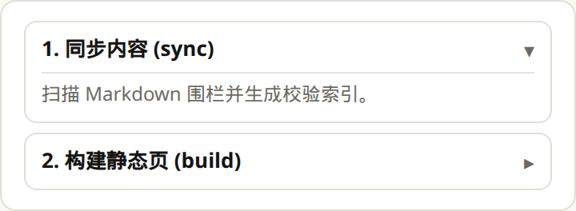 | **是**<br>`<steps>` + `<step id="...">` + `<note>`（或 `<box id="...">` + `<note>`），纯 HTML `<details>` 展开。 | 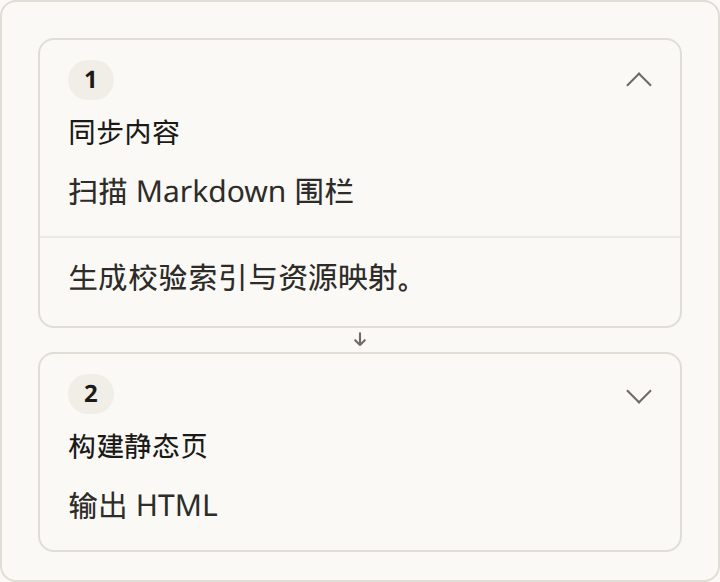 |
| **大数字指标块（KPI / Metric）**<br>抓包中用 `title size="lg"` + `text` + `caption` 拼出的核心指标展示。 | 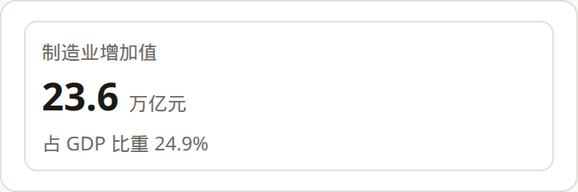 | **是（专用标签）**<br>`<kpi value="..." unit="..." label="..."/>`。 | 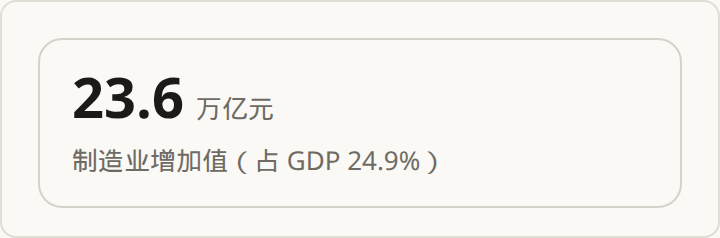 |
| **提示框（Callout）**<br>带左边框或底色的重点提示行。 |  | **是**<br>`<callout tone="note\|tip\|warn">`。 |  |
| **并列对比组（Compare Items）**<br>两到四项放在同一排对照优劣或职责边界。 | 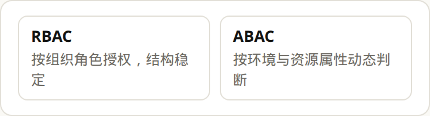 | **是**<br>`<compare>` + `<item tone="plain\|accent\|tip\|muted">`。 | 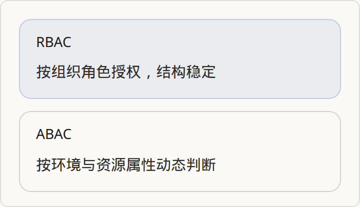 |
| **`button` / ` segmented-control`（按钮与分段切换）**<br>触发状态切换或档位选择的内建控件。 |  | **是（play）**<br>`<button>` 与 `<choice>`（分段切换）走 ChatGPT 同款 DIL：`{@body const [x,setX]=DIL.useState(...)}` + `onClick` / `value`/`onChange`。见下方 tip 实测。 | 见下方 tip 实测 |
| **`slider`（滑动条）**<br>抓包中用于调节连续数值（如预算、速率）并实时重算视图。 |  | **是（play）**<br>`<slider min max value onChange label unit />`，与 `{@body}` 派生值联动。见下方 tip 实测 / [窗台香草](/blog/windowsill-herbs/)。 | 见下方 tip 实测 |
| **`input` / `select` / `checkbox` / `radio`（表单输入）**<br>文本输入、下拉选择、复选与单选控件。 |  | **否（未实现）**<br>在 `compose` 中未实现。 | — |
| **`table`（结构化数据表）**<br>抓包 `model_dil_v2` 中出现 1 次的内建表格组件。 | 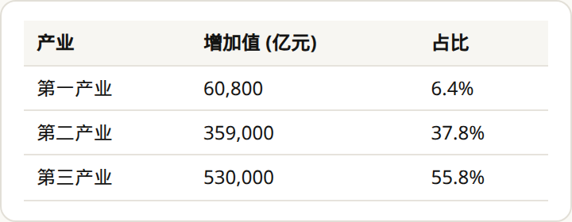 | **否（未实现）**<br>博文正文直接写 GFM Markdown 表格；`compose` 内部未设 `<table/>` 标签。 | — |
| **`pie-chart` / 内建图表**<br>抓包中由编译器追加 `card` 外壳的饼图/图表节点。 |  | **是（play）**<br>`<pie title slices={[...]} />` / `<chart type="bar|line|area|pie" ... />`，切片可用 `{expr}`。独立大数据图仍可走 `garden chart`。见下方 tip 实测。 | 见下方 tip 实测 |
| **宿主解析组件（30 eager + 283 lazy）**<br>如 `Cite`、`AsyncImage`、`ProductCard`、`FlightCard`、`Map` 等由服务端按 ID 注入数据的宿主卡片。 | 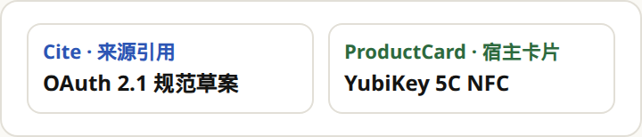 | **否（未实现）**<br>当前 tip 优先对齐内建布局与连接目录；宿主业务卡片未实现。 | — |
| **`{@body ...}`（响应式脚本块）**<br>在沙箱 Worker 中运行的状态声明与派生计算。 | 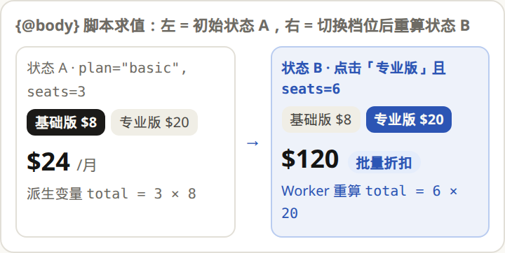<br><small>基于 OpenUI / Disdjj 协议的静态演示：左为初始状态 A（`$24/月`），右为切换档位与席位后重算出的状态 B（`$120` + 批量折扣徽章）。</small> | **是（play，受限子集）**<br>作者面与 ChatGPT 同款：`{@body const [n,setN]=DIL.useState(3)}`、`{@body const total = n * price}`。求值走白名单表达式解释器（非 Worker `eval`）。见下方 tip 实测。 | 见下方 tip 实测 |
| **`{expr}`（属性与文本插值）**<br>把脚本变量绑定到组件属性或文本节点。 | 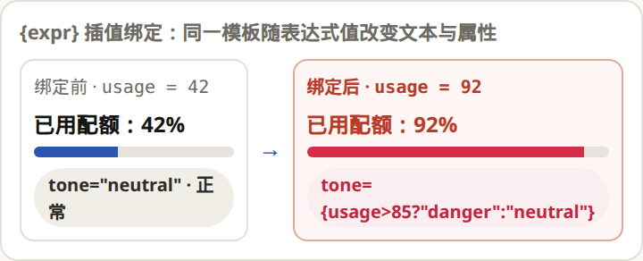<br><small>基于 OpenUI / Disdjj 协议的静态演示：左为 `usage=42` 时的正常蓝色进度条，右为 `usage=92` 时触发告警表达式变红。</small> | **是（play）**<br>属性 `value={n * price}` 与正文 `{n} 席 · 月费 ${'{'}total{'}'}` 均走表达式插值；diagram 模式仍保留 `<fan n={3}/>` 字面量捷径。见下方 tip 实测。 | 见下方 tip 实测 |
| **`{#if}` / `{:else}` / `{#each}`（条件与循环控制流）**<br>根据运行时状态增删或遍历节点树。 | 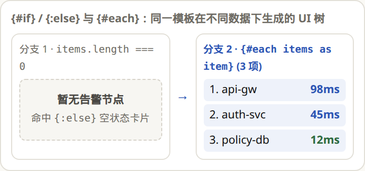<br><small>基于 OpenUI / Disdjj 协议的静态演示：左为数组为空时命中 `{:else}` 渲染空状态卡，右为有 3 条数据时 `{#each}` 展开成 3 行列表。</small> | **是（play）**<br>`{#if expr}…{:else}…{/if}` 与 `{#each items as item, i}…{/each}`，局部变量进入正文插值与子树。见下方 tip 实测。 | 见下方 tip 实测 |
| **流式编译修复（`recoveryDiagnostics`）**<br>流式输出时截断半截标签、自动闭合未完节点（抓包中 338 次恢复补丁）。 | 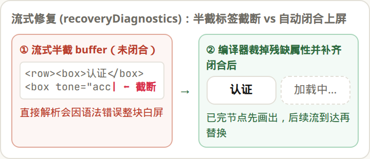<br><small>基于 OpenUI / Disdjj 协议的静态演示：左为流式半截标签（直接解析会白屏），右为编译器裁掉残缺属性并自动闭合后先画出已完卡片。</small> | **否（未实现）**<br>`ui/compose/markup.mjs` 在完整围栏上一次性解析；未闭合标签直接报错。 | — |

## tip 实测：ChatGPT 同款 DIL play

下面几块都是 `garden compose` 围栏、**同一套** `{@body}` / `{expr}` / `{#if}` / `{#each}` + 小写标签；不是旧的 PascalCase `garden interactive` 树。拧一下控件，数字应立刻变。

### Slider + body 派生

```garden compose #parity-slider
caption: 拧直径，看毫升。
intent: |
  验收滑杆与派生毫升数是否跟着变。
---
{@body const [diameter, setDiameter] = DIL.useState(12)}
{@body const water = Math.round(diameter * diameter * 0.35 + 20)}

<slider min={8} max={24} value={diameter} onChange={setDiameter} label="盆口直径" unit="cm" />
<stat label="这一次" value={water} unit="ml" />
```

### Choice + Button + `{#if}`

```garden compose #parity-choice
caption: 选档位，拧席位，看月费；点一下回到 1 席。
intent: |
  验收分段选择、按钮、滑杆与条件分支；月费数字必须跟着变。
---
{@body const [plan, setPlan] = DIL.useState("pro")}
{@body const [seats, setSeats] = DIL.useState(3)}
{@body const price = plan === "pro" ? 24 : 12}
{@body const total = seats * price}

<choice value={plan} onChange={setPlan} label="档位" options={[{value:"basic",label:"Basic"},{value:"pro",label:"Pro"}]} />
<slider min={1} max={12} value={seats} onChange={setSeats} label="席位" />
<button onClick={setSeats(1)}>席位清为 1</button>
<stat label="月费" value={total} unit="USD" />

{#if seats >= 5}
批量折扣档：{seats} 席
{:else}
标准档：{seats} 席
{/if}
```

### `{#each}` 列表

```garden compose #parity-each
caption: 遍历三行清单。
intent: |
  验收 each：三行清单必须画出来，序号与名字跟着数组走。
---
{@body const items = ["香草", "多肉", "番茄"]}
{#each items as name, i}
第 {i + 1} 项：{name}
{/each}
```

### Pie chart

```garden compose #parity-pie
caption: 三块饼。
intent: |
  验收 compose 内建 pie。
---
<pie title="窗台占比">
  <slice label="香草" value={40} />
  <slice label="多肉" value={35} />
  <slice label="番茄" value={25} />
</pie>
```
