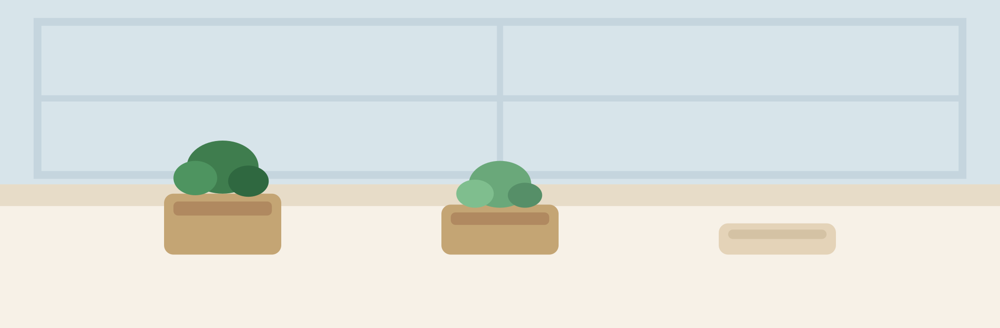
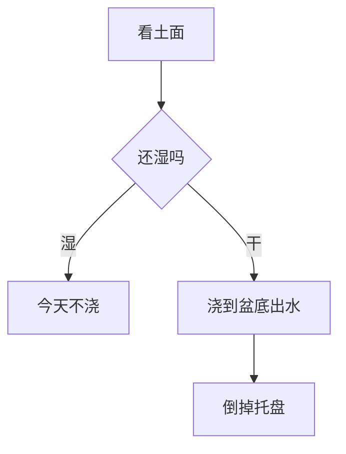

北向窗台上有三只盆。这季种了罗勒和薄荷，第三只空着，留给秋天的香菜。

## 两种香草

罗勒要见光，薄荷更耐阴。浇法也不一样。

```garden compose
<figure frame="none"><compare><item><title>罗勒</title><text>土面发白再浇透，托盘里的水倒掉。</text></item><item><title>薄荷</title><text>土保持微湿，避开正午的直射光。</text></item></compare></figure>
```

## 这季记下的数

种子是三月中旬播的。盆不深，第一次剪叶等到第六周。

```garden compose
<figure frame="none"><stack><metric label="发芽" value={7} unit="天"></metric><metric label="盆深" value={15} unit="厘米"></metric><metric label="第一次剪叶" value={6} unit="周"></metric></stack></figure>
```

## 从播种到剪叶

```garden compose
<figure frame="none"><timeline><event date="3月12日" title="播种"><text>罗勒和薄荷各一盆，覆土不超过半厘米。</text></event><event date="3月19日" title="出苗"><text>罗勒先露头，薄荷晚了两天。</text></event><event date="4月2日" title="间苗"><text>每盆留下最壮的两株。</text></event><event date="5月1日" title="第一次剪叶"><text>只剪顶端，留下至少四片叶。</text></event></timeline></figure>
```

> [!NOTE]
> 北向窗冬天光照不够，罗勒会徒长。把盆移到能见到上午光的那一格。

## 每周的株高

从第二周起，每周一量一次最高的那片叶。

```garden compose
<figure frame="none"><plot title="罗勒株高" unit="cm" caption="第六周剪叶前，罗勒大约 22 厘米。" type="bar"><datum x="第2周" y={4}/><datum x="第3周" y={8}/><datum x="第4周" y={13}/><datum x="第5周" y={18}/><datum x="第6周" y={22}/></plot></figure>
```

## 窗台怎么摆

靠左的那格上午有光，罗勒放那里。薄荷在中间。右边的空盆先不浇。



## 今天浇不浇

土面还湿就先不动。干了再浇，浇到盆底出水，然后把托盘倒掉。



> [!WARNING]
> 霜前把盆搬进屋。罗勒叶子一碰霜就发黑，回不来。

## 盆口和浇水量

盆口越大，一次浇得越多。12 厘米的盆大约是 70 毫升。

```garden compose #pot-water
caption: 盆口越大，一次浇得越多。12 厘米大约是 70 毫升。
intent: |
  让读者拧盆口直径，看这一次该浇多少毫升。
---
{@body const [diameter, setDiameter] = DIL.useState(12)}
{@body const water = Math.round(diameter * diameter * 0.35 + 20)}

<slider min={8} max={24} value={diameter} onChange={setDiameter} label="盆口直径" unit="cm" />
<stat label="这一次" value={water} unit="ml" />
```

## 水怎么往下走

浇下去的水不会停在表面。它慢慢渗过土层，最后从排水孔滴出来。

```garden compose
caption: "水从土面渗到排水孔，大约要一分钟。"
---
<sandbox title={"水从土面渗到排水孔，大约要一分钟。"} html={"\n<svg viewBox=\"0 0 640 280\" role=\"img\" aria-label=\"水从土面渗到盆底\">\n  <rect x=\"180\" y=\"36\" width=\"280\" height=\"200\" rx=\"18\" fill=\"#efe6d6\" stroke=\"#cbbfa8\"/>\n  <rect id=\"water\" x=\"196\" y=\"48\" width=\"248\" height=\"16\" fill=\"#7ea4c4\" opacity=\"0.85\"/>\n  <rect x=\"196\" y=\"150\" width=\"248\" height=\"70\" fill=\"#8b6a45\"/>\n  <circle cx=\"320\" cy=\"214\" r=\"8\" fill=\"#5c4632\"/>\n  <text x=\"320\" y=\"268\" text-anchor=\"middle\" font-size=\"14\" fill=\"#3c342c\">排水孔</text>\n</svg>\n\n"} css={"\n  html, body { margin: 0; background: transparent; color: #3c342c; font: 15px/1.5 ui-sans-serif, sans-serif; }\n  svg { display: block; width: 100%; height: auto; }\n"} js={"\n  var water = document.getElementById(\"water\");\n  var y = 48;\n  var reduce = window.matchMedia(\"(prefers-reduced-motion: reduce)\").matches;\n  if (reduce) {\n    water.setAttribute(\"y\", \"168\");\n    water.setAttribute(\"height\", \"36\");\n  } else {\n    (function tick() {\n      y += 0.45;\n      if (y > 168) y = 48;\n      water.setAttribute(\"y\", String(y));\n      water.setAttribute(\"height\", String(Math.max(16, 204 - y)));\n      requestAnimationFrame(tick);\n    })();\n  }\n"}/>
```

## 浇水纸条

纸条上先记下这一周。周四那次少了，周日又给薄荷补了一次。

```text
周一  罗勒  80 ml
周四  罗勒  80 ml
```
```diff
 周一  罗勒  80 ml
-周四  罗勒  80 ml
+周四  罗勒  120 ml
+周日  薄荷  60 ml
```

## 六周记录

| 周 | 株高 | 新叶 | 浇水 | 土面 | 气温 | 日照 | 备注 |
| --- | --- | --- | --- | --- | --- | --- | --- |
| 第1周 | 未见 | 无 | 每天喷湿 | 湿 | 16°C | 上午 | 覆土很薄 |
| 第2周 | 4 cm | 2 片 | 80 ml | 干 | 18°C | 上午 | 罗勒先出 |
| 第3周 | 8 cm | 4 片 | 80 ml | 干 | 19°C | 上午 | 薄荷跟上 |
| 第4周 | 13 cm | 6 片 | 100 ml | 干 | 21°C | 上午 | 间苗，留两株 |
| 第5周 | 18 cm | 8 片 | 120 ml | 干 | 22°C | 上午 | 叶色转深 |
| 第6周 | 22 cm | 10 片 | 120 ml | 干 | 23°C | 上午 | 剪了顶端 |

想核对叶子是不是对生、花是不是穗状时，看这一页。

```garden compose
<figure frame="none"><resource title="罗勒" href="https://zh.wikipedia.org/wiki/%E7%BD%97%E5%8B%92"><text>叶子对生，花排成穗。窗台上的那盆对得上。</text></resource></figure>
```

> [!TIP]
> 剪叶之后把盆转半圈，让另一面也能见到上午的光。
