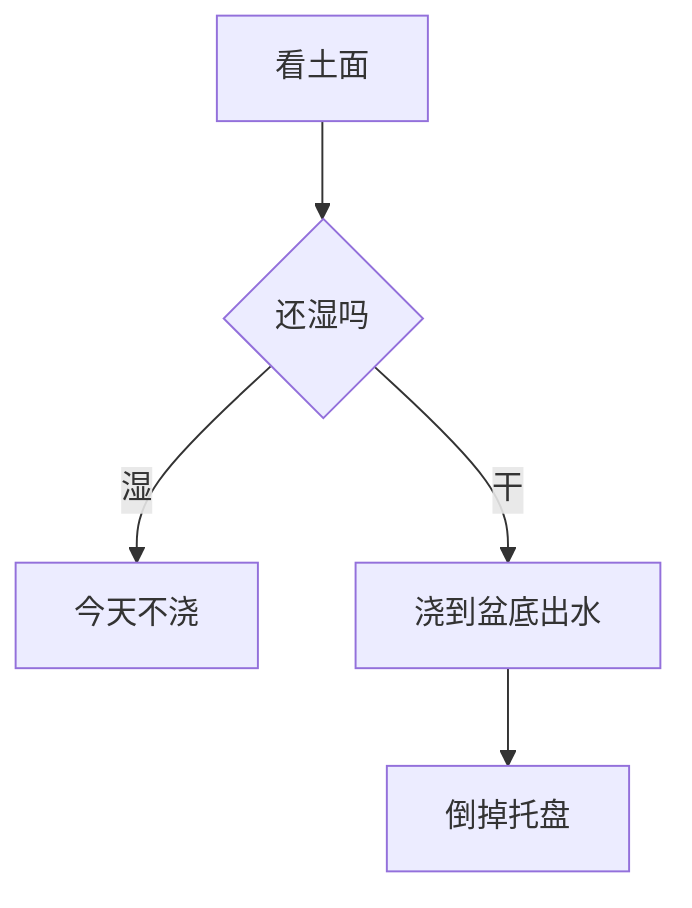

北向窗台上有三只盆。这季种了罗勒和薄荷，第三只空着，留给秋天的香菜。

## 两种香草

罗勒要见光，薄荷更耐阴。浇法也不一样。

```garden compare
items:
  - title: 罗勒
    text: 土面发白再浇透，托盘里的水倒掉。
  - title: 薄荷
    text: 土保持微湿，避开正午的直射光。
```

## 这季记下的数

种子是三月中旬播的。盆不深，第一次剪叶等到第六周。

```garden stat
items:
  - label: 发芽
    value: 7
    unit: 天
  - label: 盆深
    value: 15
    unit: 厘米
  - label: 第一次剪叶
    value: 6
    unit: 周
```

## 从播种到剪叶

```garden timeline
items:
  - date: 3月12日
    title: 播种
    text: 罗勒和薄荷各一盆，覆土不超过半厘米。
  - date: 3月19日
    title: 出苗
    text: 罗勒先露头，薄荷晚了两天。
  - date: 4月2日
    title: 间苗
    text: 每盆留下最壮的两株。
  - date: 5月1日
    title: 第一次剪叶
    text: 只剪顶端，留下至少四片叶。
```

> [!NOTE]
> 北向窗冬天光照不够，罗勒会徒长。把盆移到能见到上午光的那一格。

## 每周的株高

从第二周起，每周一量一次最高的那片叶。

```garden chart
type: bar
title: 罗勒株高
x: ["第2周", "第3周", "第4周", "第5周", "第6周"]
series:
  - name: 株高
    data: [4, 8, 13, 18, 22]
unit: cm
caption: 第六周剪叶前，罗勒大约 22 厘米。
```

## 窗台怎么摆

靠左的那格上午有光，罗勒放那里。薄荷在中间。右边的空盆先不浇。

```garden figure
caption: 朝北的窗台，从左到右是罗勒、薄荷和一只空盆。
parts:
  - name: 全部
    text: 三只盆并排，靠左的光照最好。
  - name: 罗勒
    text: 靠左，每天都够到上午的光。
  - name: 薄荷
    text: 中间，土干得慢一些。
  - name: 空盆
    text: 右边空着，留给秋天的香菜。
---
<svg xmlns="http://www.w3.org/2000/svg" viewBox="0 0 640 220">
  <rect data-p="全部" x="20" y="16" width="600" height="150" rx="10" fill="#d5e3ea"/>
  <rect data-p="罗勒" x="70" y="96" width="90" height="58" rx="8" fill="#c4a574"/>
  <circle data-p="罗勒" cx="115" cy="78" r="30" fill="#3f7d4e"/>
  <rect data-p="薄荷" x="270" y="104" width="90" height="50" rx="8" fill="#c4a574"/>
  <circle data-p="薄荷" cx="315" cy="88" r="26" fill="#6aa87a"/>
  <rect data-p="空盆" x="470" y="118" width="90" height="36" rx="8" fill="#e4d3b8"/>
</svg>
```

## 今天浇不浇

土面还湿就先不动。干了再浇，浇到盆底出水，然后把托盘倒掉。



> [!WARNING]
> 霜前把盆搬进屋。罗勒叶子一碰霜就发黑，回不来。

## 盆口和浇水量

盆口越大，一次浇得越多。12 厘米的盆大约是 70 毫升。

```garden interactive #pot-water
caption: 盆口越大，一次浇得越多。12 厘米大约是 70 毫升。
intent: |
  让读者拧盆口直径，看这一次该浇多少毫升。
---
<State diameter={12} />
<Slider bind="diameter" label="盆口直径" min={8} max={24} unit="cm" />
<Let water={round(diameter * diameter * 0.35 + 20)} />
<Stat label="这一次" value={water} unit="ml" />
```

## 水怎么往下走

浇下去的水不会停在表面。它慢慢渗过土层，最后从排水孔滴出来。

```garden html
title: 水从土面渗到排水孔，大约要一分钟。
code: |
  <style>
    html, body { margin: 0; background: transparent; color: #3c342c; font: 15px/1.5 ui-sans-serif, sans-serif; }
    svg { display: block; width: 100%; height: auto; }
  </style>
  <svg viewBox="0 0 640 280" role="img" aria-label="水从土面渗到盆底">
    <rect x="180" y="36" width="280" height="200" rx="18" fill="#efe6d6" stroke="#cbbfa8"/>
    <rect id="water" x="196" y="48" width="248" height="16" fill="#7ea4c4" opacity="0.85"/>
    <rect x="196" y="150" width="248" height="70" fill="#8b6a45"/>
    <circle cx="320" cy="214" r="8" fill="#5c4632"/>
    <text x="320" y="268" text-anchor="middle" font-size="14" fill="#3c342c">排水孔</text>
  </svg>
  <script>
    var water = document.getElementById("water");
    var y = 48;
    var reduce = window.matchMedia("(prefers-reduced-motion: reduce)").matches;
    if (reduce) {
      water.setAttribute("y", "168");
      water.setAttribute("height", "36");
    } else {
      (function tick() {
        y += 0.45;
        if (y > 168) y = 48;
        water.setAttribute("y", String(y));
        water.setAttribute("height", String(Math.max(16, 204 - y)));
        requestAnimationFrame(tick);
      })();
    }
  </script>
```

## 浇水纸条

纸条上先记下这一周。周四那次少了，周日又给薄荷补了一次。

```text
周一  罗勒  80 ml
周四  罗勒  80 ml
```
```diff
 周一  罗勒  80 ml
-周四  罗勒  80 ml
+周四  罗勒  120 ml
+周日  薄荷  60 ml
```

## 六周记录

| 周 | 株高 | 新叶 | 浇水 | 土面 | 气温 | 日照 | 备注 |
| --- | --- | --- | --- | --- | --- | --- | --- |
| 第1周 | 未见 | 无 | 每天喷湿 | 湿 | 16°C | 上午 | 覆土很薄 |
| 第2周 | 4 cm | 2 片 | 80 ml | 干 | 18°C | 上午 | 罗勒先出 |
| 第3周 | 8 cm | 4 片 | 80 ml | 干 | 19°C | 上午 | 薄荷跟上 |
| 第4周 | 13 cm | 6 片 | 100 ml | 干 | 21°C | 上午 | 间苗，留两株 |
| 第5周 | 18 cm | 8 片 | 120 ml | 干 | 22°C | 上午 | 叶色转深 |
| 第6周 | 22 cm | 10 片 | 120 ml | 干 | 23°C | 上午 | 剪了顶端 |

想核对叶子是不是对生、花是不是穗状时，看这一页。

```garden card
url: https://zh.wikipedia.org/wiki/%E7%BD%97%E5%8B%92
title: 罗勒
description: 叶子对生，花排成穗。窗台上的那盆对得上。
```

> [!TIP]
> 剪叶之后把盆转半圈，让另一面也能见到上午的光。
