## [知识卡片 · card](/garden/components/card)

```garden card
title: SQLite WAL 写入模式
url: https://www.sqlite.org/wal.html
meta: 文档说明 · sqlite.org
description: 把修改先顺序追加到预写日志，读操作继续访问原数据库页，减少读写互斥等待。
points:
  - 写入只追加到 `-wal` 文件末尾，不需要在事务提交时原地覆盖数据页。
  - 读事务记录当前末尾偏移量即可看到一致快照，不会阻塞并发写入。
```

## [数字指标 · stat](/garden/components/stat)

```garden stat
items:
  - label: 正文列宽
    value: "740"
    unit: px
    caption: 默认阅读列宽度
  - label: 宽图上限
    value: "1040"
    unit: px
    caption: 左右各最多外扩 150px
  - label: 宽表上限
    value: "1340"
    unit: px
    caption: 左右各最多外扩 300px
```

## [并排对比 · compare](/garden/components/compare)

```garden compare
items:
  - title: 写一句话说明改了什么
    text: 想法块紧跟在完整代码下面，AI 把它换成 diff，页面合成「代码 / 对比上一版」。
  - title: 手写 diff
    text: 完整代码下面紧跟一段 diff。
```

## [时间线 · timeline](/garden/components/timeline)

```garden timeline
items:
  - date: 步骤 1
    title: 同步内容与静态资源
    text: 校验 Front Matter、复制图片附件并生成搜索索引与 RSS。
  - date: 步骤 2
    title: 构建静态站点产物
    text: 把全部路由预渲染到静态目录。
```

## [条形图表 · chart](/garden/components/chart)

```garden chart
title: 三种版面区域的宽度上限
xLabel: 版面区域
yLabel: 最大宽度
unit: px
data:
  - x: 普通正文列
    y: 740
  - x: 宽幅配图区
    y: 1040
  - x: 多列宽表格
    y: 1340
```

## [说明图 · compose](/garden/components/compose)

```garden compose
<intent>
上面一行是交付顺序：理解需求、设计方案、开发上线。下面一行才是要强调的决策循环：提出假设、低成本验证、迭代或放弃。上面是背景，下面是重点。
</intent>
<row align="center">
  <title align="center">理解需求</title>
  <arrow dir="right"/>
  <title align="center">设计方案</title>
  <arrow dir="right"/>
  <title align="center">开发上线</title>
</row>
<divider/>
<row align="center">
  <pill tone="muted">提出假设</pill>
  <arrow dir="right"/>
  <pill tone="muted">低成本验证</pill>
  <arrow dir="right"/>
  <pill tone="muted">迭代或放弃</pill>
</row>
```

## [嵌入网页片段 · html](/garden/components/html)

```garden html
title: 字符长度小工具
code: |
  <!doctype html>
  <html lang="zh-CN">
  <head>
    <meta charset="utf-8" />
    <style>
      body { margin: 0; padding: 16px 18px; font: 14px/1.6 system-ui, sans-serif; color: #1b1a18; background: #faf9f5; }
      input { width: 100%; box-sizing: border-box; padding: 8px 10px; border: 1px solid #d5d1c8; border-radius: 6px; font: inherit; background: #fff; color: #1b1a18; }
      .meta { margin-top: 10px; color: #6e6b64; font-variant-numeric: tabular-nums; }
      strong { color: #1b1a18; }
    </style>
  </head>
  <body>
    <input id="txt" value="把文章放在自己的 Git 仓库里，推送后自动构建。" aria-label="输入示例文本" />
    <div class="meta">当前字符数：<strong id="count">23</strong> 字</div>
    <script>
      const input = document.getElementById("txt");
      const count = document.getElementById("count");
      input.addEventListener("input", () => { count.textContent = String(input.value.length); });
    </script>
  </body>
  </html>
```

## [可调公式与参数 · interactive](/garden/components/interactive)

```garden interactive #overview-reading
caption: 示例：按字数和阅读速度估算阅读时间。
---
<State words={6000} speed={400} />
<Let minutes={round(words / speed)} />

<Slider bind="words" label="正文字数" min={1000} max={20000} step={500} unit="字" />
<Slider bind="speed" label="阅读速度" min={200} max={800} step={50} unit="字/分钟" />

<Stat label="预计阅读时间" value={minutes} unit="分钟" />
```

## [文件下载与预览 · file](/garden/components/file)

```garden file
src: ./components/file/checklist.md
title: 发布前检查清单
note: 可点击「预览」在当前页展开阅读，或直接下载原文件
```

## [关系图 · relations](/garden/components/relations)

```garden relations
items:
  - title: 选书
    text: 定下这个月读什么
  - title: 共读
    text: 每周读完约定的章节
  - title: 讨论
    text: 见面聊各自的看法
  - title: 复盘
    text: 记下下次要改的地方
links:
  - from: 1
    to: 2
  - from: 2
    to: 3
  - from: 3
    to: 4
  - from: 4
    to: 1
  - from: 3
    to: 1
    style: dashed
    label: 影响选书
```

## [图标列表 · list](/garden/components/list)

```garden list
items:
  - icon: search
    text: 搜索这个月的书名
  - icon: eye
    text: 看了 3 篇书评
  - icon: heart
    text: 收藏了活动页面
  - icon: chat
    text: 在群里问能不能只听不说
```

## [选择卡 · choice](/garden/components/choice)

```garden choice
title: 下个月在哪里见面？
items:
  - icon: idea
    value: ¥40 / 人
    text: 街角咖啡馆，含一杯饮料
    label: 更看重氛围
    reply: 选了咖啡馆。我们会提前订好靠窗的长桌。
  - icon: book
    value: 免费
    text: 社区图书馆活动室，需提前预约
    label: 更看重安静
    reply: 选了图书馆。我们会在月初提交预约。
none:
  label: 都不合适 / 说不清
  reply: 没关系，我们会在群里再列几个场地。
```

## [链接卡片 · {card}](/garden/components/link-card)

[KaTeX 支持的函数](https://katex.org/docs/supported.html){card}

## [来源胶囊 · {source}](/garden/components/source)

引自维基百科 [wikipedia.org](https://en.wikipedia.org/wiki/Book_discussion_club){source}

## [本地图片](/garden/components/image)


