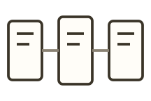
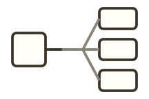
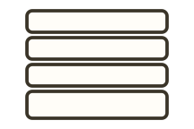
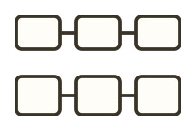
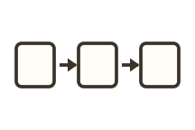
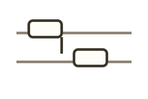
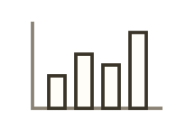
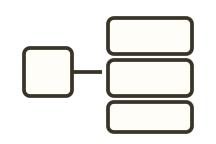
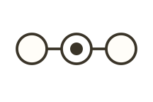
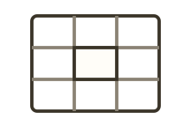

<!-- Generated by scripts/handbook-diagrams.mjs. Do not edit by hand. -->

Typora 和 VS Code / Cursor 的 `/garden` 列表来自同一份内置推荐列表，目前共 21 项：20 种常用图示，最后一项是「其他」。选中一项会插入统一的 `garden compose` 说明草稿，不是另一种作者围栏。推荐说明草稿用来写清材料和表达目标，不是语法课。

「其他」用于现成图示无法表达、或需要自由组合图文的内容。不必把下面的列表当成合法白名单。

入口和编译步骤见 [Compose](/garden/components/compose) 与 [语法检查与快捷输入](/garden/workflow)。

**[关联图](/garden/components/diagrams/columns-join/)** 适合说明两边如何通过中间一项关联起来。

**[发散图](/garden/components/diagrams/fan-out/)** 适合说明先到一处，再同时连到好几处。

**[分层图](/garden/components/diagrams/layers/)** 适合说明自上而下的层次，不必按顺序走完。

**[并列图](/garden/components/diagrams/facets/)** 适合说明一件事的几个方面，没有先后顺序。

**[上下对照图](/garden/components/diagrams/two-row/)** 适合把背景过程和重点过程分行对照。

**[图文列表](/garden/components/diagrams/icon-rail/)** 适合逐条说明互不依赖的内容。

**[流程图](/garden/components/diagrams/sequence/)** 适合说明一件事按什么顺序完成。

**[分步图](/garden/components/diagrams/steps/)** 适合一步步解释，步骤里可以展开细节。

**[对比图](/garden/components/diagrams/compare/)** 适合比较两三种方案在同一条件下的差异。

**[时间线图](/garden/components/diagrams/timeline/)** 适合按日期或时间点排列事件。

**[时序图](/garden/components/diagrams/lanes/)** 适合说明谁在什么时候向谁发了什么。

**[选项卡](/garden/components/diagrams/tabs/)** 适合几组说明互相独立、一次只看一组。

**[数据图](/garden/components/diagrams/chart/)** 适合把已有数字画成柱状、折线或占比。

**[参数调节图](/garden/components/diagrams/tunable/)** 适合让读者改一两个输入，看结果怎么变。

**[换算图](/garden/components/diagrams/converter/)** 适合一个输入同时算出好几项结果。

**[代码走查](/garden/components/diagrams/code-walkthrough/)** 适合一行行看代码执行到哪、变量是多少。

**[逐步演示](/garden/components/diagrams/stepper/)** 适合让读者停在某一步，看状态怎么变。

**[路径标注图](/garden/components/diagrams/trace/)** 适合在已有流程或状态图上标出走到哪。

**[步骤清单](/garden/components/diagrams/plan/)** 适合读者照着一项项做，并回来查看进度。

**[格子图](/garden/components/diagrams/inspect-grid/)** 适合标出二维结构里哪几格特别、为什么。

**[其他](/garden/components/diagrams/other/)** 适合现成图形无法表达、需要自由组合图文的内容。
