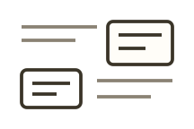

<!-- Generated by scripts/handbook-diagrams.mjs. Do not edit by hand. -->



适合现成图形无法表达、需要自由组合图文的内容。

不要把列表里的常用图示当成合法白名单，也不要为此学习新语法。

Typora 和 VS Code / Cursor 共用同一份推荐列表。在 `/garden` 里，这一项的名称和适用说明与上面相同。选中后会插入下面的 `garden compose` 说明草稿。补全材料和表达目标，再交给 AI 编译。

「其他」不是又一种现成模板。现成图示无法表达、或需要把几种内容放在一起时，在同一个 `garden compose` 里用任意 Markdown、安全 HTML，以及卡片、行列、步骤等基础块自由组合。推荐说明草稿不是语法课，也不要把列表当成合法白名单。

````markdown
```garden compose
请根据我提供的材料和表达目标，在统一的 garden compose 里自由组合图文。现成图形无法表达、或需要把几种内容组合在一起时，用任意 Markdown / HTML 以及已有的基础块做成合适的说明。

我的材料：
- （粘贴要呈现的内容、关系和原文）

我的表达目标：
- （读者应该理解什么、重点是什么）

请你：
- 只根据材料组织内容，不要发明事实或结论
- 自行处理图形语法、布局和手机阅读适配，不要让我学习新语法或写 CSS
- 列表里的常用图示只是起点，不是合法白名单；没有现成配方也可以，先抽取真实关系再组合基础块
- 不要把结果限制为某一个现成模板；需要时可以混合普通 Markdown、安全 HTML，以及卡片、行列、步骤等基础块
```
````
