图片单独成段时会包进图框，并在下方显示图注。

- **什么时候用**：这张图属于文章，读者需要看到图下说明。
- **什么时候不用**：只是装饰时，把 `alt` 写成以 `image`、`截图` 或 `img` 开头的占位词，这样不会出现图注。要按部分高亮说明时用[分区结构图](/garden/components/figure)；要提供下载时用[文件下载与预览](/garden/components/file)。

长文 `content/posts/my-post.md` 的配图放在同名目录 `content/posts/my-post/`。正文用 Markdown 图片语法引用，地址写成 `./my-post/diagram.svg`，方括号里的 `alt` 写成图注。

构建时会复制图片，并读出像素宽高，避免图片加载前把后面的文字顶下去。宽图如何向外扩，见[阅读排版是怎么工作的](/garden/design)。

图注优先用写在地址后面引号里的 Markdown 标题，没有标题时用 `alt`。`alt` 以 `image`、`截图` 或 `img` 开头时不当作图注。

下面这张图的图注就是它的 `alt`：

随想里的图片写在 Front Matter 的 `media` 中，多张拼成宫格，不使用这套图注。见[写文章与随想](/garden/writing)。

## Excalidraw

`.excalidraw` 和别的配图放在一起。正文仍用 Markdown 图片，地址指向源文件，例如 `./my-post/flow.excalidraw`。没有单独的 garden 组件。

`garden build`、`make dev` 和 `garden sync` 会找出这些图片。源文件有改动，或旁边的 `.svg` 缺失、过期时，先删掉旧的 `.svg`，再导出一张新的扁平 SVG，里面不嵌可再编辑的场景。上面的例子会得到同目录的 `flow.svg`。页面引用这张 SVG。读者看到的是普通图片，文章脚本不会加载 Excalidraw。

导出程序是 [excalidraw-image](https://github.com/rickardp/excalidraw-image) `0.2.0`，走的是 Excalidraw 自己的 SVG 导出。第一次遇到 `.excalidraw` 时，构建从 GitHub Releases 下载对应系统的可执行文件（压缩包约 48MB）并缓存在本机。不需要安装 Chromium。字体写进 SVG，页面不请求 excalidraw.com。已经下载过，或用 `GARDEN_EXCALIDRAW_IMAGE` 指向本机程序时，离线构建（`GARDEN_OFFLINE` 设为 `1`）不会再次下载。

源文件缺失，或导出失败时，构建直接停止，并写明路径和原因。

这不是 `garden` 围栏，没有字段表。
