## 是什么

图片视频组件涵盖文章中的所有视觉与流媒体承载方式：包括**自动测量宽高防抖动的本地/远程配图（`.fig`）**、**带原生播放控件的本地音频与视频**，以及**只需把视频网址单独放一行即可自动生成的 Bilibili 与 YouTube 站内播放器**。

## 有什么用

- **消除图片加载跳动与深色失真**：构建期提前写入像素宽高，桌面宽图自动对称外扩至最高 `1040px`，点击即可打开页内灯箱；深色模式下自动衬上 `#faf9f5` 暖纸底，无需作者准备两套深浅色配图。
- **零 iframe 手写负担，安全内嵌主流视频**：不用去 B 站或 YouTube 复制冗长且容易破坏排版的 `<iframe>` 嵌入代码，只需贴一行干净的视频链接，自动生成 16:9 响应式播放器、禁止自动出声打扰读者，并在播放器下方保留跳回原站观看的清晰入口。

---

## 形态一：本地与远程配图（自动图注与点击灯箱）

### 怎么写

将文章 `content/posts/my-post.md` 的配图放入同名目录 `content/posts/my-post/`，在正文单独成段写标准 Markdown 图片语法：

```markdown

```

- **图注生成规则**：优先读取括号内网址后面的引号标题 ``；未写引号标题时使用方括号里的 `alt` 作为图注；若只是纯装饰截图、不想显示图注，把 `alt` 写成以 `image`、`截图` 或 `img` 开头即可自动隐藏图注。

### 实际长什么样（Web 端与移动端双形态，点击图片可放大）

<div data-doc-showcase="本地配图真实渲染（支持点击打开高清灯箱）">


</div>

---

## 形态二：本地音频与视频

### 怎么写

短音频与演示视频可直接放在文章同名资源目录（长视频或高码率大文件建议通过管理后台上传到 OSS 对象存储后填写 `https://` 地址），在正文中直接使用带 `controls` 的原生 `<audio>` 或 `<video>` 标签（不要写进 `garden compose` 内部，也不要开启 `autoplay`）：

```html
<audio controls preload="metadata" src="./my-post/chime.wav"></audio>

<video controls preload="metadata" playsinline src="./my-post/motion-demo.webm"></video>
```

### 实际长什么样（Web 端与移动端双形态，可直接点击播放）

<div data-doc-showcase="原生本地音频与视频真实渲染（可直接点击播放测试）">

<p><audio controls preload="metadata" src="../assets/samples/chime.wav"></audio></p>

<p><video controls preload="metadata" playsinline style="max-width:100%;border-radius:10px;border:1px solid var(--rule)" src="../assets/samples/motion-demo.webm"></video></p>

</div>

---

## 形态三：Bilibili 站内视频播放器

### 怎么写

将可播放的 Bilibili 视频链接（支持 `/video/BV...`、`/video/av...` 以及 `player.bilibili.com` 地址）**单独占一行，前后各留空行**：

```markdown
https://www.bilibili.com/video/BV1GJ411x7h7
```

- 多余的分享追踪查询参数会被自动剥离清洗，且强制关闭自动播放；
- 若手里只有 `b23.tv/...` 短链（构建期出于确定性原则不会在渲染时联网解短链），可在终端运行 `make embed URL="https://b23.tv/..."`（或 `npx garden embed <短链>`），把终端输出的完整 `BV` 链接贴入文章即可。

### 实际长什么样（Web 端与移动端双形态）

<div data-doc-showcase="Bilibili 独立行播放器真实渲染">

https://www.bilibili.com/video/BV1GJ411x7h7

</div>

---

## 形态四：YouTube 站内隐私增强播放器

### 怎么写

同样把 YouTube 视频地址（支持 `youtube.com/watch?v=...`、`youtu.be/...`、`/shorts/...`）**单独占一行，前后留空行**。支持在参数中附带起播秒数（如 `?t=15` 或 `?t=1m30s`）：

```markdown
https://www.youtube.com/watch?v=M7lc1UVf-VE&t=15
```

- 引擎底层自动重写为无跟踪 Cookie 的官方隐私增强域名 `www.youtube-nocookie.com/embed/...`；
- 如果某条视频链接你不希望展开成播放器、只想展示为普通链接卡片，在链接末尾紧跟 `{card}`（如 `[视频标题](https://youtu.be/M7lc1UVf-VE){card}`）即可。

### 实际长什么样（Web 端与移动端双形态）

<div data-doc-showcase="YouTube 独立行隐私增强播放器真实渲染（从第 15 秒起播）">

https://www.youtube.com/watch?v=M7lc1UVf-VE&t=15

</div>

---

## 在线演练场：修改视频地址或图注实时更新渲染

你可以在下方左侧切换 **Bilibili**、**YouTube** 或 **配图与音视频** 预设，换成任意真实 `BV` 号、调整 YouTube `?t=` 起播秒数或修改图注文字，点击 **「更新渲染」** 立即查看真实播放器：

```doc-playground
{
  "title": "图片与视频播放器交互演练场",
  "description": "修改 Bilibili BV 号、YouTube 视频 ID / 起播时间或图片说明，点击「更新渲染」查看实时效果。",
  "presets": [
    {
      "id": "bilibili",
      "label": "Bilibili 播放器",
      "code": "下面这行独立 Bilibili 视频地址会自动渲染为站内播放器：\n\nhttps://www.bilibili.com/video/BV1GJ411x7h7"
    },
    {
      "id": "youtube",
      "label": "YouTube 播放器",
      "code": "支持 ?t= 秒数参数指定起播时间（自动走 youtube-nocookie.com）：\n\nhttps://www.youtube.com/watch?v=M7lc1UVf-VE&t=30"
    },
    {
      "id": "image-audio",
      "label": "配图与本地音视频",
      "code": "\n\n<p><audio controls preload=\"metadata\" src=\"../assets/samples/chime.wav\"></audio></p>"
    }
  ]
}
```
