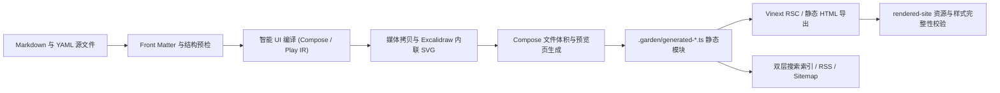

Garden 在运行时不需要任何数据库或后端 API 来支撑阅读端。之所以能同时兼顾「作者只写纯 Markdown」与「线上具备秒开搜索、链接卡片、矢量内联与复杂交互组件」，是因为引擎在构建期（`garden sync` 与 `garden build`）完成了一条完整的静态编译管线。

---

## 1. 编译总管线：Git 即唯一真源

所有文章（`content/posts/**/*.md`）、专栏编排（`content/columns.yaml`）与站点身份（`site.config.yaml`）均以纯文本保存在 Git 仓库中。每次执行 `make dev` 或 `garden build` 时，`scripts/build-content.mjs` 按以下顺序完成编译：

编译生成的元数据与正文被拆分为独立的 `.garden/generated-content.ts`（仅含列表所需的轻量元数据，不含正文）与 `.garden/generated-post-bodies.ts`（按路径索引正文）。这样首页、归档页与客户端脚本永远不会把整站文章正文打进浏览器 JS 包（`tests/client-bundle.test.mjs` 对此做严格字节级门禁）。

---

## 2. 组件渲染原理：Markdown AST 插件链与 Compose 双模引擎

### 2.1 正文 AST 渲染管线（`MarkdownArticle`）

单篇文章正文经统一语法树管线渲染，严格按职责分层处理：

1. **Remark 阶段（Markdown 语法树）**：
   - `remark-gfm`、`remark-breaks`、`remark-cjk-friendly`、`remark-math` 处理表格、脚注、软换行、中文标点紧邻加粗与 LaTeX 公式（多字母带下划线标识符如 `max_tokens` 自动保护为 `\mathrm{...}`，避免下划线被误拆为下标）。
   - `remarkGarden` 识别 `garden compose` 围栏，并将紧邻的「完整代码块 + `diff` 代码块」合成为可切换 `<garden-codediff>` 节点。
   - `remarkVideoPlayer` 与 `remarkLinkCard` 识别独立行视频地址、`{card}` 链接卡片标记与 `{source}` 来源胶囊标记。
   - `remarkA2` 将 `[!NOTE]` 等五类提示框转换为带定制矢量图标的语义警告框，并将带说明的独立图片封装为 `<figure class="fig">`。
2. **Rehype 阶段（HTML 语法树）**：
   - `rehype-raw` 解析受控内联 HTML，`rehypeGardenBlocks` 将块级自定义组件从 `
` 中安全提升为独立流式节点，防止 HTML 嵌套违规导致水合报错。
   - `rehype-katex` 排版数学公式，`rehypeKeepPunctuation` 将行内公式或行尾最后一个字素与句末标点聚类在同一行（长荧光笔划线 `<u>` 仅拆分末尾单字素聚类，保留整句自然多行折行）。
   - `rehype-slug` 与 `rehypeHeadingAnchors` 生成标题锚点（若标题内部本身含有外链，自动拆分锚点区间，绝不产生 `<a>` 嵌套 `<a>`），最后由 `rehype-highlight` 完成多语言语法高亮。

### 2.2 `garden compose` 的静态树与 Play IR 双模机制

作者虽然只写同一种 `garden compose` 围栏，底层渲染器会根据内容自动走两条最优路径：

- **静态说明模式（零额外客户端运行时开销）**：
  当围栏内不包含 `{@body}` 状态声明时，`ui/compose` 在服务端直接把 `<row>`、`<stack>`、`<band>`、`<compare>`、`<steps>`、`<timeline>`、`<relations>`、`<icon-list>`、`<choices>`、`<plot>` 及安全 `<markdown>` / `<html>` 内容岛归一化并输出语义 HTML（仅在包含点击交互的原生语义组件如 `<steps>` / `<choices>` / `<relations>` 上挂载极轻量的交互岛），禁用 JavaScript 时依然 100% 可读。
- **Play 响应式交互模式（受控表达式引擎 + 静态快照回退）**：
  当围栏包含 `{@body const [x, setX] = DIL.useState(...)}` 时，`ui/compose/dil.mjs` 与 `ui/core/compile.mjs` 将作者编写的小写标签与插值表达式编译为类型安全的 **UI Payload IR**（内置白名单数学函数与受限 AST 求值器，不执行任意 `eval`）。构建期同时由 `renderStatic` 生成默认状态下的可读静态快照，客户端水合后接管滑杆、单选器与图表重绘。

---

## 3. 外链元数据自动拉取与双层刷新机制

正文中写下 `[标题](https://...){card}`、单独一行网址或 `[出处](https://...){source}` 时，读者的浏览器**不会在打开页面时向第三方网站发起任何跨域图标或数据请求**（既保护读者隐私，又避免外站防盗链或慢响应拖慢页面）：

1. **构建期静态抓取与本地化缓存（`scripts/link-assets.mjs`）**：
   - 构建或启动 `make dev` 时，脚本扫描全部文稿中的外链域名与 `{card}` URL，内置 DNS 私网地址拦截（防止 SSRF，同时兼容本地代理的 `198.18.0.0/15` Fake-IP 段）。
   - 自动抓取各站点的 Favicon 存入 `public/link-assets/fav/`；对 `{card}` 链接解析目标页的 OpenGraph / HTML `<title>`、简介、作者、发布时间（遇到 HTML `meta refresh` 跳转会自动跟随），并将 `og:image` 缩略图下载压缩为 `720px` 宽的本地 WebP 存入 `public/link-assets/og/`。
   - 所有元数据持久化在 `.garden/link-assets.json`。增量开发模式仅抓取 Git 改动文稿中的新增链接；任何网络超时或抓取失败都会自动沿用上一次缓存，**绝不因外部网站宕机而中断你的博客构建**。
2. **可选的第二层边缘刷新（`LinkCardRefresh` + Worker）**：
   - 构建同时生成白名单文件 `public/link-allowlist.json`（仅列出全站已发布文章真正引用过的卡片 URL）。
   - 当 `site.config.yaml` 配置了 `linkPreview.worker` 时，客户端空闲时可向你自建的轻量 Cloudflare Worker 查询白名单内链接的最新标题与摘要，兼顾静态首屏直出与远期信息保鲜。

---

## 4. 媒体自动化：图片防抖动、Excalidraw 内联与文件预览编译

- **本地与远程图片尺寸预测量（`scripts/image-sizes.mjs`）**：
  本地图片在 `garden sync` 时直接解析文件头字节读取宽高（自动处理 JPEG EXIF 旋转方向与超长属性 SVG）；远程 `https://` 图片通过 HTTP `Range: bytes=0-65535` 只拉取文件头部字节探测宽高并缓存在 `.garden/image-sizes.json`。服务端输出的每张 `` 天生具备精确宽高与宽图外扩边距。
- **Excalidraw 构建期扁平矢量内联（`scripts/excalidraw.mjs`）**：
  当正文引用 `` 时，构建脚本比对源文件 SHA-256 指纹，按需调用固定版本的 `excalidraw-image` 导出**去画布底色、内嵌字体数据 URI、剥离可编辑冗余 JSON** 的干净扁平 `.svg`，再由 `excalidraw-inline.mjs` 清洗危险标签后直接内联进文章 HTML DOM——页面无需加载任何 Excalidraw 前端运行时，且图中的所有中英文文字均可直接用鼠标框选复制。
- **`<file>` 与 `<files>` 体积计算及按需预览编译**：
  本地附件在构建期自动拷贝至 `public/media/` 并读取真实字节体积；远程 OSS 附件通过 `HEAD` / 单字节 `Range` 请求探测体积记入 `file-sizes.json`。若本地附件为 `.md` 文件，`scripts/file-preview.mjs` 会在构建期将其预渲染为独立安全的 `.md.preview.html` 文件，只有当读者点击卡片上的「预览」拉开抽屉时才按需拉取，不增加主文章页面体积。

---

## 5. 双层离线全文搜索与静态导出门禁

- **两阶段零后端搜索（`ui/garden/search-index.mjs` + `SiteHeader` / `DocsHeader`）**：
  1. `public/search-index.json`：仅含每篇的标题、章节/专栏、标签与 240 字短摘要，在用户鼠标移近搜索按钮或按下 `⌘/Ctrl + K` 时瞬时加载。
  2. `public/search-full.<hash>.json`：剥离 Markdown 标记、公式块和超 4 行长代码后的纯文本全文（相同正文自动去重），在首屏加载完成后的浏览器空闲期（`requestIdleCallback`，开启省流量模式时推迟到打开搜索框时）静默拉取并以内容哈希为键存入浏览器 **IndexedDB**，后续访问直接零网络读取。
  3. 检索时优先执行分词精确子串匹配（标题与标签高权重置顶），无精确命中时自动回退至动态按需加载的 `Fuse.js` 模糊容错匹配，并围绕命中区间裁剪上下文高亮片段。
- **静态产物完整性门禁（`scripts/rendered-site.mjs` & `prepare-pages-output.mjs`）**：
  每次静态导出（`STATIC_EXPORT=1`）末尾，引擎会用 `parse5`、`postcss` 与 `acorn` 真实解析导出的每一页 `.html`、`.css` 与 `.js` 模块图：验证不存在断裂的资源路径、未打包裸模块导入、缺失的客户端路由 Flight 载荷（`index.txt`）或丢失的 Compose 样式规则，并严禁 `.env`、源码目录与 Source Map 混入最终发布的 GitHub Pages 产物。
