Garden 的设计原则严格区分**读者在浏览器里看见什么**与**作者在编辑器里承担什么**。任何不能提升阅读清晰度或降低写作阻力的视觉装饰与配置开关，都被刻意排除在系统之外。

---

## 一、读者角度：沉浸式阅读与最少打扰

长篇技术文章往往包含数千字推理、代码块、宽架构图与多列对比表。Garden 遵循**信息元素越少越好（最少打扰）**的原则：文章页不放悬浮分享栏、不放花哨阅读时长徽章、不放自动弹窗或跳动动效，让视线始终停留在内容本身。

### 1. 颜色体系：暖纸墨色、零品牌蓝与深色配图衬底

刺眼的纯白背景（`#ffffff`）和高饱和度品牌蓝链接在长文阅读中极易造成视觉疲劳。Garden 全站采用柔和的**暖白纸底 + 深墨阶**配色（定义在 `app/styles/tokens.css`），正文链接保持墨色并通过下划线粗细反馈悬停，只有语义提示框与数据图保留克制的功能色：

| 颜色变量 | 浅色模式 | 深色模式 | 设计用途 |
| :--- | :--- | :--- | :--- |
| `--paper` | `#faf9f5` | `#1f1e1d` | 页面主纸张背景；深色模式下透明黑线配图自动衬上 `#faf9f5` 暖白底 |
| `--paper-deep` / `--well` | `#f0eee6` | `#262624` | 代码块凹槽、工具条底座与次级填充面 |
| `--chip` | `#f0eee6` | `#30302e` | 标签胶囊与紧凑按钮背景 |
| `--card` | `#ffffff` | `#262624` | 独立图框、浮层卡片与对照演示容器 |
| `--ink` | `#1b1a18` | `#eeece7` | 标题、正文加粗强调与主交互控件色 |
| `--text` / `--soft` | `#2d2c29` / `#4a4844` | `#dcd9d2` / `#bdb9b0` | 正文主阅读字色与次级说明字色 |
| `--muted` | `#6e6b64` | `#a09b91` | 日期、图注、表头与辅助元信息（明暗两套主题均满足 WCAG AA `>= 4.5:1` 对比度） |
| `--rule` / `--rule-strong` | `#e6e3dc` / `#d6d2c9` | `#3d3d3a` / `#4d4c48` | `1px` 分割细线、卡片描边与强调边框 |

针对技术博客最常见的「透明底黑线架构图在深色模式下看不见」痛点，Garden **拒绝使用 `filter: invert()` 反色滤镜**（反色会导致彩色实拍截图严重失真），而是为正文配图和灯箱统一垫上 `var(--image-backing)`（`#faf9f5`）暖纸底色：透明线稿清晰可读，实心彩色图片毫发无损。

### 2. 字体、字间距与行间距

- **零外部 Web 字体阻塞**：正文与标题直接选用当前操作系统最成熟的中西文原生字体栈（macOS 下的 `-apple-system` / `PingFang SC`，Windows 下的 `Segoe UI` / `Microsoft YaHei`，代码采用 `JetBrains Mono` / `SF Mono` 等宽栈），除数学公式按需使用 KaTeX 字形外不预加载任何大体积 Web Font，首屏文字零闪烁直出。
- **字号与行高节奏**：正文字号固定为 **`17px`**，行高（`line-height`）设为 **`1.75`**，字间距保持自然呼吸，不挤压英文与数字间距；代码块采用 `14px` / `1.6` 行高，兼顾单行容纳量与跨行扫读舒适度。
- **句末标点与外链图标防孤立**：内置标点聚类器保证公式、加粗、荧光笔划线和 emoji 后的句末标点（含 `~`）绝不会孤立掉到下一行行首；外链自动抓取的 `14px` Favicon 始终与链接首字绑定在同一行。
- **标题双行均衡断行**：作者在标题中写 `丨` 时自动拆成上下两行，并按较长一行的字符视觉宽度（汉字计 `1`，大写字母计 `0.68`，其余字符计 `0.58`）精准缩放字号，确保主副标题都不二次折行。

### 3. 行宽度、图片大小、表格大小与三级自适应扩宽

一行文字太宽会让读者换行时丢行，而图片和表格太窄又会被迫缩成一团或频繁出现横向滚动条。Garden 通过服务端预计算与客户端 `ArticleMeasure` 协同实现 **`740px` / `1040px` / `1340px` 三级对称宽度体系**：

| 版面层级 | 上限宽度 | 自适应尺寸测量与渲染策略 |
| :--- | :--- | :--- |
| **正文阅读列** | `740px` | 段落、列表、提示框、代码块与智能 UI 严格收束在 `740px` 内，每行约 38～42 个汉字，处于长文扫读的最佳眼球移动跨度 |
| **图片大小（`.fig`）** | `1040px` | 构建期自动读取本地与远程图片的真实像素宽高写入 `` 彻底消除加载抖动。Retina 2x 截图默认按 `naturalWidth / 2` 计算理想显示宽度：窄图保持原尺寸不拉伸；宽图在桌面视口（`>= 900px`）自动向左右两侧对称外扩最多各 `150px`（总宽上限 `1040px`），点击图片可在页内打开高清灯箱 |
| **表格大小（`.table-wrap`）** | `1340px` | 客户端先以 `max-content` 测量表格不折行时的真实内容宽度：窄表留在 `740px` 正文列内；多列宽表按实际超出量向两侧对称外扩最多各 `300px`（总宽上限 `1340px`），仍超出视口时才启用局部平滑横向滚动 |

### 4. 目录设计与窗口自适应

- **右侧跟随目录与递归折叠**：桌面端右侧浮动 `200px` 章节目录（提取 `H2`–`H5`），默认处于「跟读模式」，随阅读位置自动高亮当前小节并展开当前分支、收起无关长分支，也可一键切换「全部展开」；点击目录跳转时提前唤醒目标标题上方的懒加载图片并瞬间停靠，杜绝平滑滚动途中的图片撑开偏移。
- **宽元素碰撞自动避让**：当正文中的 `1040px` 宽图或 `1340px` 宽表滚入右侧目录所在高度区间时，`ArticleMeasure` 会实时计算重叠距离，将右侧目录平滑向右推移避让；若窗口剩余宽度不足以容纳推移后的目录，则暂时淡出隐藏，滚过宽图宽表后立即恢复——正文与目录永远不会互相遮挡。
- **全尺寸窗口自适应**：从超宽桌面显示器、笔记本分屏到平板与 `375px` 手机屏幕连续自适应。视口小于 `900px` 时右侧目录自动收纳进顶栏右上角的「目录」抽屉按钮（无 JavaScript 环境下同样可通过 CSS `:target` 打开），链接卡片、文件下载卡与多列对比组件自动切换为符合拇指触控高度（`44px`）的移动端竖排形态。

---

## 二、作者角度：纯粹写作、低心智负担与 AI Native

### ① 沉浸式写作（Typora 优先的纯 Markdown 体验）

作者日常面对的始终是干净的标准 `.md` 文件，没有任何私有 JSX 导入语句或顶部样板代码：
- 在 Typora 中打开 `content/posts/` 即可享受所见即所得的沉浸式写作：相对路径图片 `./post-slug/pic.png` 在 Typora 与最终网站中指向同一份文件。
- 原生打磨中文写作痛点：`remark-cjk-friendly` 让紧贴全角括号、引号的加粗无需额外加空格；`<u>...</u>` 荧光笔划线支持任意长度多行折行。

### ② 低心智负担：自然语言 + AI + 插件即可表达复杂智能 UI

传统技术博客一旦想做并排卡片、架构层次图或可调公式曲线，作者就不得不中断写作思路去查组件 API 文档、调间距甚至写 HTML/JS。

在 Garden 中：
- **只需记住一个围栏名 `garden compose`**：不管是静态层次图、时间线、文件下载预览卡还是带滑杆的交互图表，入口永远只有这一个。
- **只描述「想表达什么」，不写「怎么画」**：作者用两三句自然语言写清材料与重点，剩下的布局对齐、深浅色适配与窄屏折行全部交给 AI 编译。
- **编辑器插件顺手辅助**：安装 Typora 或 VS Code / Cursor 插件后，敲下 `/garden` 即可从带缩略图的 21 种常用图示中点选插入结构化说明草稿，光标移出围栏即可直接看到与线上一致的实时渲染预览。

### ③ AI Native：极少、极精的内置协作契约

许多项目堆砌冗长的提示词文件，反而让 AI Agent 迷失上下文或编造不存在的属性。Garden 从引擎层贯彻 **AI Native** 工程化设计：
- **极简高信噪比的 `AGENTS.md` 与 Skills**：初始化站点时自动维护一份百行以内的 `AGENTS.md` 概念地图，以及两项职责严明的技能——负责编译与视觉布局自检的 `garden-compose`，与负责结构修复和审稿建议的 `garden-post-review`。
- **按需拉取权威 Schema，不凭记忆猜测**：Agent 通过 `npx --no-install garden ui schema` 与 `garden ui prompt` 直接从当前安装的引擎校验器与真实样式表中提取最新可用标签、属性与图标目录，杜绝过时文档导致的幻觉。
- **原子化读写与确定性门禁**：Agent 用 `garden ui scan` 获取目标块的哈希锁，用 `garden ui apply` 只改写单个围栏，再用与 CI 完全一致的 `garden verify` 闭环验收，使 AI 排查报错与辅助创作既强大又完全可控。
