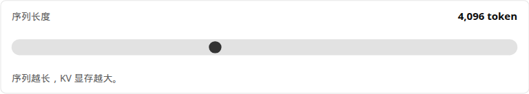
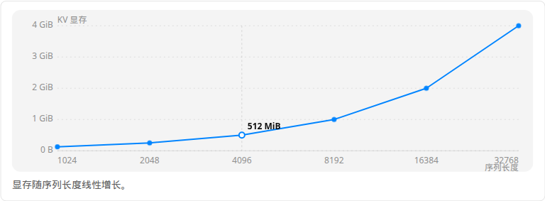
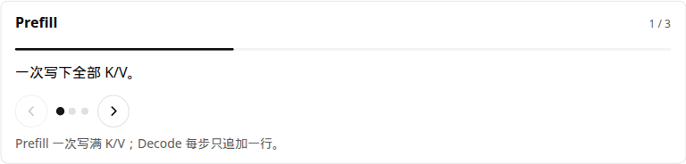
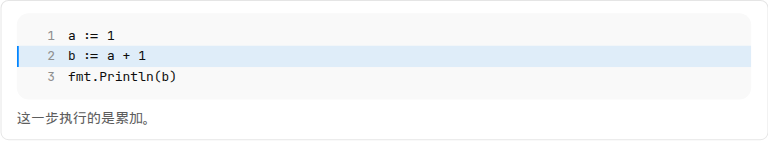

Garden 的视觉与组件系统并非凭空造轮子，而是明确取法两个在各自领域把体验做到极致的标杆产品：**阅读界面与纸墨秩序参考 Claude，正文内的结构化卡片与可交互微件参考 ChatGPT Intelligent UI**，并将二者统一在同一套暖纸墨色设计语言中。

---

## 1. Claude 风格：安静、温润的编辑部阅读感

在 AI 产品的界面演进中，Anthropic 的 Claude 展现出一种罕见的「书籍与手稿感」——它不靠炫光渐变、高饱和彩色徽章或密集边框刷存在感，而是靠纸张底色、灰阶对比度与留白层次建立秩序。

Garden 将这一审美转化为长文博客的基础视觉骨架：

```garden compose
<icon-list>
  <entry icon="palette" title="暖白羊皮纸底与墨色层级">
    <text>全站以 `#faf9f5` 暖纸色替代冷白背景，搭配 `#f0eee6` 凹槽底色与 `#1b1a18` 深墨主色；深色模式采用 `#1f1e1d` 暖炭黑，避免纯黑屏幕上的刺眼光晕。</text>
  </entry>
  <entry icon="minus" title="克制的 1px 细线与微状态反馈">
    <text>列表、专栏卡与链接卡默认采用透明背景加 `1px` 低对比度细边线（`#e6e3dc`），悬停时仅以微弱底色变化（`#f5f4ed`）或下划线加粗回应，不做卡片上浮位移。</text>
  </entry>
  <entry icon="book-open" title="排版节奏优先于界面装饰">
    <text>顶栏、元信息栏与文末参考卡全部退居次要灰阶，把最高对比度留给文章标题、小节锚点、代码高亮与核心结论。</text>
  </entry>
</icon-list>
```

---

## 2. ChatGPT Intelligent UI：正文内的原生交互表达

在对话式 AI 界面中，ChatGPT 引入了一套高度凝练的 **Intelligent UI** 微件语言：当解释增长率、参数权衡、执行步进、状态流转或代码逐行变化时，不再堆砌冗长文字，而是内嵌紧凑的指标盒、滑杆曲线、步进器、二维检查格与代码走查面板。

Garden 对这套微件的盒模型、字重层级、圆角边框与交互手感进行了逐项测量与还原，并将其改造为**可在静态博客离线运行、无服务端依赖且兼容无脚本回退**的 `garden compose` 组件引擎。

### 关键微件规格与实测还原

1. **滑杆（Slider）与响应式曲线（Chart）**：
   - 滑杆采用 `24px` 高全圆角浅灰轨道与内缩 `3px` 的 `18×18` 实心圆钮，触控热区高度扩展至 `38px`，不画花哨的渐变已滑填充条。
   - 曲线与柱状图置于柔和内嵌底板上，当前参数点以清晰空心圆标注实时数值，拖动滑杆时零延迟同步重绘：

   

   

2. **步进演示（Steps / Stepper）与代码走查（Code Walkthrough）**：
   - 步进面板顶部左侧为 `16px / 600` 步骤标题，右侧以 `12px` 次要字色显示步数进度（如 `1 / 3`），下方配 `3px` 细进度条与 `36px` 圆形前后切换按钮。
   - 代码走查面板使用 `12px` 圆角、`13px` 等宽字体与 `1.6` 行高，当前执行行左侧标 `2px` 强调竖条并铺淡色高亮底，随时切换步骤查看变量状态变化：

   

   

### 在同一套纸墨主题中自然共生

直接照搬聊天窗口的冷白组件放进暖纸博客会产生割裂感。因此 Garden 在保留 ChatGPT Intelligent UI **结构比例、信息密度与控件交互语义**的同时，将其表面底色、边框透明度、正文继承字号与深色模式变量接入了博客自身的主题令牌：

- 静态 `garden compose` 最外层场景默认采用透明底色，与文章纸张融为一体；需要无框融入段落流时只需声明 `frame="none"`。
- 组件内的普通说明文字默认继承文章正文的字体家族与字号基线，只有指标大数字、眉题、图例与轴刻度保留专门的语义字阶。
- 当标准组件目录仍不足以表达特殊二维拓扑或自定义物理动效时，可在同一个 `garden compose` 围栏内使用隔离 `<sandbox>` 画布（仅开启 `allow-scripts`，禁止 `allow-same-origin` 与外部网络请求），既拥有完整表现力，又严守静态博客的安全边界。
