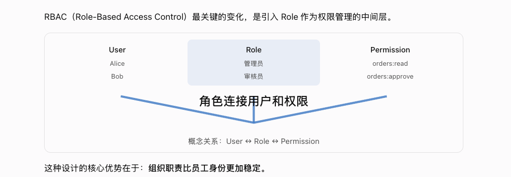
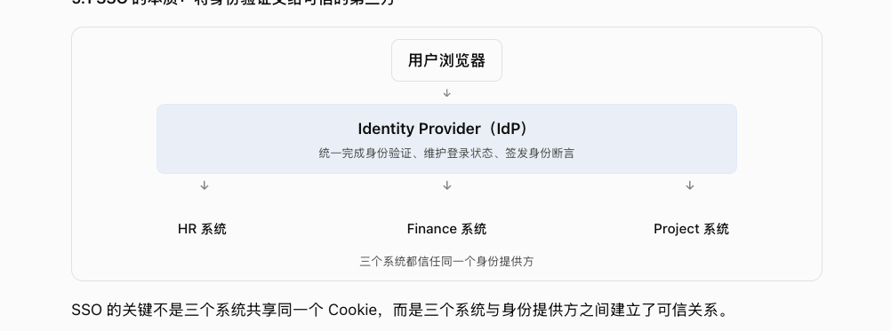
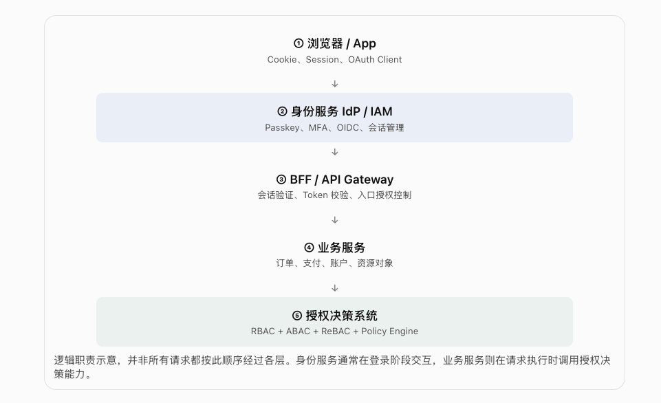
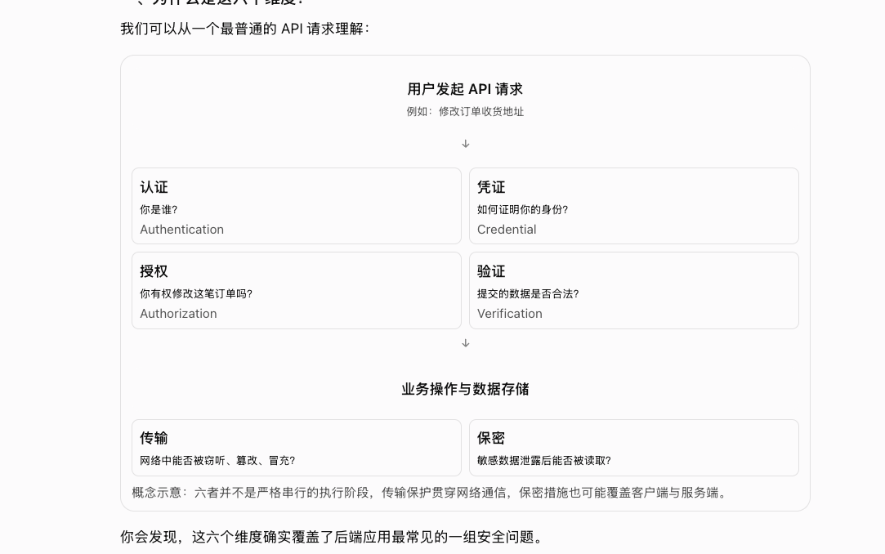
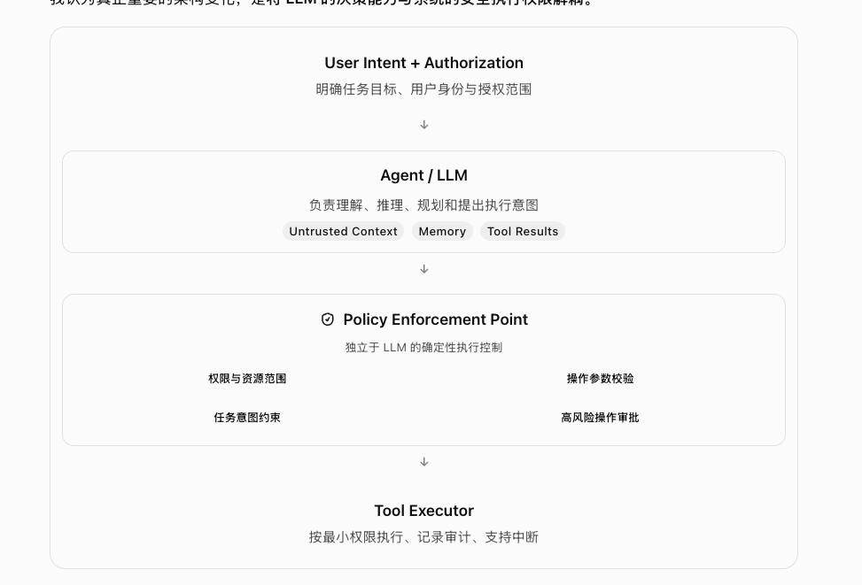
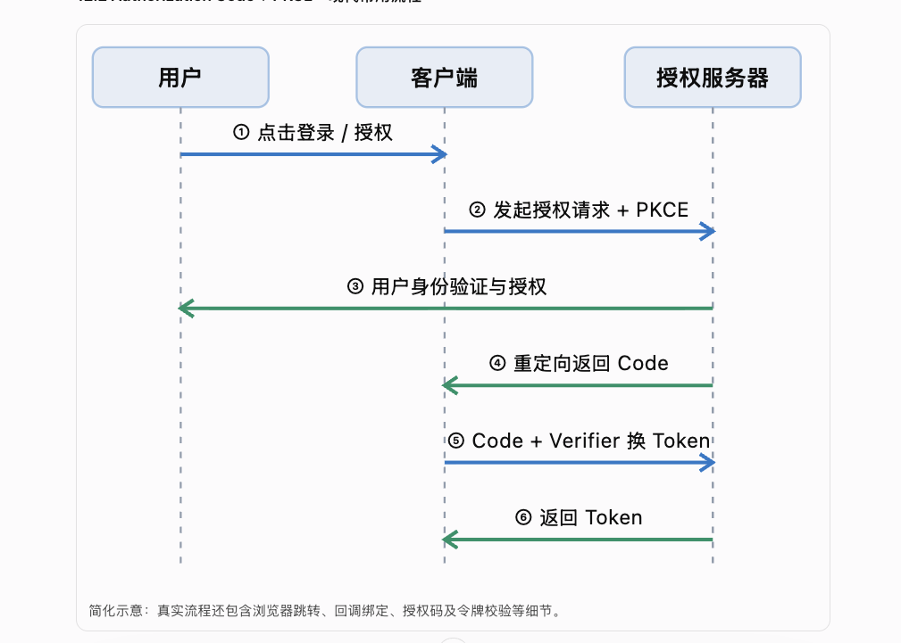

The left column is the ChatGPT original. The right column is the same skeleton built with `garden compose`. Color comes only from the theme tokens. A narrow screen stacks the original above the compose diagram, then stacks rows inside the diagram.

## How the atoms fit together

| ChatGPT atom | compose |
| --- | --- |
| Soft full-width band (Role, IdP, steps 2 and 5, Agent) | `card` with `frame: band` |
| Small capsule (the browser) | `card` with `frame: pill` |
| Plain title plus a gray line | `card` with `frame: text`, or `title` + `text` |
| Bordered card | `card` |
| Circled index | `badge` set to a circled number |
| Shield | `mark: shield` |
| One downward arrow | `arrow: down` |
| Several downward arrows in a row | `fan`, then a `row` with the same count |
| V connector with a label in the notch | `join` |
| Swimlane, dashed lifelines, both arrow directions | `lanes`, `tone: forward` or `back` |
| Footer line | `text` with `tone: muted` |
| Two-by-two grid | two `row` nodes, two cells each |

A band wraps only the highlighted layer. Inside a centered `stack`, a footer that should sit on the left uses `align: start`.

## RBAC



```garden compose
intent: |
  Three columns for User, Role, and Permission. Role sits on a soft band. A join says the role connects users and permissions.
tree:
  - row:
      align: center
      children:
        - stack:
            align: center
            children:
              - title: User
              - text: Alice
              - text: Bob
        - card:
            frame: band
            tone: accent
            align: center
            title: Role
            children:
              - text: Admin
              - text: Reviewer
        - stack:
            align: center
            children:
              - title: Permission
              - text: "orders:read"
              - text: "orders:approve"
  - join: The role connects users and permissions
  - type: text
    text: "User ↔ Role ↔ Permission"
    align: center
    tone: muted
```

## SSO



```garden compose
intent: |
  The browser points at one identity provider, which then reaches HR, Finance, and Project.
tree:
  - stack:
      align: center
      children:
        - card:
            frame: pill
            title: Browser
        - arrow: down
        - card:
            frame: band
            tone: accent
            align: center
            title: Identity Provider (IdP)
            text: Verify identity, keep the session, and issue an assertion
        - fan: 3
        - row:
            align: center
            children:
              - title: HR
              - title: Finance
              - title: Project
        - type: text
          text: All three systems trust the same identity provider
          align: center
          tone: muted
```

## Auth stack



```garden compose
intent: |
  Five layers from the browser down to the authorization decision. The identity service and the decision system use a soft band.
tree:
  - stack:
      align: center
      children:
        - card:
            frame: text
            align: center
            badge: "①"
            title: Browser / App
            text: Cookie, session, OAuth client
        - arrow: down
        - card:
            frame: band
            tone: accent
            align: center
            badge: "②"
            title: Identity service IdP / IAM
            text: Passkey, MFA, OIDC, session
        - arrow: down
        - card:
            frame: text
            align: center
            badge: "③"
            title: BFF / API Gateway
            text: Session, token, and entry checks
        - arrow: down
        - card:
            frame: text
            align: center
            badge: "④"
            title: Business service
            text: Orders, payments, accounts, resources
        - arrow: down
        - card:
            frame: band
            tone: accent
            align: center
            badge: "⑤"
            title: Authorization decision
            text: RBAC + ABAC + ReBAC + policy engine
        - type: text
          text: Not every request walks the stack in this order. The identity service is usually involved at sign-in. The business service calls the decision system when it executes a request.
          align: start
          tone: muted
```

## Six checks on an API call



```garden compose
intent: |
  One API call splits into authentication, credential, authorization, and verification, then transport and confidentiality.
tree:
  - stack:
      align: center
      children:
        - title: The user starts an API request
        - type: text
          text: "Example: change an order address"
          tone: muted
  - arrow: down
  - row:
      children:
        - card:
            title: Authenticate
            children:
              - text: Who are you?
              - type: text
                text: Authentication
                tone: muted
        - card:
            title: Credential
            children:
              - text: How do you prove it?
              - type: text
                text: Credential
                tone: muted
  - row:
      children:
        - card:
            title: Authorize
            children:
              - text: May you change this order?
              - type: text
                text: Authorization
                tone: muted
        - card:
            title: Verify
            children:
              - text: Is the payload valid?
              - type: text
                text: Verification
                tone: muted
  - arrow: down
  - stack:
      align: center
      children:
        - title: Work and storage
  - row:
      children:
        - card:
            title: Transport
            text: Can the network eavesdrop, alter, or spoof this?
        - card:
            title: Confidentiality
            text: Can a leaked secret still be read?
  - type: text
    text: These six checks are not a single sequence. Transport covers the network. Confidentiality can cover both client and server.
    tone: muted
```

## Agent, policy point, and tool



```garden compose
intent: |
  Intent goes through the agent, then a policy enforcement point, then the tool executor. The policy point holds four constraints.
tree:
  - stack:
      align: center
      children:
        - title: User Intent + Authorization
        - type: text
          text: State the task, the user, and the granted scope
          tone: muted
        - arrow: down
        - card:
            frame: band
            align: center
            title: Agent / LLM
            text: Understand, plan, and propose an action
            children:
              - row:
                  align: center
                  children:
                    - badge: Untrusted Context
                    - badge: Memory
                    - badge: Tool Results
        - arrow: down
        - card:
            align: center
            mark: shield
            title: Policy Enforcement Point
            children:
              - type: text
                text: A deterministic check outside the LLM
                align: center
                tone: muted
              - row:
                  align: center
                  children:
                    - text: Scope and resources
                    - text: Argument checks
              - row:
                  align: center
                  children:
                    - text: Task limits
                    - text: High-risk review
        - arrow: down
        - title: Tool Executor
        - type: text
          text: Least privilege, an audit record, and a way to stop
          tone: muted
```

## OAuth authorization code + PKCE



```garden compose
intent: |
  Three lanes for the user, the client, and the authorization server, with six PKCE steps.
tree:
  - lanes:
      actors:
        - User
        - Client
        - Authorization server
      messages:
        - from: 1
          to: 2
          text: Start sign-in
          tone: forward
        - from: 2
          to: 3
          text: Authorization request + PKCE
          tone: forward
        - from: 3
          to: 1
          text: Authenticate and approve
          tone: back
        - from: 3
          to: 2
          text: Redirect with the code
          tone: back
        - from: 2
          to: 3
          text: Code + verifier for a token
          tone: forward
        - from: 3
          to: 2
          text: Return the token
          tone: back
  - type: text
    text: This sketch leaves out the browser redirect, callback binding, and token checks.
    tone: muted
```
