<!-- Generated by scripts/handbook-diagrams.mjs. Do not edit by hand. -->

The `/garden` list in Typora and in VS Code / Cursor comes from the same built-in list. There are currently 21 items: 20 common figures, and Other as the last item. Choosing one inserts a single `garden compose` brief, not a different author fence. That brief is for your material and goal, not a syntax lesson.

Use Other when no built-in figure fits, or when you need to combine text and graphics freely. Do not treat the list below as a closed allowlist.

For the entry and compile steps, see [Compose](/garden/en/components/compose) and [Checks & Shortcuts](/garden/en/workflow).

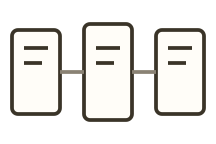

**[Join diagram](/garden/en/components/diagrams/columns-join/)** Use this to show how two sides connect through a middle item.

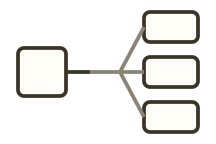

**[Fan-out diagram](/garden/en/components/diagrams/fan-out/)** Use this to show a first stop that then branches to several places at once.

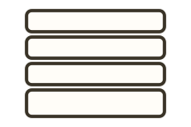

**[Layer diagram](/garden/en/components/diagrams/layers/)** Use this to show top-down layers that do not have to be walked in order.

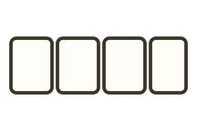

**[Aspect diagram](/garden/en/components/diagrams/facets/)** Use this to show several aspects of one thing, with no required order.

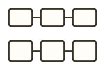

**[Two-row contrast](/garden/en/components/diagrams/two-row/)** Use this to contrast a background process with the process you want to emphasize, on two rows.

**[Illustrated list](/garden/en/components/diagrams/icon-rail/)** Use this to explain independent items one by one.

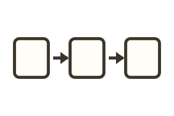

**[Flow diagram](/garden/en/components/diagrams/sequence/)** Use this to show the order in which something is done.

**[Step diagram](/garden/en/components/diagrams/steps/)** Use this to explain something step by step, with room for detail inside a step.

**[Comparison diagram](/garden/en/components/diagrams/compare/)** Use this to compare two or three options under the same conditions.

**[Timeline](/garden/en/components/diagrams/timeline/)** Use this to arrange events by date or time.

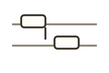

**[Message sequence](/garden/en/components/diagrams/lanes/)** Use this to show who sent what to whom, and when.

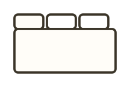

**[Tabs](/garden/en/components/diagrams/tabs/)** Use this when several groups of notes are independent and the reader should see one group at a time.

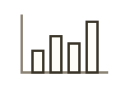

**[Chart](/garden/en/components/diagrams/chart/)** Use this to turn numbers you already have into bars, lines, or shares.

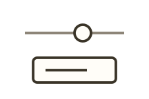

**[Tunable chart](/garden/en/components/diagrams/tunable/)** Use this when the reader should change one or two inputs and watch the result.

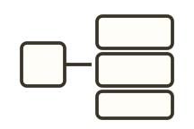

**[Conversion diagram](/garden/en/components/diagrams/converter/)** Use this when one input should produce several results at once.

**[Code walkthrough](/garden/en/components/diagrams/code-walkthrough/)** Use this to walk through code line by line: what runs, and what the variables are.

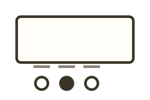

**[Stepper](/garden/en/components/diagrams/stepper/)** Use this when the reader should pause on a step and see how state changes.

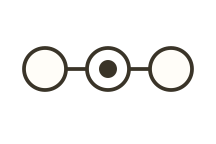

**[Path callout](/garden/en/components/diagrams/trace/)** Use this to mark how far you have walked on an existing flow or state diagram.

**[Checklist](/garden/en/components/diagrams/plan/)** Use this when the reader should follow items one by one and come back to check progress.

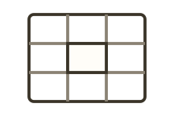

**[Grid diagram](/garden/en/components/diagrams/inspect-grid/)** Use this to mark which cells in a two-dimensional structure matter, and why.

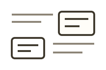

**[Other](/garden/en/components/diagrams/other/)** Use this when no built-in figure fits, and you need to combine text and graphics freely.
