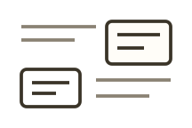

<!-- Generated by scripts/handbook-diagrams.mjs. Do not edit by hand. -->



Use this when no built-in figure fits, and you need to combine text and graphics freely.

Do not treat the built-in list as a closed allowlist, and do not learn a new syntax for this.

Typora and VS Code / Cursor share this list. In the `/garden` picker, this row is the same figure and the same use case. Choosing it inserts a `garden compose` brief. Fill in your material and goal, then ask the AI to compile the post.

The built-in picker currently inserts that brief in Chinese. The English wording below is the same recommended brief, written for the English handbook so you can copy it when you write in English.

Other is not another ready-made template. When no built-in figure fits, or several kinds of content need to sit together, combine ordinary Markdown, safe HTML, and basic blocks such as cards, rows, columns, or steps in the same `garden compose` fence. The recommended brief is not a syntax lesson, and the list is not a closed allowlist.

````markdown
```garden compose
Please combine text and graphics freely in one garden compose fence, from the material and the communication goal I provide. When no built-in figure fits, or several kinds of content need to sit together, use ordinary Markdown / HTML and the existing building blocks.

My material:
- (paste the content, relationships, and source wording)

My goal:
- (what the reader should understand, and what the focus is)

Please:
- Organize only from the material; do not invent facts or conclusions
- Handle the graphic syntax, layout, and mobile reading yourself; do not ask me to learn a new syntax or write CSS
- The built-in figures in the list are a starting point, not a closed allowlist; if no recipe fits, extract the real relationships and combine building blocks
- Do not limit the result to one ready-made template; mix ordinary Markdown, safe HTML, and basic blocks such as cards, rows, columns, or steps when needed
```
````
