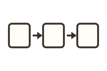

<!-- Generated by scripts/handbook-diagrams.mjs. Do not edit by hand. -->



Use this to show the order in which something is done.

Do not add arrows to unordered items, and do not shrink type to force a horizontal row on a narrow screen.

Typora and VS Code / Cursor share this list. In the `/garden` picker, this row is the same figure and the same use case. Choosing it inserts a `garden compose` brief. Fill in your material and goal, then ask the AI to compile the post.

The built-in picker currently inserts that brief in Chinese. The English wording below is the same recommended brief, written for the English handbook so you can copy it when you write in English.

The recommended brief is a starting point, not a syntax lesson, and not the only valid form. You may still combine Markdown or safe HTML building blocks in the same `garden compose` fence.

````markdown
```garden compose
Please make a "Flow diagram" diagram in garden compose from the material and the communication goal I provide.

My material:
- (paste the original items and wording to keep)

My goal:
- (what the reader should see at a glance)

Please:
- Organize only from the material; do not invent facts or conclusions
- Handle the graphic syntax, layout, and mobile reading yourself; do not ask me to learn tags or write CSS
- "Flow diagram" is the recommended starting point: Use arrows only when the source text has an order. Short stages can run left to right; long stages or a narrow screen should stack top to bottom
- A recommended figure is not the only valid form; you may still combine necessary Markdown / HTML building blocks in the same compose fence
- Do not start a different author fence or a new syntax; use only garden compose
```
````
