An image that is its own paragraph is wrapped in a figure, with a caption underneath.

- **When to use**: The figure belongs in the article, and the reader should see a caption under it.
- **When to skip**: For a decorative image, start the alt text with `image` or `img` so there is no caption. Use an [annotated diagram](/garden/en/components/figure) when each region needs its own note, or [file download](/garden/en/components/file) when the reader should download the file.

For a post at `content/posts/my-post.md`, put images in `content/posts/my-post/`. Reference them with Markdown image syntax, with the address `./my-post/diagram.svg` and the caption in the alt text.

The build copies the file and records its pixel width and height, so later text does not jump when the image loads. How wide figures expand is covered in [How the Reading Layout Works](/garden/en/design).

The caption is the Markdown image title when you write one in quotes after the address. Otherwise it is the alt text. Alt text that starts with `image` or `img` is not used as a caption.

The caption under this figure is its alt text:

Images on a thought go in the `media` list in Front Matter and form a grid, without this caption. See [Writing Posts & Thoughts](/garden/en/writing).

This is not a `garden` fence, so it has no field table.
