An image that is its own paragraph is wrapped in a figure, with a caption underneath.

- **When to use**: The figure belongs in the article, and the reader should see a caption under it.
- **When to skip**: For a decorative image, start the alt text with `image` or `img` so there is no caption. Use an [explanation diagram](/garden/en/components/compose) when each step needs its own note, or [file download](/garden/en/components/compose) when the reader should download the file.

For a post at `content/posts/my-post.md`, put images in `content/posts/my-post/`. Reference them with Markdown image syntax, with the address `./my-post/diagram.svg` and the caption in the alt text.

The build copies the file and records its pixel width and height, so later text does not jump when the image loads. How wide figures expand is covered in [How the Reading Layout Works](/garden/en/design).

The caption is the Markdown image title when you write one in quotes after the address. Otherwise it is the alt text. Alt text that starts with `image` or `img` is not used as a caption.

The caption under this figure is its alt text:

## Excalidraw

Put the `.excalidraw` file with the post's other images. Keep using a Markdown image, and point the address at the source file, for example `./my-post/flow.excalidraw`. There is no separate garden component for this.

`garden build`, `make dev`, and `garden sync` find those images. When the source has changed, or the sibling `.svg` is missing or out of date, the old `.svg` is deleted and a new flat SVG is exported, with no editable scene embedded. The example above produces `flow.svg` in the same directory. That is the only export: one light SVG with a transparent canvas. Strokes and fills stay as drawn. There is no dark file and no CSS invert. The page embeds that SVG in the article, so the text in the figure can be selected and copied. The alt text is the SVG `title`. The article never loads Excalidraw.

The exporter is [excalidraw-image](https://github.com/rickardp/excalidraw-image) `0.2.0`, which runs Excalidraw's own SVG export. The first `.excalidraw` reference downloads the matching executable from GitHub Releases (about 48 MB compressed) and caches it on the machine. Chromium is not required. Fonts are written into the SVG, so the page does not request excalidraw.com. After that download, or when `GARDEN_EXCALIDRAW_IMAGE` points at a local binary, an offline build (`GARDEN_OFFLINE` set to `1`) does not download again.

A missing source file or a failed export stops the build and reports the path and the reason.

This is not a `garden` fence, so it has no field table.
