Garden is a Claude-style blog framework where you write posts in Markdown and describe components in plain language.

## A Complete Example

The four steps in this section come from a real post, and every command output is taken verbatim from an actual run.

### 1. The Author Writes an Idea

Drop an unnamed `garden` fence where the interactive block should go and state what the reader adjusts and sees:

````markdown
## 写作节奏

```garden
让读者拖动每天写的字数和每周写几天，看写完一篇 8000 字的长文要几周。
```
````

### 2. The Agent Scans and Writes Back the Component

Tell the Agent to compile `content/posts/writing-pace.md`. Following the `garden-ui` skill in the repository, the Agent first runs `npx garden ui scan` to read the line number, original wording, and hash:

```console
$ npx garden ui scan content/posts/writing-pace.md
{
  "file": "content/posts/writing-pace.md",
  "draft": false,
  "blocks": [
    {
      "lang": "garden-idea",
      "status": "uncompiled",
      "startLine": 9,
      "intentHash": "cb3a3569",
      "intent": "让读者拖动每天写的字数和每周写几天，看写完一篇 8000 字的长文要几周。",
      "section": "写作节奏"
    }
  ]
}
```

Next, the Agent reads the component catalog from `npx garden ui prompt`, writes a `garden interactive` block, and runs `npx garden ui apply` with `--intent-hash` to replace only that fence while leaving the rest of the file byte-for-byte untouched:

```console
$ npx garden ui apply content/posts/writing-pace.md --intent-hash cb3a3569 --file new.md
{"ok":true,"file":"content/posts/writing-pace.md","kind":"garden","line":9}
```

### 3. The Pre-commit Hook Checks and Prints a Fix Prompt

On the first `garden sync` or `garden dev` run, Garden writes `exec npx --no-install garden ui check --staged --quiet` to `.git/hooks/pre-commit`. If the author commits before step 2, the hook blocks the commit and prints a ready-to-paste prompt for the AI:

```console
$ git commit -m "写作节奏"
content/posts/writing-pace.md:9  -  garden-idea  还有没编译的想法

──────────────────────── 发给 AI 的修复提示词 ────────────────────────
请处理下面 Garden 博文里列出的块：没编译的想法要编译，有错误的交互块要修好。

要求：
- 先运行 npx garden ui prompt，读组件目录和规则；仓库里有 garden-ui skill 时按它的流程做。
- 只改列出的块，用 npx garden ui apply <稿件> --id <id> 写回（没有 id 的想法用 --intent-hash），不要直接编辑稿件。
- 不改作者原话的意思。改完运行 npx garden ui check <稿件>，直到通过。
- 如果你不能访问这个仓库，就只回复每块修好后的完整围栏。

1. content/posts/writing-pace.md，第 9–11 行，intent-hash: cb3a3569
   - garden-idea：这段想法还没编译，请按原话编译成 garden interactive 或其他 garden 组件（或判断后写回正文）。
（后面附当前围栏原文）
────────────────────────────────────────────────────────────
已写入 .garden/ui-fix-prompt.md。确实要先提交，可以用 git commit --no-verify。
```

The same prompt is saved to `.garden/ui-fix-prompt.md` and copied to the clipboard when a clipboard command is available. Once the Agent applies the block and the author commits again, the hook exits silently with code `0`.

### 4. The Rendered Result

The `garden interactive` fence written back in step 2 renders directly on the article page as an interactive calculator:

```garden interactive #writing-pace
caption: 每天多写几百字，比每周多写一天更快。
intent: |
  让读者拖动每天写的字数和每周写几天，看写完一篇 8000 字的长文要几周。
---
<State daily={500} days={3} />
<Let weekly={daily * days} />
<Let weeks={ceil(8000 / weekly)} />

<Slider bind="daily" label="每天写" min={200} max={2000} step={100} unit="字" />
<Slider bind="days" label="每周写" min={1} max={7} step={1} unit="天" />

<Stat label="写完 8000 字需要" value={weeks} unit="周" hint="不足一周按一周算" />
```

> [!IMPORTANT] Humans and Agents Share the Same Tools
> The `npx garden ui scan`, `npx garden ui apply`, and `npx garden ui check` commands used by the Agent are the exact commands run by the author's pre-commit hook. When the hook stops a commit, its output is the instruction for the Agent's next step. See [Writing with AI](/garden/en/ai-writing).

The remaining sections cover the layout and component rules that work out of the box without an Agent.

## Two-line Titles and the `740px` Reading Column

Write ` | ` (with spaces on both sides) inside a title to split it across two lines and scale the font size to fit the longer line. Body copy stays inside a `740px` column, while wide figures expand symmetrically into the side margins without overlapping the navigation or table of contents.

Transparent-background line drawings automatically get a warm paper backing in dark mode, so you do not need separate dark assets:



## Wide Tables Expand Symmetrically

When a table is wider than the reading column without wrapping, it expands into both margins up to `1340px` on desktop:

| Content Type | Source Location | How the Page Handles Long-form and Media Details | Typical Use |
| :--- | :--- | :--- | :--- |
| Long-form posts | `content/posts/<slug>.md` and a matching asset folder | Reads local image dimensions at build time to prevent layout shift, splits titles on ` \| `, widens figures and tables, and renders KaTeX math and Mermaid diagrams | System design notes, code walkthroughs, debugging postmortems, and book notes |
| Short thoughts | `content/thoughts/<slug>.md` | Renders multi-image grids, native `image` / `audio` / `video` players, and external `link` preview cards | Short observations, terminal screenshots, audio clips, and saved links |
| Ordered columns | `content/columns.yaml` | Chains multiple posts from `content/posts/` in reading order with series progress and previous/next navigation | Multi-part tutorials, topic series, and chaptered notes |

## Code Blocks and the Diff Toggle

Write a one-sentence `garden` idea right below an updated code block to describe what changed, and the Agent generates the adjacent `diff` fence; you can also write the `diff` fence by hand. When a code block is immediately followed by a `diff` block, the page combines them into a single frame with tabs for the full code and the diff against the previous version, while the copy button always copies the new code.

```yaml
pages:
  garden:
    title: "用 Markdown 写丨推送之后网站自己更新"
    subtitle: "用 Markdown 写文章、随想和专栏，保存在自己的 Git 仓库里。"
```

```diff
 pages:
   garden:
-    title: "用 Markdown 写。\n推送之后，网站自己更新。"
-    subtitle: ""
+    title: "用 Markdown 写丨推送之后网站自己更新"
+    subtitle: "用 Markdown 写文章、随想和专栏，保存在自己的 Git 仓库里。"
```

> [!NOTE] Note
> A `diff` fence must sit immediately after a complete code block; a standalone `diff` fence triggers a `diff-orphan` error in `npx garden check`.

> [!TIP] Custom Callout Titles
> Write text on the same line after `> [!TIP]` (or place a bold line immediately below) to replace the default callout title. Supported types include `NOTE`, `TIP`, `IMPORTANT`, `WARNING`, and `CAUTION`.

## Structured Components in Markdown

Use ```` ```garden <name> ```` fences to insert metrics, side-by-side comparisons, timelines, or charts. Here is a `garden stat` block:

```garden stat
items:
  - label: 正文阅读列
    value: "740"
    unit: px
    caption: 段落、代码块与列表的默认列宽
  - label: 宽幅配图区
    value: "1040"
    unit: px
    caption: 截图按像素宽度的一半显示，像素宽度约 2000px 以上时展开到这个宽度
  - label: 多列宽表区
    value: "1340"
    unit: px
    caption: 宽表格在桌面端向两侧对称外扩上限
```

See [Components Overview](/garden/en/components) in the sidebar for all 9 built-in components and their live examples.

<h2 id="garden-admin-title">From Init to Daily Writing</h2>

Your site repository stores only configuration, Markdown posts, and static assets, while `hd-garden` provides the renderer and build scripts. Initialize and preview a site locally:

```bash
npx hd-garden init my-blog
cd my-blog
npm install
make dev
```

Run `make update` when a post is ready; it runs the full check and build before committing and pushing. Read the chapters for details:

- **[Quick Start](/garden/en/start)**: Directory layout, creating posts with `make new`, previewing drafts, and daily commands.
- **[Site & Column Config](/garden/en/config)**: Every field in `site.config.yaml`, custom SVG icons, and ordering series in `content/columns.yaml`.
- **[Deploy to GitHub Pages](/garden/en/deploy)**: A single GitHub Actions workflow that supports both one public repository and a private source repo paired with a public Pages repo.
- **[Writing Posts & Thoughts](/garden/en/writing)** and **[How the Reading Layout Works](/garden/en/design)**: Front Matter fields, external link cards, three-tier adaptive widths, and color tokens.
