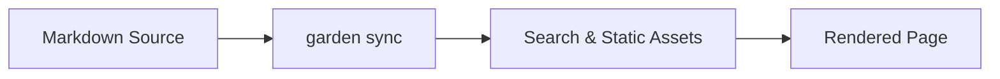

Garden organizes content into **posts** (`content/posts/`) and **thoughts** (`content/thoughts/`). Both are UTF-8 Markdown files whose filenames contain only lowercase letters, digits, and hyphens (`a-z`, `0-9`, `-`).

## 1. Post Front Matter (`content/posts/*.md`)

Create a post with `make new DIR=systems SLUG=wal-checkpoint TITLE="Understanding WAL | Checkpoints and Recovery"` or create a `.md` file directly:

```yaml
---
title: Understanding WAL | Checkpoints and Recovery
date: 2026-10-18
updated: 2026-10-19
description: How write-ahead logging preserves snapshot visibility under concurrent reads and writes, and how background checkpoints bound log growth.
tags:
  - Database
  - Storage
pinned: false
draft: false
cover: windowsill-herbs.svg
original: https://example.com/original-post
references:
  - title: SQLite Write-Ahead Logging
    url: https://www.sqlite.org/wal.html
  - title: Database Internals
---
```

| Field | Required | Type | Description |
| :--- | :--- | :--- | :--- |
| `title` | Yes | String | Post title. Write ` \| ` (with spaces on both sides) to split the heading into two lines and scale the font size to fit |
| `date` | Yes | Date string | Publication date (such as `2026-10-18` or an ISO timestamp with timezone) |
| `description` | Yes | String | Summary shown in the article deck, archive lists, and search engine descriptions |
| `updated` | No | Date string | Last updated date, shown in the article meta bar and used for RSS sorting |
| `publishAt` | No | Date string | Scheduled publish time; included only when earlier than the build time (or when `CONTENT_INCLUDE_DRAFTS=1`) |
| `tags` | No | String array | Tags for the post; clicking a tag filters `/blog?t=<tag>` |
| `pinned` | No | Boolean | Set to `true` to feature the post in the pinned section on the home page |
| `draft` | No | Boolean | Set to `true` to mark as a draft and exclude from production builds |
| `cover` | No | Path string | Cover image path relative to `content/covers/` |
| `original` | No | Full URL | External canonical source link, rendered in the article meta bar |
| `references` | No | `{ title, url? }[]` | Reference list rendered at the bottom of the post with automatically extracted domain names |

At the bottom of every post page, between the Webmention section and the comments, sit the Previous and Next navigation cards. Posts link only to other posts ordered by `date` (where Previous is the older post), while column entries follow their order in `content/columns.yaml`; the oldest and newest entries show only one card.

> [!CAUTION] Caution
> Do not write a `slug` field in Front Matter (`npx garden check` reports an `unexpected-slug` error because the filename is already the slug). Posts do not use a `topic` field either.

## 2. Code Blocks and the Diff Toggle

Standard code blocks show their language label (such as `RUST`, `TS`, `PYTHON`, or `SHELL`) and a copy button in the top-right corner. To show how a snippet changed from an earlier version, place the updated code block first and follow it with a `garden` idea fence stating what changed in one sentence:

````markdown
```go
func openStore(path string) (*Store, error) {
	return openWithMode(path, ModeWAL)
}
```

```garden
Compared with the previous version: open the store with ModeWAL instead of ModeJournal.
```
````

Following the `garden-ui` skill, the Agent runs `npx garden ui apply` to replace that idea fence with a `diff` fence right below the code block (see [Writing with AI](/garden/en/ai-writing)). The page combines the two adjacent blocks into a single code frame with tabs for the full code and the diff against the previous version, while the copy button always copies the new full code:

```go
func openStore(path string) (*Store, error) {
	return openWithMode(path, ModeWAL)
}
```

```diff
 func openStore(path string) (*Store, error) {
-	return openWithMode(path, ModeJournal)
+	return openWithMode(path, ModeWAL)
 }
```

**Hand-written format**: Without an Agent, you can write the `diff` code block directly below the complete code block (separated only by a blank line):

````markdown
```diff
 func openStore(path string) (*Store, error) {
-	return openWithMode(path, ModeJournal)
+	return openWithMode(path, ModeWAL)
 }
```
````

> [!IMPORTANT] Important
> A `diff` fence must immediately follow a complete code block; a standalone `diff` fence with no preceding code block triggers a `diff-orphan` error in `npx garden check`.

## 3. CJK Bold, Highlighter Strokes, and Callouts

- **CJK-friendly bold**: `remark-cjk-friendly` is enabled so `**bold next to CJK punctuation**` parses cleanly without extra spaces around the asterisks.
- **Highlighter stroke**: Wrap text in `<u>key phrase</u>` or `<mark>key phrase</mark>` to apply a warm yellow highlighter band, like <u>this highlighted phrase</u>.
- **Callouts**: Supports `> [!NOTE]`, `> [!TIP]`, `> [!IMPORTANT]`, `> [!WARNING]`, and `> [!CAUTION]` (plus `INFO`, `SUCCESS`, `DANGER`, and `FAILURE`). Write a title on the same line after the marker to set a custom heading:

```markdown
> [!WARNING] Back Up the Data Directory Before Upgrading
> Changing the page size requires rebuilding the index files and cannot be rolled back in place.
```

> [!WARNING] Back Up the Data Directory Before Upgrading
> Changing the page size requires rebuilding the index files and cannot be rolled back in place.

## 4. Local Images, Source Chips, and External Link Cards

- **Local images and sidecar folders**: For a post at `content/posts/my-post.md`, place its images inside `content/posts/my-post/` and reference them with relative paths such as `./my-post/diagram.svg`. At build time, Garden copies the file, records its pixel dimensions, and renders the `alt` text (unless it starts with default placeholders like `image` or `img`) as a `<figcaption>`.
- **Inline external links**: Regular external links in body text automatically display the target site's favicon and a trailing `↗` arrow, keeping the icon attached to the first word of the link so it never wraps alone.
- **Inline source chips (`{source}`)**: Append `{source}` directly after the closing `)` of an external link (with no space), such as `[wikipedia.org](https://en.wikipedia.org/wiki/Book_discussion_club){source}`, to render it as an inline source chip: the site's build-time favicon (or the uppercase first letter of the registrable domain's main label, such as `W` for `en.wikipedia.org`) plus the link text, **without** the `↗` external-link arrow. For example: cited from Wikipedia [wikipedia.org](https://en.wikipedia.org/wiki/Book_discussion_club){source}.
- **Link cards**: Turn an external URL into a preview card with site name, title, and description in either of two ways:
  1. Put the full URL on its own paragraph line (surrounded by blank lines): `https://spec.commonmark.org/`
  2. Append `{card}` directly to an inline link (with no space): `See the [CommonMark Spec](https://spec.commonmark.org/){card}.`
  You can also run `make embed URL="https://example.com"` to fetch Open Graph metadata for a URL.

## 5. Math Formulas and Mermaid Diagrams

- **LaTeX math**: Rendered at build and server-render time with KaTeX. Use `$L = \lambda W$` for inline math and `$$...$$` for display blocks. Multi-letter identifiers containing underscores (such as `group_num` or `max_batch`) are automatically wrapped as upright `\mathrm{group\_num}`, while single-letter subscripts like `W_q` or `H_{kv}` remain standard math subscripts.
- **Mermaid diagrams**: Use ```` ```mermaid ```` fences to draw flowcharts or sequence diagrams that adapt to light and dark themes:



## 6. Writing Thoughts (`content/thoughts/*.md`)

Thoughts are short notes with optional image grids, audio/video files, or external link cards:

```yaml
---
title: Late-Night Debugging Notes
date: 2026-10-19 21:30
tags:
  - Notes
media:
  - type: image
    src: ./rainy-night/terminal.png
    alt: Benchmark output in the terminal
  - type: link
    src: https://sqlite.org/wal.html
    title: SQLite Write-Ahead Logging
---

A short note written in standard Markdown.
```

The `media` array accepts four item types: `image` (multiple images automatically form a grid), `audio` (native `<audio>` player), `video` (native `<video>` player with optional `poster`), and `link` (rendered as an external link card supporting `src`, `title`, `description`, and `image`).
