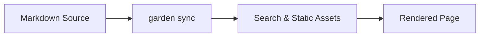

Garden stores posts in `content/posts/`. These are UTF-8 Markdown files whose filenames contain only lowercase letters, digits, and hyphens (`a-z`, `0-9`, `-`).

## 1. Post Front Matter (`content/posts/*.md`)

Create a post with `make new DIR=systems SLUG=wal-checkpoint TITLE="Understanding WAL | Checkpoints and Recovery"` or create a `.md` file directly:

```yaml
---
title: Understanding WAL | Checkpoints and Recovery
date: 2026-10-18
updated: 2026-10-19
description: How write-ahead logging preserves snapshot visibility under concurrent reads and writes, and how background checkpoints bound log growth.
tags:
  - Database
  - Storage
pinned: false
draft: false
cover: windowsill-herbs.svg
original: https://example.com/original-post
references:
  - title: SQLite Write-Ahead Logging
    url: https://www.sqlite.org/wal.html
  - title: Database Internals
---
```

| Field | Required | Type | Description |
| :--- | :--- | :--- | :--- |
| `title` | Yes | String | Post title. Write ` \| ` (with spaces on both sides) to split the heading into two lines and scale the font size to fit |
| `date` | Yes | Date string | Publication date (such as `2026-10-18` or an ISO timestamp with timezone) |
| `description` | No | String | Summary shown in the article deck, archive lists, and search engine descriptions. Empty (`description: ""`), omitted, null, or whitespace-only values hide the summary; Garden does not substitute an excerpt from the body |
| `updated` | No | Date string | Last updated date, shown in the article meta bar and used for RSS sorting |
| `publishAt` | No | Date string | Scheduled publish time; included only when earlier than the build time (or when `CONTENT_INCLUDE_DRAFTS=1`) |
| `tags` | No | String array | Tags for the post; clicking a tag filters `/blog?t=<tag>` |
| `pinned` | No | Boolean | Set to `true` to feature the post in the pinned section on the home page |
| `draft` | No | Boolean | Set to `true` to mark as a draft and exclude from production builds |
| `cover` | No | Path string | Cover image path relative to `content/covers/` |
| `original` | No | Full URL | External canonical source link, rendered in the article meta bar |
| `references` | No | `{ title, url? }[]` | Reference list rendered at the bottom of the post with automatically extracted domain names |

At the bottom of every post page, between the Webmention section and the comments, sit the Previous and Next navigation cards. Posts link only to other posts ordered by `date` (where Previous is the older post), while column entries follow their order in `content/columns.yaml`; the oldest and newest entries show only one card.

> [!CAUTION] Caution
> Do not write a `slug` field in Front Matter (`npx garden check` reports an `unexpected-slug` error because the filename is already the slug). Posts do not use a `topic` field either.

## 2. Code Blocks and the Diff Toggle

Standard code blocks show their language label (such as `RUST`, `TS`, `PYTHON`, or `SHELL`) and a copy button in the top-right corner. To show how a snippet changed from an earlier version, place the updated code block first and follow it with a `garden` idea fence stating what changed in one sentence:

````markdown
```go
func openStore(path string) (*Store, error) {
	return openWithMode(path, ModeWAL)
}
```

```garden compose
Compared with the previous version: open the store with ModeWAL instead of ModeJournal.
```
````

Following the `garden-compose` skill, the Agent runs `npx garden ui apply` to replace that idea fence with a `diff` fence right below the code block (see [Writing with AI](/garden/en/ai-writing)). The page combines the two adjacent blocks into a single code frame with tabs for the full code and the diff against the previous version, while the copy button always copies the new full code:

```go
func openStore(path string) (*Store, error) {
	return openWithMode(path, ModeWAL)
}
```

```diff
 func openStore(path string) (*Store, error) {
-	return openWithMode(path, ModeJournal)
+	return openWithMode(path, ModeWAL)
 }
```

**Hand-written format**: Without an Agent, you can write the `diff` code block directly below the complete code block (separated only by a blank line):

````markdown
```diff
 func openStore(path string) (*Store, error) {
-	return openWithMode(path, ModeJournal)
+	return openWithMode(path, ModeWAL)
 }
```
````

> [!IMPORTANT] Important
> A `diff` fence must immediately follow a complete code block; a standalone `diff` fence with no preceding code block triggers a `diff-orphan` error in `npx garden check`.

## 3. CJK Bold, Highlighter Strokes, and Callouts

- **CJK-friendly bold**: `remark-cjk-friendly` is enabled so `**bold next to CJK punctuation**` parses cleanly without extra spaces around the asterisks.
- **Highlighter stroke**: Wrap text in `<u>key phrase</u>` or `<mark>key phrase</mark>` to apply a warm yellow highlighter band, like <u>this highlighted phrase</u>.
- **Callouts**: Supports `> [!NOTE]`, `> [!TIP]`, `> [!IMPORTANT]`, `> [!WARNING]`, and `> [!CAUTION]` (plus `INFO`, `SUCCESS`, `DANGER`, and `FAILURE`). Write a title on the same line after the marker to set a custom heading:

```markdown
> [!WARNING] Back Up the Data Directory Before Upgrading
> Changing the page size requires rebuilding the index files and cannot be rolled back in place.
```

> [!WARNING] Back Up the Data Directory Before Upgrading
> Changing the page size requires rebuilding the index files and cannot be rolled back in place.

## 4. Local Images, Source Chips, and External Link Cards

These three are written in the Markdown body. Rendering rules live on the component pages. This section only records where the files go:

- **Local images**: For a post at `content/posts/my-post.md`, put images in `content/posts/my-post/` and reference them as `./my-post/diagram.svg`. Captions are documented on [Local Image](/garden/en/components/image).
- **Excalidraw**: Put the source with the other images and reference it with a Markdown image whose address ends in `.excalidraw`, for example `./my-post/flow.excalidraw`. The build writes one light `flow.svg` beside it, with a transparent background, and embeds that SVG in the article so its text can be selected. See [Local Image](/garden/en/components/image).
- **Source chips** and **link cards** stay in the prose. See [Source Chip](/garden/en/components/source) and [Link Card](/garden/en/components/link-card).

## 5. Math Formulas and Mermaid Diagrams

- **LaTeX math**: Rendered at build and server-render time with KaTeX. Use `$L = \lambda W$` for inline math and `$$...$$` for display blocks. Multi-letter identifiers containing underscores (such as `group_num` or `max_batch`) are automatically wrapped as upright `\mathrm{group\_num}`, while single-letter subscripts like `W_q` or `H_{kv}` remain standard math subscripts.
- **Mermaid diagrams**: Use ```` ```mermaid ```` fences to draw flowcharts or sequence diagrams that adapt to light and dark themes:



## 6. Local Audio and Video

For a post at `content/posts/my-post.md`, put audio and video in `content/posts/my-post/`. Write them in the Markdown body. Do not wrap them in Compose, and do not put them inside a Compose `<html>` island. Use an `audio` or `video` tag with `controls`, and set `src` to a relative path such as `./my-post/clip.mp3` or `./my-post/clip.mp4`. Files in object storage use a full `https://` address. Do not autoplay.

The build copies local attachments into the public directory. Do not commit large media to Git; prefer object storage.

## 7. YouTube and Bilibili Players

Paste a playable video URL on its own line, with blank lines around it. The page renders an in-article player that does not autoplay, and keeps a link to the original site:

```markdown
https://www.youtube.com/watch?v=VIDEO_ID

https://www.bilibili.com/video/BV1xx411c7mD
```

`https://youtu.be/VIDEO_ID`, `/shorts/`, and `/embed/` also work, as do Bilibili `av` ids and `player.bilibili.com` player URLs. Tracking parameters are ignored. A YouTube start time such as `?t=90` or `?t=1m30s` starts at that second.

These do not become a player:

- A link inside a sentence, or more than one link in the same paragraph
- A URL inside a code fence or inline code
- An address that is not a single video (playlists, channels, article pages). A URL like that on its own line still renders as a [link card](/garden/en/components/link-card)
- Lookalike or unrelated hosts that are not exactly YouTube or Bilibili
- Short links such as `b23.tv` that need a redirect to discover the video. Rendering does not wait on the network to resolve them. Open the short link in a browser, or run `npx garden embed <short-url>`, then paste the printed full video URL on its own line
- When you want a card instead of a player, write `{card}` immediately after the link

The player accepts only official video URLs from those platforms. YouTube uses the privacy-enhanced `youtube-nocookie.com` host. Arbitrary pages and arbitrary iframes are not embedded.

`npx garden embed URL` or `make embed URL="..."` prints one paste-ready canonical URL, and writes any title or summary to the terminal. It no longer emits a legacy `embed` fence.

## 8. File Downloads and Previews

To let readers download a file (a spec pack, a PDF, or sample code), use `<file>` or `<files>` inside `garden compose`. Put the files in the post's same-named directory, and write `src` relative to the Markdown file:

```text
content/posts/go-lock.md
content/posts/go-lock/mutex-notes.pdf
content/posts/go-lock/demo.zip
```

One file:

````markdown
```garden compose
<file src="./go-lock/demo.zip" title="Sample code" note="Three lock examples you can run"/>
```
````

A group of files:

````markdown
```garden compose
<files title="References">
  <file src="./go-lock/mutex-notes.pdf" note="A one-page mutex state machine"/>
  <file src="./go-lock/readme.md"/>
  <file src="https://oss.example.com/go-lock/trace.zip" title="Full trace"/>
</files>
```
````

| Attribute | Meaning |
| :--- | :--- |
| `src` | Required. Local files use a relative path; files in object storage use a full `https://` URL |
| `title` | Optional card name; defaults to the file name |
| `note` | Optional one-line description |

You do not write the format or size. The build fills in a line such as `PDF · 204 KB`. A missing local file fails the build. Local Markdown, HTML, and PDF files can be previewed on the page: choose Preview to open the file on the right, or full screen on a phone.

## 9. Footnotes

Use GFM footnotes. Put the marker in the prose and the definition in its own paragraph, with matching names:

```markdown
This rule comes from a CommonMark derivative.[^1]

[^1]: See [remark-gfm](https://github.com/remarkjs/remark-gfm).
```

Footnotes are collected at the end of the article.
