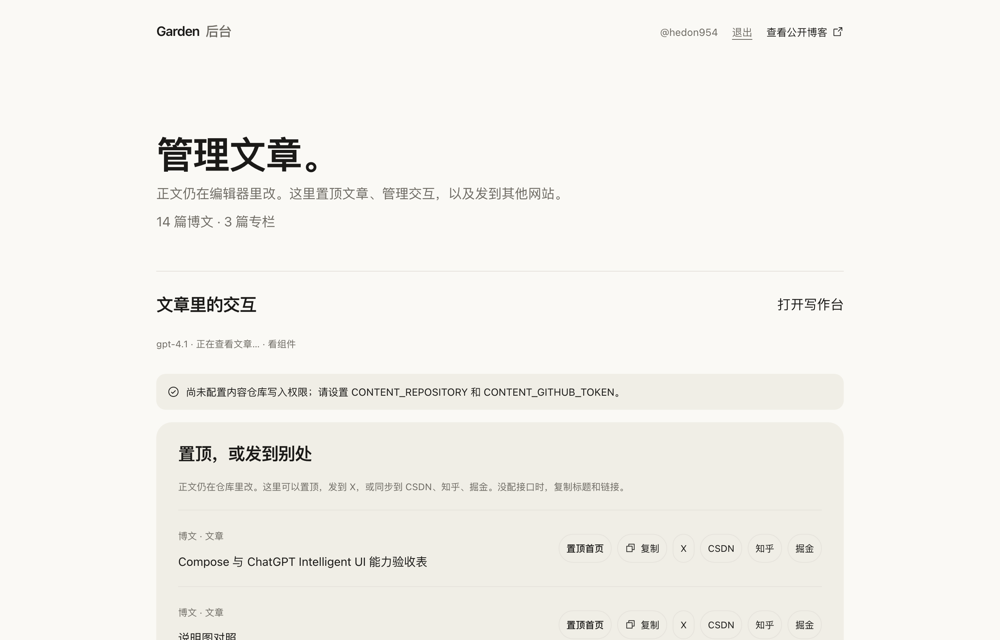
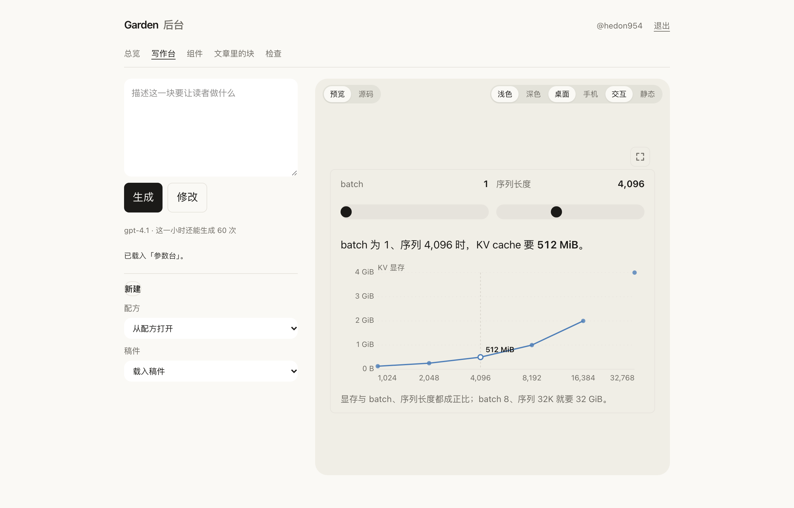
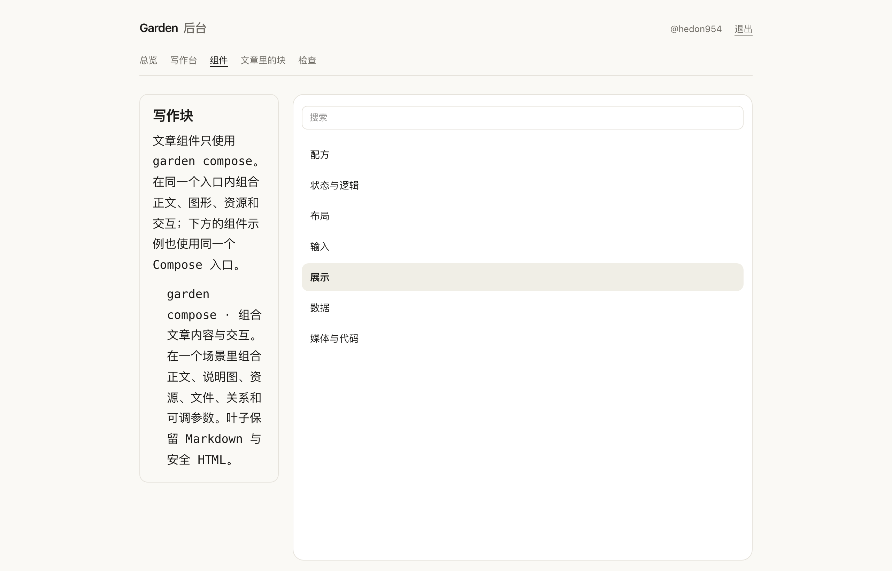

Garden 采用**静态阅读端与动态管理端完全分离**的架构：公开博客始终构建为纯静态文件托管在 GitHub Pages 上，零数据库、零后端暴露面；而 `/admin` 管理后台是一个可选的独立服务端应用，通过 GitHub OAuth 验证作者身份，并通过 GitHub Contents API 直接向你的内容仓库提交变更。

> [!NOTE] 管理后台的边界：它不是另一套富文本编辑器
> 长文写作始终在你最顺手的本地编辑器（Typora、VS Code、Cursor）中进行，`content/` 仓库始终是唯一内容真源。管理后台只负责**需要服务端凭据或在线交互辅助**的四件事：对象存储上传、首页置顶、跨平台分发，以及在线智能 UI 写作台。

---

## 1. 核心功能与具体使用方式

### 1.1 后台总览：文章置顶、OSS 上传与多平台分发（`/admin`）

登录 `/admin` 主面板后，页面汇总当前站点的全部博文与专栏条目，提供三项高频管理操作：



1. **置顶首页（Pin to Home）**：
   - 点击任意博文右侧的 **「置顶首页 / 取消置顶」**，后台会精准定位源码仓库中对应的 `content/posts/...md`，仅切换 Front Matter 中的 `pinned: true/false` 字段并提交一次 Git Commit，保留文件其余所有注释、字段顺序与正文字节不变。
   - 提交进入 `main` 分支后，自动触发 GitHub Actions 重新发布公开博客。
2. **大体积媒体上传（阿里云 OSS 直传）**：
   - 配置 OSS 环境变量后，可在后台上传高清原图、音频和长视频，避免二进制大文件撑爆 Git 仓库体积。
   - 后台校验管理员会话与文件大小后，签发有效期 10 分钟、限定路径前缀与体积上限的 **OSS Post Policy**，由浏览器直传对象存储并返回公开 CDN/OSS 地址，直接粘贴回 Markdown 正文即可（`OSS_ACCESS_KEY_SECRET` 永远不会离开服务端）。
3. **跨平台一键分发（X / CSDN / 知乎 / 掘金）**：
   - 每篇文章右侧提供 **「复制」** 与 **「X」「CSDN」「知乎」「掘金」** 按钮。
   - 分发时后台会自动将文中的 `garden compose` 智能组件降级转换为第三方平台可读的纯 Markdown 结构，并附上原文永久链接；配置了 `X_USER_ACCESS_TOKEN` 或对应平台同步 Webhook 时直接推送，未配置接口时可一键复制标准分发包手工粘贴。

### 1.2 在线智能 UI 写作台（`/admin/ui`）

顶部导航切换到 **「写作台」**，即可在不打开本地终端的情况下在线创作、调试或修改 `garden compose` 块：



- **AI 生成与多轮微调**：配置 OpenAI 兼容模型接口（`UI_MODEL_BASE_URL`、`UI_MODEL_API_KEY`、`UI_MODEL_NAME`）后，在左侧输入自然语言需求点击 **「生成」**，或基于当前组件输入修改意见点击 **「修改」**，服务端自动完成生成与语法自检修复。
- **手改源码即时重绘**：即使不连接模型，切换到 **「源码」** 标签手工修改标签、属性或 `{@body}` 公式时，预览区也会在 150ms 防抖后纯前端即时重绘，并在出错行高亮提示诊断码。
- **六维预览切换与安全写回**：右上角工具栏支持随时切换 **浅色 / 深色**、**桌面 / 手机**、**交互 / 静态回退**；如果从「稿件」下拉框加载了仓库某篇文章里的已有块，改完点击 **「写回」** 会生成带 `--base` 哈希锁的 `npx garden ui apply` 命令，本地稿件若已改动会拒绝盲目覆盖。

### 1.3 组件清单、交互块巡检与草稿预览

顶部导航还提供三个配套视图：



- **组件（`/admin/ui/catalog`）**：可视化检索全部内置配方与组件原语，点击「用它开始」直接载入写作台。
- **文章里的块（`/admin/ui/blocks`）**：扫描源码仓库全部博文（含未发布草稿）中的所有 `garden compose` 块，集中展示编译状态与跳转入口。
- **草稿正文预览（`/admin/preview/<稿件路径>`）** 与 **检查（`/admin/ui/evals`）**：在线预览远端仓库任意草稿的正文排版效果，或使用回归评测集检验当前配置模型的生成质量。

---

## 2. 环境变量参考

所有部署方式共用同一份环境变量契约（密钥类变量仅保存在后台运行环境，绝不写入公开静态构建）：

| 变量名 | 必填 | 用途说明 |
| :--- | :--- | :--- |
| `SITE_URL` | 是 | 公开博客地址（如 `https://hedon.top`） |
| `CONTENT_REPOSITORY` | 写库时必填 | 源码仓库 `owner/repo`（双仓模式下**必须填私有源码仓库**，不要填公开产物仓库） |
| `CONTENT_BRANCH` | 否 | 内容分支名，默认 `main` |
| `CONTENT_GITHUB_TOKEN` | 写库时必填 | 仅授予该源码仓库 `Contents: Read and write` 权限的 Fine-grained PAT |
| `ADMIN_GITHUB_LOGINS` | 生产必填 | 允许登录后台的 GitHub 用户名白名单，多个账号用英文逗号分隔 |
| `GITHUB_OAUTH_CLIENT_ID` | 生产必填 | GitHub OAuth App 的 Client ID |
| `GITHUB_OAUTH_CLIENT_SECRET` | 生产必填 | GitHub OAuth App 的 Client Secret |
| `GITHUB_SESSION_SECRET` | 必填 | 至少 32 位随机字符串，用于对 HttpOnly 会话 Cookie 做 HMAC-SHA256 签名 |
| `GITHUB_OAUTH_REDIRECT_URI` | 否 | 反向代理或多域名下显式指定回调地址：`https://你的后台域名/api/auth/github/callback` |
| `OSS_ENDPOINT`、`OSS_BUCKET`、`OSS_ACCESS_KEY_ID`、`OSS_ACCESS_KEY_SECRET` | 传图时必填 | 阿里云 OSS 节点、Bucket 名与仅限目标前缀写入的 RAM 凭据（需在 Bucket 开启允许后台域名 `POST` 的 CORS 规则并暴露 `ETag`） |
| `OSS_PREFIX`、`OSS_PUBLIC_BASE_URL`、`OSS_MAX_UPLOAD_MB` | 否 | 上传目录前缀（默认 `blog-media`）、自定义 CDN 根域名、单文件大小上限（默认 `200` MB） |
| `UI_MODEL_BASE_URL`、`UI_MODEL_API_KEY`、`UI_MODEL_NAME` | AI 生成选填 | 写作台连接 OpenAI 兼容大模型的接口地址、密钥与模型名称 |

---

## 3. 部署方案（本地启动与远端服务器部署）

后台内置于同一个 Garden 应用中，既可以在写稿时**本地按需启动**，也可以部署到**远端云服务器**或 **Cloudflare Workers** 随时在外部访问。

### 方案一：本地直接启动（零服务器成本）

平时在本机写文章需要用到写作台或后台功能时，直接通过本地开发或本地服务模式启动：

1. **最简开发模式（自动复用本机 `gh` 登录态）**：
   本机已安装并登录 GitHub CLI（`gh auth login`）时，在博客目录直接运行：
   ```bash
   make dev
   ```
   浏览器打开 `http://localhost:3000/admin`，开发模式会自动为你签发本地会话并读取本机 `gh` 令牌，无需创建 OAuth App 即可立即使用全部后台页面。
2. **独立本地常驻服务（加载 `.env.admin.local`）**：
   将环境变量整理到 `.env.admin.local`（Git 自动忽略），在引擎或站点环境运行：
   ```bash
   node --env-file=.env.admin.local ./node_modules/.bin/garden start --host 127.0.0.1 --port 3000
   ```
   若在 GitHub 创建本地专用 OAuth App，将 Callback URL 填为 `http://localhost:3000/api/auth/github/callback` 即可。

### 方案二：远端云服务器部署（Node / Docker 常驻）

如果你有一台自己的云服务器（如阿里云 ECS、腾讯云或任意 Linux VPS），推荐使用容器常驻运行，配合 Nginx / Caddy 提供 HTTPS 反向代理：

1. 在 GitHub **Settings → Developer settings → OAuth Apps** 创建生产 OAuth App，Callback URL 设为 `https://admin.example.com/api/auth/github/callback`。
2. 在服务器上准备 `.env.admin.local`（不要把环境文件打进镜像），构建并运行容器：
   ```bash
   docker build -t garden-admin .
   docker run -d --name garden-admin \
     --env-file .env.admin.local \
     -p 127.0.0.1:3000:3000 \
     --restart unless-stopped \
     garden-admin
   ```
3. 将 `https://admin.example.com` 反向代理至本机 `127.0.0.1:3000`，并在博客源码仓库的 GitHub Actions Variables 中填入 `ADMIN_URL=https://admin.example.com`。

### 方案三：无服务器远端部署（Cloudflare Workers）

不想维护 Linux 云主机时，可以直接把后台部署到 Cloudflare Workers（站点仓库已自带 `.github/workflows/admin-cloudflare.yml` 工作流）：

- **方式 A（命令行一键部署）**：
  ```bash
  npx wrangler login
  npm run build
  npx wrangler deploy --config dist/server/wrangler.json --name my-blog-admin
  ```
- **方式 B（GitHub Actions 手动触发部署）**：
  在博客源码仓库 **Actions Secrets** 中配置 `CLOUDFLARE_API_TOKEN` 与 `CLOUDFLARE_ACCOUNT_ID`，进入 GitHub **Actions → Deploy admin to Cloudflare** 点击 **Run workflow** 并输入 Worker 名称即可完成构建与发布；随后在 Cloudflare Dashboard 的 Worker **Settings → Variables and Secrets** 中填入上述后台环境变量并绑定自定义后台域名。
