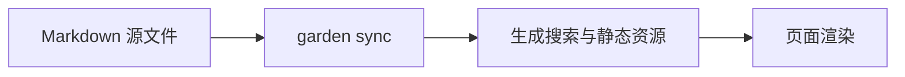

Garden 的文章放在 `content/posts/`，使用 UTF-8 编码的 Markdown 文件，文件名只能包含小写字母、数字和连字符（`a-z`、`0-9`、`-`）。

## 1. 长文 Front Matter（`content/posts/*.md`）

用 `make new DIR=systems SLUG=wal-checkpoint TITLE="深入理解 WAL丨检查点与恢复流程"` 创建文章，或者手动新建 `.md` 文件：

```yaml
---
title: 深入理解 WAL丨检查点与恢复流程
date: 2026-10-18
updated: 2026-10-19
description: 拆解预写日志在并发读写下的页面可见性规则，以及后台检查点如何控制日志文件体积。
tags:
  - 数据库
  - 存储
pinned: false
draft: false
cover: windowsill-herbs.svg
original: https://example.com/original-post
references:
  - title: SQLite Write-Ahead Logging
    url: https://www.sqlite.org/wal.html
  - title: 《Database Internals》
---
```

| 字段 | 必填 | 类型 | 说明 |
| :--- | :--- | :--- | :--- |
| `title` | 是 | 字符串 | 文章标题。中间写 `丨`、`｜` 或 ` \| ` 会分成两行并按字数缩放字号 |
| `date` | 是 | 日期字符串 | 发布日期（如 `2026-10-18` 或带时区的 ISO 时间） |
| `description` | 否 | 字符串 | 文章摘要，显示在正文开头导语、列表页与搜索引擎摘要中；留空（如 `description: ""`）、省略、YAML `null` 或只写空白时，不渲染摘要，也不会自动截取正文替代 |
| `updated` | 否 | 日期字符串 | 最后更新日期，显示在文章元信息栏并用于 RSS 排序 |
| `publishAt` | 否 | 日期字符串 | 定时发布时间；早于当前构建时间（或设置 `CONTENT_INCLUDE_DRAFTS=1`）才会发布 |
| `tags` | 否 | 字符串数组 | 文章标签列表，点击标签会跳转到 `/blog?t=<标签>` 筛选 |
| `pinned` | 否 | 布尔值 | 设为 `true` 时显示在站点首页「置顶」区域 |
| `draft` | 否 | 布尔值 | 设为 `true` 时视为草稿，正式构建会自动跳过 |
| `cover` | 否 | 路径字符串 | 封面图路径，相对 `content/covers/` 目录 |
| `original` | 否 | 完整链接 | 原文链接，设置后在标题下方元信息栏显示 `原文 ↗` |
| `references` | 否 | `{ title, url? }[]` | 文末参考资料列表，构建期自动提取域名并渲染在正文底部的「参考」卡片中 |

文章页底部，在「来自开放网络的回应」和评论之间，有「上一篇」「下一篇」两个按钮。长文只和长文排，按 `date` 先后，上一篇是更早的那篇；专栏文章按专栏里的顺序排；最早或最新的一篇只显示一侧。

> [!CAUTION]
> 不要在 Front Matter 里手写 `slug` 字段（`npx garden check` 会报 `unexpected-slug` 错误：`不要写 slug，文件名就是标识`）。文章也没有 `topic` 分类字段。

## 2. 代码块与「代码 / 对比上一版」切换

普通代码块在右上角带有语言名称（如 `RUST`、`TS`、`PYTHON`、`SHELL`）和复制按钮。想展示一段代码和上一版相比改了什么，先放改好的完整代码，再紧跟着写一个 `garden` 想法块，用一句话写出改动内容：

````markdown
```go
func openStore(path string) (*Store, error) {
	return openWithMode(path, ModeWAL)
}
```

```garden compose
和上一版比：打开存储时的模式从 ModeJournal 改成了 ModeWAL。
```
````

Agent 按 `garden-compose` skill 会通过 `npx garden ui apply` 把这段想法替换成紧挨着完整代码的 `diff` 围栏（详见 [用 AI 写作](/garden/ai-writing)）。页面渲染时会把这两段合成一个可切换 **「代码」** 和 **「对比上一版」** 的代码框，右上角的复制按钮始终复制新版完整代码：

```go
func openStore(path string) (*Store, error) {
	return openWithMode(path, ModeWAL)
}
```

```diff
 func openStore(path string) (*Store, error) {
-	return openWithMode(path, ModeJournal)
+	return openWithMode(path, ModeWAL)
 }
```

**手写格式**：如果不使用 Agent，也可以直接在完整代码块正下方手写一段 `diff` 代码块（两段之间只隔空行）：

````markdown
```diff
 func openStore(path string) (*Store, error) {
-	return openWithMode(path, ModeJournal)
+	return openWithMode(path, ModeWAL)
 }
```
````

> [!IMPORTANT]
> `diff` 代码块必须紧跟在一段完整代码块后面；如果单独写一段 `diff` 而前面没有完整代码，`npx garden check` 会报 `diff-orphan` 错误。

## 3. 中文加粗、荧光笔高亮与提示框

- **中文标点旁加粗**：内置 `remark-cjk-friendly`，紧挨中文括号、引号或顿号写 `**像「这样」的加粗**` 能正常解析，不需要在星号两侧加空格。
- **荧光笔高亮**：用 `<u>重点句子</u>` 或 `<mark>重点句子</mark>` 可以给文字加上暖黄色荧光笔底纹，效果如：<u>这一句带有荧光笔下划线底色</u>。
- **提示框（Callouts）**：支持 `> [!NOTE]`、`> [!TIP]`、`> [!IMPORTANT]`、`> [!WARNING]`、`> [!CAUTION]`（以及 `INFO`、`SUCCESS`、`DANGER`、`FAILURE`）。在标记同行末尾写文字可替换默认标题：

```markdown
> [!WARNING] 升级前先备份数据目录
> 修改页大小后需要重建索引文件，不能直接原地回退。
```

> [!WARNING] 升级前先备份数据目录
> 修改页大小后需要重建索引文件，不能直接原地回退。

## 4. 本地图片、来源胶囊与外部链接卡片

这三项写在 Markdown 正文里。渲染规则在组件页，这里只保留文件放哪：

- **本地图片**：长文 `content/posts/my-post.md` 的配图放在同名目录 `content/posts/my-post/`，正文用 `./my-post/diagram.svg` 引用。图注见[本地图片](/garden/components/image)。
- **Excalidraw**：源文件和配图放在一起，用 Markdown 图片引用，地址以 `.excalidraw` 结尾，例如 `./my-post/flow.excalidraw`。构建生成旁边的一张浅色 `flow.svg`，画布背景透明，并把 SVG 嵌进正文，图里的文字可以选中。见[本地图片](/garden/components/image)。
- **来源胶囊**与**链接卡片**不另建文件。见[来源胶囊](/garden/components/source)和[链接卡片](/garden/components/link-card)。

## 5. 数学公式与 Mermaid 图表

- **LaTeX 数学公式**：使用 KaTeX 在构建与渲染期直接排版。行内公式写 `$L = \lambda W$`，独立公式块写 `$$...$$`。公式里带下划线的多字母变量名（如 `group_num`、`max_batch`）会自动保护为正体标识符 `\mathrm{group\_num}`，而 `W_q`、`H_{kv}` 等单字母带下标仍保持标准数学下标。
- **Mermaid 图表**：使用 ```` ```mermaid ```` 代码块直接绘制流程图或时序图，图表会自动适配浅色与深色主题：



## 6. 本地音频和视频

长文 `content/posts/my-post.md` 的音视频放在同名目录 `content/posts/my-post/`。写在 Markdown 正文里，不要包进 Compose，也不要放进 Compose 的 `<html>` 内容岛。使用带 `controls` 的 `audio` 或 `video` 标签，`src` 填写相对路径，例如 `./my-post/clip.mp3` 或 `./my-post/clip.mp4`。对象存储里的文件写完整的 `https://` 地址。不要自动播放。

构建会把本地附件复制到公开目录。大文件不要提交进 Git，更适合放对象存储。

## 7. 嵌入 YouTube / Bilibili

把可播放的视频链接单独占一行，前后留空行。页面会渲染成站内播放器，不自动播放，并保留到原站的链接：

```markdown
https://www.youtube.com/watch?v=VIDEO_ID

https://www.bilibili.com/video/BV1xx411c7mD
```

也支持 `https://youtu.be/VIDEO_ID`、`/shorts/`、`/embed/`，以及 Bilibili 的 `av` 号和 `player.bilibili.com` 播放地址。多余的跟踪参数会被忽略；YouTube 链接里的开始时间（如 `?t=90` 或 `?t=1m30s`）会从那一秒起播。

这些情况不会变成播放器：

- 句子里的链接，或同一段里有多条链接
- 代码块、行内代码里的地址
- 不是单个视频的地址（播放列表、频道、专栏文章等）。单独一行时仍按[链接卡片](/garden/components/link-card)处理
- 域名并不精确匹配 YouTube / Bilibili 的仿冒或无关地址
- `b23.tv` 等需要跳转才能确定视频的短链。渲染时不会为了解析短链去访问网络；请先在浏览器打开，或运行 `npx garden embed <短链>`，把打印出的完整视频链接单独一行贴进文章
- 希望显示卡片而不是播放器时，在链接后紧跟 `{card}`

播放器只接受上述平台的官方视频地址，YouTube 使用隐私增强域名 `youtube-nocookie.com`，不会嵌入任意网页或任意 iframe。

`npx garden embed URL` 或 `make embed URL="..."` 会打印一行可直接粘贴的规范化地址，标题等说明写在终端里，不再生成旧的 `embed` 围栏。

## 8. 文件下载与预览

想让读者下载一份文件（规格包、PDF、示例代码），在 `garden compose` 里用 `<file>` 或 `<files>`。文件放在这篇稿的同名目录里，`src` 相对这篇 Markdown 写：

```text
content/posts/go-lock.md
content/posts/go-lock/mutex-notes.pdf
content/posts/go-lock/demo.zip
```

一个文件：

````markdown
```garden compose
<file src="./go-lock/demo.zip" title="示例代码" note="三个可以直接运行的加锁例子"/>
```
````

一组文件：

````markdown
```garden compose
<files title="参考资料">
  <file src="./go-lock/mutex-notes.pdf" note="互斥锁的状态机，一页纸"/>
  <file src="./go-lock/readme.md"/>
  <file src="https://oss.example.com/go-lock/trace.zip" title="完整 trace"/>
</files>
```
````

| 属性 | 说明 |
| :--- | :--- |
| `src` | 必填。本地文件写相对路径；对象存储里的文件写完整的 `https://` 地址 |
| `title` | 可选，卡片上的名字，默认是文件名 |
| `note` | 可选，一句话说明里面有什么 |

格式和大小不用手写，构建时会算出来，显示成「PDF · 204 KB」这样的一行。找不到本地文件时，构建会失败。本地的 Markdown、HTML 和 PDF 可以在页面里预览：点「预览」，文件在右侧打开，手机上占满全屏。

## 9. 脚注

使用 GFM 脚注。标记写在正文里，定义单独成段，名称要对应：

```markdown
这条规则来自 CommonMark 的衍生语法。[^1]

[^1]: 详见 [remark-gfm](https://github.com/remarkjs/remark-gfm)。
```

脚注会集中出现在文章末尾。
