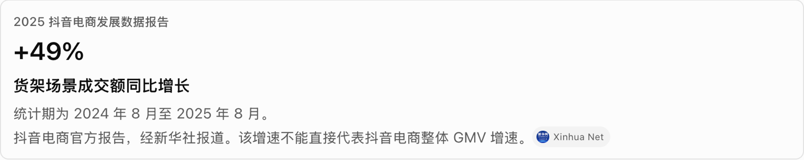
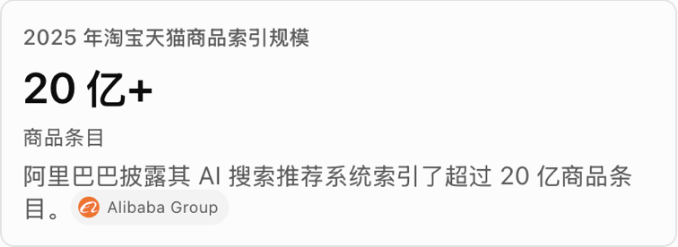
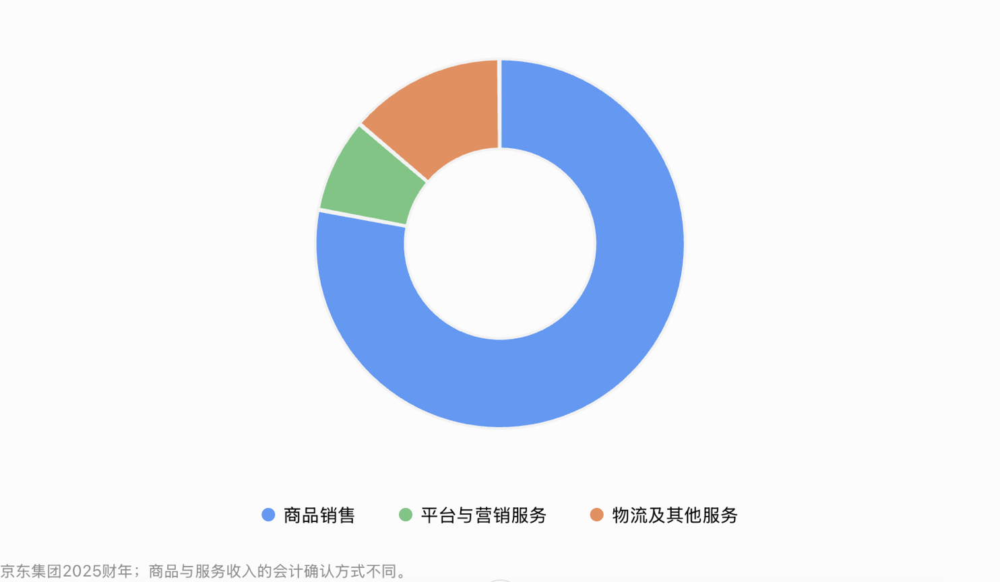
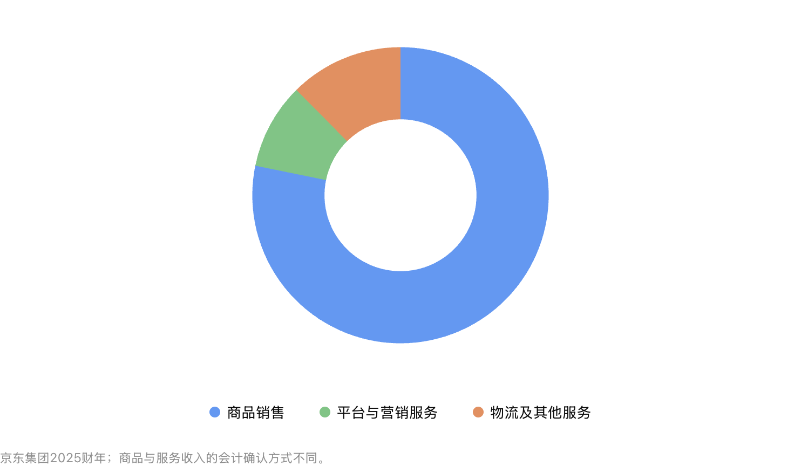
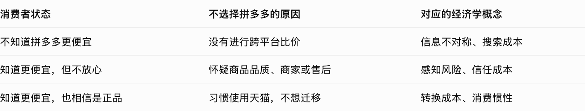
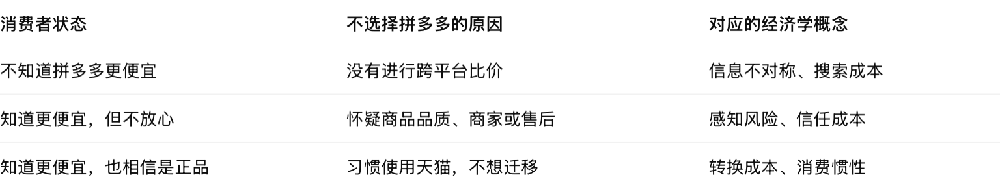

# Intelligent UI 对照

2026-10-11。左边是 ChatGPT 网页版会话「撰写二手电商业务分析」里的原件，右边是 Garden 按同一套计算样式画出来的同一块。两边裁图像素尺寸相同。

ChatGPT 带边框的 `box`：宽按内容列 **768px**（并排时 **378px**），圆角 **8px**，边框 **1px / rgba(0,0,0,0.1)**，内边距 **12px**，行距 **4px**，底色透明。大数字 **24px / 32px / 600**，颜色 **#0d0d0d**。眉题 **12px / 16px / 500 / #5d5d5d**。说明 **14px / 18.2px / #5d5d5d**。来源胶囊 **74×20**（Xinhua Net），字 **9px / #5d5d5d**，底 **#f3f3f3**，图标 **12px**。中文按页面语言 `en-US` 走系统界面字体，和 ChatGPT 同一行折行。

本地对照页：`http://localhost:5199/ui-parity`。

## 增长数字

盒子 **768×154**。五行：眉题、`+49%`、600 字重的副标题、统计期、来源。

ChatGPT：

Garden：

## 窄卡片

盒子 **378×138**。第三行「商品条目」是 **12px / 16px / 400 / #5d5d5d**。说明在「条」后换行，「目。」和来源胶囊在第二行，胶囊左缘距说明框 **27px**、顶缘 **17px**。

ChatGPT：

Garden：

## 来源

胶囊 **74×20**，内边距 **4px 6px 4px 4px**，字距正常。

ChatGPT：

Garden：

## 圆环

图区 **742×400**。外半径 **137.28**，内半径 **70.4**，圆心 **(371, 181)**。颜色 `#539af8`、`#6bc67f`、`#ef8b57`。图例在图区底部，说明在图下 **12px / 16px / #8f8f8f**，上边距 **16px**。整块 **742×432**。

ChatGPT：

Garden：

## 表格

表 **768×147**。表头 **14px / 20px / 600**，单元格 **14px / 20px / 400**，内边距 **8px 8px 8px 0**。行间 **1px / rgba(0,0,0,0.05)**，末行无底边。三列宽 **265.9 / 278.5 / 223.6**。

ChatGPT：

Garden：

## 流程

盒子 **768×250**，内容居中，间距 **8px**，字 **16px / 26px / 400**。箭头是 **16×16** 图标，向下为 **#8f8f8f**，循环为 **#5d5d5d**。

ChatGPT：

Garden：

