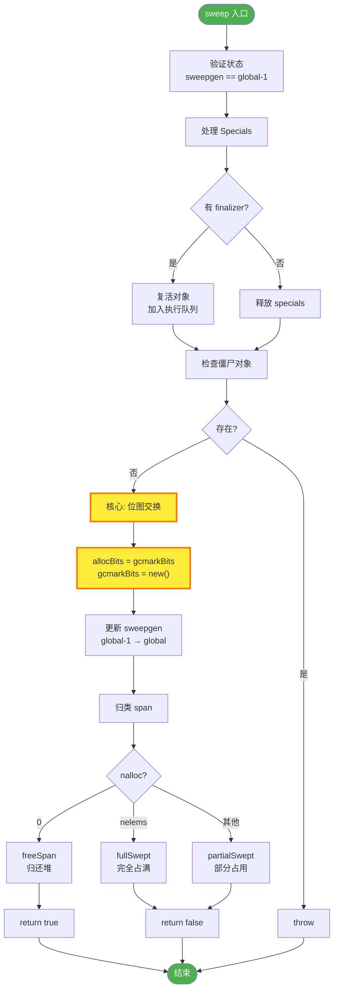

> 特此声明，本篇是笔者基于 Go 1.25.3 版本源码、并与 Google Gemini 3Pro 共创所作，非常庆幸在当今 AI 时代下获取知识已是如此便利，且也为学习者从第一性原理理解所学知识大大降低了门槛。不过本篇的篇章安排和叙述逻辑，均由笔者把控和审阅，欢迎放心阅读。

## 1. 垃圾回收

抛开具体的语言，垃圾回收（GC）在计算机科学中解决的核心问题只有一个：**对象生命周期的自动化管理**。

如果手动管理内存（如 C/C++ 的 `malloc/free`），我们面临的是由于"人为疏忽"导致的两个极端错误：

- **悬挂指针（Dangling Pointer）**：过早释放，导致后续访问出错。
- **内存泄漏（Memory Leak）**：忘记释放，导致资源耗尽。

GC 的出现，是为了将"判断内存是否不再使用"这个逻辑，从**业务代码**剥离，下沉到**运行时（Runtime）**。

从大的方面来讲，实现垃圾回收主要是要解决 2 个问题：

1. 怎么判断哪些对象是垃圾？
2. 如何清理垃圾？

### 1.1 垃圾搜索算法

从原理上讲，一个对象被判定为垃圾，意味着**当前程序的后续执行中，再也无法访问到它了**。这在计算机科学中被称为对象存活性（Object Liveness）问题。

主要有 2 个思路：引用计数法和可达性分析。

#### 1.1.1 引用计数法

- 给每个对象贴一个计数器。只要有一个地方引用它，计数器就 +1；引用失效（比如指针置空或离开作用域），计数器就 -1。当计数器归零时，该对象即为垃圾。一旦变成垃圾，立刻就能被回收，不需要等待特定的 GC 时间点。
- 但是存在**循环引用**的缺陷：假如对象 A 引用 B，B 也引用 A，除此之外没有其他人引用它们。虽然它们在外部已经无法访问（本质是垃圾），但它们互相揪着对方，计数器永远是 1，导致内存泄漏。
- CPython（Python 的解释器）的主力 GC 机制就是引用计数，但它配合了"标记-清除"来专门处理循环引用问题。PHP 和 C++ 的 `std::shared_ptr` 也是基于此思路。

#### 1.1.2 可达性分析


- 从根（GC Roots）节点向下搜索对象节点，搜索走过的路经称为引用链，当一个对象到根之间没有连通的话，则对象不可用。
- 可以作为 GC Roots 的对象通常是指那些**肯定在使用中**的对象：
  - 被栈上的指针引用；
  - 被全局变量的指针引用；
  - 被寄存器中的指针引用；
- 可达性分析的核心挑战是在遍历过程中，如果程序还在运行（对象引用关系在变），图就在变，怎么保证准确性？传统的做法是 **STW (Stop The World)**，暂停所有用户线程专门来做 GC。现代的做法是**三色标记法 (Tri-color Marking)**（如 Go 语言），允许 GC 线程和用户线程并发运行，用读写屏障（Barrier）技术来修正并发带来的标记误差，从而尽可能减少 STW 的时长。

### 1.2 垃圾回收算法

找出了垃圾，下一步就是回收内存。这里的核心矛盾是：**效率** vs**空间碎片**。

#### 1.2.1 标记清理法

算法分成 **标记** 和**清除** 两个阶段，先标记出要回收的对象，然后统一回收这些对象。

- 简单。
- 效率不高，标记和清除的效率都不高。
- 标记清除后会产生大量不连续的内存碎片，从而导致在分配大对象时触发 GC。


> Go 使用的就是标记清除法
>
> 虽然普通的标记清除法会造成内存碎片的问题，但是由于 Go 的内存模型中，将内存天然划分成多个 span，所以不存在内存碎片问题。故 Go 用了这种实现简单的标记清除法。对于 Go 内存模型不熟悉的读者，可参阅：[Go 底层原理丨内存模型](https://hedon.top/2025/11/17/go/go-memory-model/)。

#### 1.2.2 标记复制法

把内存分成**两块完全相同的区域**，每次使用其中一块，当一块使用完了，就把这块上还存活的对象拷贝到另外一块，然后把这块清除掉。

- 实现简单、运行高效，不用考虑内存碎片的问题。
- 内存有些浪费。

> JVM 实际实现中，是将内存分为一块较大的 Eden 区和两块较小的 Survivor 空间，每次使用 Eden 和一块 Survivor，回收时，把存活的对象复制到另外一块 Survivor。
>
> HotSpot 默认的 Eden 和 Survivor 比是 8:1，也就是每次能用 90% 的新生代空间。
>
> 如果 Survivor 空间不够，就要依赖老年代进行分配担保，把放不下的对象直接进入老年代。


#### 1.2.3 标记整理法

标记过程跟标记清除一样，但后续不是直接清除可回收对象，而是让所有存活对象都向一端移动，然后直接清除边界以外的内存。

> 标记整理法的开销较大，Java 的老年代就采用标记整理法，因为老年代的 GC 频率较低。


## 2. 宏观概述

在对 GC 有了一个简单的了解之后，我们先来详细了解 Go 语言的垃圾回收机制的宏观详细设计，在下一章节我们将在 AI 的帮助下，深入源码（Go1.25.3）去了解去背后的底层实现细节和那些令人叹为观止的优化思路。

截止 Go1.25，Go 还是使用的**三色标记法 + 并发标记清理法 + 混合写屏障**进行垃圾回收，Go 官方透露在 Go1.26 将默认开启 Green Tea GC，关于 Green Tea GC，将会在下篇进行详细展开。

### 2.1 核心架构特征

- **并发标记-清扫**（Concurrent Mark-Sweep）
- **类型精确**（Type Accurate）：知道内存中哪些是指针
- **写屏障**（Write Barrier）：保证并发标记的正确性
- **非分代**（Non-generational）
- **非压缩**（Non-compacting）
- **Per-P 分配**：减少锁竞争

### 2.2 三色标记法

#### 2.2.1 基本原理

Go 将对象用三种颜色来进行标记：

- **黑色**：本对象已经被 GC 访问过，且本对象的子引用对象也已经被访问过了
- **灰色**：本对象已访问过，但是本对象的子引用对象还没有被访问过，全部访问完会变成黑色，属于中间态
- **白色**：尚未被 GC 访问过的对象，如果全部标记已完成依旧为白色的，称为不可达对象，既垃圾对象

#### 2.2.2 基本步骤

1. 起初所有堆上的对象都是【白色】的；
2. 将 GC Roots 直接引用到的对象挪到【灰色】中；
3. 对【灰色】的对象进行根搜索算法：
   1. 将该对象引用到的其他对象加入【灰色】中；
   2. 将自己挪到【黑色】中；
4. 重复 3 直到【灰色】为空；
5. 回收【白色】中的对象。


#### 2.2.3 删除屏障

> 并发标记时，对指针释放的白色对象置灰。

这样可以避免在并发 GC 的过程中，由于指针的转移造成对象被误清。

比如一开始 B → C，当 B 在灰色集合的时候，释放了对 C 的指针，但是这个时候有一个在黑色集合的 E 指向了 C，也就是 E → C。由于 E 已经分析过了，所以在对 B 进行分析的时候，就会漏掉 C，导致后面 C 还是在白色集合中，就被误清了。

加入删除屏障后，C 会被强制置灰，就不会误清了。

```garden html
title: 三色标记 + 删除屏障演示
---
<!doctype html><meta charset="utf-8"><meta http-equiv="Content-Security-Policy" content="default-src 'none'; script-src 'unsafe-inline'; style-src 'unsafe-inline'">
<style>:root{--ink:#1B1A18;--soft:#4A4844;--muted:#6E6B64;--rule:#E6E3DC;--rule-strong:#D6D2C9;--card:#fff;--blue:#2C55B4;--blue-tint:#EAF0FC;--blue-line:rgba(44,85,180,.28);--paper:#F8F7F3;--well:#F0EEE8}
#r{display:flow-root;padding:16px}body{margin:0;font:15px/1.6 -apple-system,BlinkMacSystemFont,"PingFang SC","Noto Sans SC",sans-serif;color:var(--ink);background:transparent}
button{font:600 14px/1 inherit;font-family:inherit;padding:10px 14px;min-height:40px;border-radius:8px;border:1px solid var(--rule-strong);background:var(--card);color:var(--ink);cursor:pointer}
button:hover{border-color:var(--blue-line)}button:focus-visible{outline:2px solid var(--blue);outline-offset:2px}button:disabled{opacity:.45;cursor:default}
.bar{display:flex;flex-wrap:wrap;gap:8px;margin-top:14px}.mono{font-family:ui-monospace,SFMono-Regular,Menlo,monospace}
.cap{font-size:13px;color:var(--muted);margin:10px 0 0}
</style><script>function size(){var r=document.getElementById('r');if(r)parent.postMessage({type:'garden:resize',height:Math.ceil(r.getBoundingClientRect().bottom)+4},'*')}</script><main id="r"><style>
svg{width:100%;height:auto;display:block}
.n circle{stroke:var(--ink);stroke-width:1.5}.n text{font:600 14px ui-monospace,Menlo,monospace;text-anchor:middle;dominant-baseline:central}
.w circle{fill:var(--card)}.w text{fill:var(--ink)}.g circle{fill:#9A9890}.g text{fill:#fff}.k circle{fill:#1B1A18}.k text{fill:#fff}
.dead circle{stroke:#B4213A;stroke-dasharray:4 3;stroke-width:2.5}
.rt rect{fill:var(--blue-tint);stroke:var(--blue-line)}.rt text{font:600 13px sans-serif;fill:var(--blue);text-anchor:middle;dominant-baseline:central}
line{stroke:var(--muted);stroke-width:1.5}line.gone{stroke-dasharray:5 4;opacity:.35}line.new{stroke:var(--blue);stroke-width:2}
.st{display:flex;gap:16px;flex-wrap:wrap;font-size:13px;color:var(--soft);margin-top:8px}.st b{color:var(--ink)}
.msg{margin:10px 0 0;min-height:3.2em}.tg{display:flex;align-items:center;gap:8px;font-size:14px;margin-bottom:8px}
</style>
<label class="tg"><input type="checkbox" id="bar"> 开启删除屏障（对指针释放的白色对象置灰）</label>
<svg viewBox="0 0 520 190" role="img" aria-label="对象引用图（示例）">
<defs><marker id="a" viewBox="0 0 8 8" refX="8" refY="4" markerWidth="7" markerHeight="7" orient="auto"><path d="M0 0L8 4L0 8z" fill="#6E6B64"/></marker></defs>
<line id="eRE" x1="72" y1="80" x2="148" y2="48" marker-end="url(#a)"/><line id="eRB" x1="72" y1="100" x2="148" y2="132" marker-end="url(#a)"/>
<line id="eBC" x1="192" y1="132" x2="278" y2="100" marker-end="url(#a)"/><line id="eEC" class="gone" x1="192" y1="48" x2="278" y2="80" marker-end="url(#a)"/>
<line x1="412" y1="58" x2="412" y2="116" marker-end="url(#a)"/><line x1="428" y1="122" x2="428" y2="64" marker-end="url(#a)"/>
<g class="rt"><rect x="6" y="70" width="66" height="40" rx="8"/><text x="39" y="90">Roots</text></g>
<g id="E" class="n w"><circle cx="170" cy="40" r="20"/><text x="170" y="40">E</text></g>
<g id="B" class="n w"><circle cx="170" cy="140" r="20"/><text x="170" y="140">B</text></g>
<g id="C" class="n w"><circle cx="300" cy="90" r="20"/><text x="300" y="90">C</text></g>
<g id="F" class="n w"><circle cx="420" cy="40" r="20"/><text x="420" y="40">F</text></g>
<g id="G" class="n w"><circle cx="420" cy="140" r="20"/><text x="420" y="140">G</text></g>
</svg>
<div class="st"><span>白色：<b id="sw"></b></span><span>灰色：<b id="sg"></b></span><span>黑色：<b id="sk"></b></span></div>
<p class="msg" id="msg" aria-live="polite"></p>
<div class="bar"><button id="nx">下一步</button><button id="rs">重来</button><span class="mono cap" id="ct" style="margin:auto 0"></span></div>
<p class="cap">示例对象图：F、G 互相引用但不可达；第 4 步模拟用户代码在并发标记时把 B → C 改成 E → C。</p>
<script>
var S,col,ids=['E','B','C','F','G'];
var steps=[
 function(){say('1. 起初所有堆上的对象都是【白色】的。')},
 function(){col.E='g';col.B='g';say('2. 将 GC Roots 直接引用到的对象（E、B）挪到【灰色】中。')},
 function(){col.E='k';say('3. 扫描灰色对象 E：它此时没有引用其他对象，自己挪到【黑色】中。')},
 function(){document.getElementById('eBC').classList.add('gone');var ec=document.getElementById('eEC');ec.classList.remove('gone');ec.classList.add('new');
   if(bar()){col.C='g';say('并发修改：B 释放了对 C 的指针，黑色的 E 指向了 C。删除屏障生效，C 被强制置灰。')}
   else say('并发修改：B 释放了对 C 的指针，黑色的 E 指向了 C。由于 E 已经分析过了，没人会再扫描到 C。')},
 function(){col.B='k';say('3. 扫描灰色对象 B：它已经不再引用 C，自己挪到【黑色】中。')},
 function(){if(col.C==='g'){col.C='k';say('3. 扫描灰色对象 C，自己挪到【黑色】中。')}else{say('4. 【灰色】已经为空，标记结束。');return 'skip'}},
 function(){var w=ids.filter(function(i){return col[i]==='w'});w.forEach(function(i){document.getElementById(i).classList.add('dead')});
   say('5. 回收【白色】中的对象：'+w.join('、')+'。'+(w.indexOf('C')>=0?' C 仍被 E 引用却被误清了！':' C 保住了，F、G 作为不可达对象被回收。'))}
];
function bar(){return document.getElementById('bar').checked}
function say(t){document.getElementById('msg').textContent=t}
function init(){S=0;col={};ids.forEach(function(i){col[i]='w';document.getElementById(i).classList.remove('dead')});
 var bc=document.getElementById('eBC'),ec=document.getElementById('eEC');bc.classList.remove('gone');ec.classList.add('gone');ec.classList.remove('new');steps[0]();draw()}
function draw(){ids.forEach(function(i){var g=document.getElementById(i);g.classList.remove('w','g','k');g.classList.add(col[i])});
 ['w','g','k'].forEach(function(c){document.getElementById('s'+c).textContent=ids.filter(function(i){return col[i]===c}).join(' ')||'—'});
 document.getElementById('ct').textContent=(S+1)+' / '+steps.length;document.getElementById('nx').disabled=S>=steps.length-1;size()}
document.getElementById('nx').onclick=function(){S++;steps[S]();draw()};
document.getElementById('rs').onclick=init;document.getElementById('bar').onchange=init;init();
</script></main><script>
addEventListener('message',function(e){if(e.source!==parent||!e.data||e.data.type!=='garden:theme')return;if(e.data.scheme==='dark'||e.data.scheme==='light')document.documentElement.style.colorScheme=e.data.scheme;var t=e.data.tokens||{};for(var k in t)if(/^--[a-z-]+$/.test(k)&&/^[#\w(),.% -]+$/.test(t[k]))document.documentElement.style.setProperty(k,t[k])});
addEventListener('resize',size);
</script>
```


#### 2.2.4 插入屏障

> 并发标记时，对指针新指向的白色对象置灰。

这样可以避免在并发 GC 的过程中，误清掉指针新指向的对象。

比如一开始并没有指向 C 的对象，但是在 GC 过程中，E → C，但是由于 E 已经分析过了，已经进入黑色集合了，所以最后会漏掉 C，导致 C 被误清。

加入插入屏障后，C 会被强制置灰，就不会误清了。


### 2.3 GC 四阶段循环

```garden figure
parts:
  - id: all
    label: 全部
    text: GC 循环周期
  - id: trig
    label: GC Trigger
    text: GC Trigger 堆阈值/定时/手动
  - id: p1
    label: 清扫终止
    text: "STW: 准备根对象, 清理上一轮残余"
  - id: p2
    label: 并发标记
    text: 所有对象标记完成 gcMarkDone
  - id: p3
    label: 标记终止
    text: "STW: 保证全局标记完成, 必须全局一致"
  - id: p4
    label: 并发清扫
    text: 清理结束 & 等待下一轮
---
<svg viewBox="0 0 680 210" class="dx-svg g-flow" role="img" aria-label="GC 四阶段循环：GC Trigger → 清扫终止（STW）→ 并发标记 → 标记终止（STW）→ 并发清扫 → 等待下一轮">
<defs><marker id="ahc" viewBox="0 0 8 8" refX="7" refY="4" markerWidth="7" markerHeight="7" orient="auto"><path d="M0 0L8 4L0 8z" class="fl-ah"/></marker></defs>
<g class="fl-e"><line x1="92" y1="90" x2="114" y2="90" marker-end="url(#ahc)"/><line x1="232" y1="90" x2="254" y2="90" marker-end="url(#ahc)"/><line x1="372" y1="90" x2="394" y2="90" marker-end="url(#ahc)"/><line x1="512" y1="90" x2="534" y2="90" marker-end="url(#ahc)"/>
<path d="M594 116 V176 H50 V118" fill="none" stroke="currentColor" class="fl-e1" marker-end="url(#ahc)"/></g>
<text x="243" y="52" text-anchor="middle" class="dx-cap">开启写屏障</text><text x="383" y="52" text-anchor="middle" class="dx-cap">gcMarkDone</text><text x="523" y="52" text-anchor="middle" class="dx-cap">关闭写屏障</text><text x="322" y="196" text-anchor="middle" class="dx-cap">清理结束 &amp; 等待下一轮</text>
<rect x="8" y="66" width="84" height="48" rx="8" class="fl-n" data-p="trig" stroke-dasharray="5 4"/><text x="50" y="86" text-anchor="middle" class="dx-l">GC Trigger</text><text x="50" y="104" text-anchor="middle" class="dx-cap">堆阈值/定时/手动</text>
<rect x="116" y="62" width="116" height="56" rx="8" class="fl-n gc-stw" data-p="p1 stw"/><text x="174" y="84" text-anchor="middle" class="dx-l">① 清扫终止</text><text x="174" y="104" text-anchor="middle" class="dx-cap">STW</text>
<rect x="256" y="62" width="116" height="56" rx="8" class="fl-n fl-m" data-p="p2 conc"/><text x="314" y="84" text-anchor="middle" class="dx-l">② 并发标记</text><text x="314" y="104" text-anchor="middle" class="dx-cap">Concurrent</text>
<rect x="396" y="62" width="116" height="56" rx="8" class="fl-n gc-stw" data-p="p3 stw"/><text x="454" y="84" text-anchor="middle" class="dx-l">③ 标记终止</text><text x="454" y="104" text-anchor="middle" class="dx-cap">STW</text>
<rect x="536" y="62" width="116" height="56" rx="8" class="fl-n fl-m" data-p="p4 conc"/><text x="594" y="84" text-anchor="middle" class="dx-l">④ 并发清扫</text><text x="594" y="104" text-anchor="middle" class="dx-cap">Concurrent</text>
</svg>
```

### 2.4 GC 触发机制

- **堆大小触发**：GOGC=100 时，堆增长 100% 触发（4M→8M）
- **定时触发**：sysmon 会定时检查，如果 2min 内没有进行 gc，那 runtime 就会进行一次 gc。
- **手动触发**：`runtime.GC()`

## 3. 源码解析

结论先行，整个 GC 的全景图如下所示：

```
┌─────────────────────────────────────────────────────────────┐
│                    GC 周期完整流程                            │
└─────────────────────────────────────────────────────────────┘

触发 GC (gcStart)
    ├─ 检查触发条件 (gcTrigger.test)
    │   ├─ gcTriggerHeap: heapLive >= trigger
    │   ├─ gcTriggerTime: 距上次GC > 2分钟
    │   └─ gcTriggerCycle: 手动触发
    │
    ├─ 完成上一轮扫描 (sweepone)
    │
    └─ === 阶段 1: 扫描终止 (STW) ===
        ├─ stopTheWorld(stwGCSweepTerm)
        ├─ finishsweep_m()      // 完成剩余扫描
        ├─ clearpools()         // 清理 sync.Pool
        └─ gcResetMarkState()   // 重置标记状态

┌─────────────────────────────────────────────────────────────┐
│                    阶段 2: 并发标记                           │
└─────────────────────────────────────────────────────────────┘

    ├─ setGCPhase(_GCmark)      // 启用写屏障
    ├─ gcBgMarkPrepare()         // 准备后台工作者
    ├─ gcPrepareMarkRoots()      // 准备根对象扫描
    ├─ atomic.Store(&gcBlackenEnabled, 1)  // 启用标记
    └─ startTheWorld()           // 恢复世界

    并发执行：
    ├─ 标记工作者 (gcBgMarkWorker)
    │   ├─ Dedicated Worker: 专用标记
    │   ├─ Fractional Worker: 分数标记
    │   └─ Idle Worker: 空闲标记
    │
    ├─ Mutator Assist (gcAssistAlloc)
    │   └─ 分配者协助标记以保持节奏
    │
    └─ 根对象扫描
        ├─ 扫描所有 goroutine 栈
        ├─ 扫描全局变量
        └─ 扫描 finalizer 队列

    工作循环：
    └─ while (有灰色对象) {
        obj = gcw.tryGetObj()  // 从队列获取灰色对象
        scanobject(obj, gcw)   // 扫描对象，标记引用
        // 将新发现的灰色对象加入队列
    }

┌─────────────────────────────────────────────────────────────┐
│              阶段 3: 标记终止检测 (gcMarkDone)                 │
└─────────────────────────────────────────────────────────────┘

检测循环：
    ├─ 条件: work.nwait == work.nproc && !gcMarkWorkAvailable
    │
    ├─ === Ragged Barrier ===
    │   └─ forEachP: 刷新所有 P 的本地缓冲
    │       ├─ wbBufFlush1(pp)   // 写屏障缓冲
    │       └─ pp.gcw.dispose()  // 工作缓冲
    │
    ├─ 发现新工作？goto 检测循环
    │
    └─ === 标记终止 (STW) ===
        ├─ stopTheWorld(stwGCMarkTerm)
        ├─ 最后检查: 处理 ragged barrier 后的写屏障
        ├─ 发现新工作？startTheWorld, goto 检测循环
        └─ 确认完成

┌─────────────────────────────────────────────────────────────┐
│                 阶段 4: 并发扫描 (gcSweep)                    │
└─────────────────────────────────────────────────────────────┘

    ├─ atomic.Store(&gcBlackenEnabled, 0)  // 禁用标记
    ├─ setGCPhase(_GCoff)                  // 禁用写屏障
    ├─ mheap_.sweepgen += 2                // 更新扫描代数
    └─ startTheWorld()                     // 恢复世界

    并发执行：
    ├─ 后台扫描 (bgsweep)
    │   └─ 循环调用 sweepone()
    │
    └─ 惰性扫描 (lazy sweep)
        └─ 分配时按需扫描 span

┌─────────────────────────────────────────────────────────────┐
│                   阶段 5: 等待下次触发                         │
└─────────────────────────────────────────────────────────────┘

    ├─ 计算下次触发点
    │   ├─ heapGoal = heapMarked * (1 + GOGC/100)
    │   └─ trigger = heapGoal - runway
    │
    └─ 在分配路径检查: heapLive >= trigger
        └─ 是 → gcStart (回到顶部)
```

### 3.1 GC 触发 gcStart()

GC 的触发通过 `gcTrigger` 机制来检测三种条件：

```go
type gcTrigger struct {
	kind gcTriggerKind
	now  int64  // gcTriggerTime: 当前时间
	n    uint32 // gcTriggerCycle: 要启动的周期编号
}

const (
	// gcTriggerHeap: 当堆大小达到控制器计算的触发堆大小时启动
	gcTriggerHeap gcTriggerKind = iota

	// gcTriggerTime: 距离上次GC超过 forcegcperiod (2分钟) 时启动
	gcTriggerTime

	// gcTriggerCycle: 手动触发
	gcTriggerCycle
)
```

当 [gcTrigger.test()](https://github.com/golang/go/blob/release-branch.go1.25/src/runtime/mgc.go#L616) 返回 `true` 时，就会执行 `gcStart()` 函数：

```go
func (t gcTrigger) test() bool {
	// 必须满足：GC已启用、非panic状态、不在GC中
	if !memstats.enablegc || panicking.Load() != 0 || gcphase != _GCoff {
		return false
	}
	switch t.kind {
	case gcTriggerHeap:
		// 堆触发：heapLive >= trigger
		trigger, _ := gcController.trigger()
		return gcController.heapLive.Load() >= trigger
	case gcTriggerTime:
		// 时间触发：距上次GC > forcegcperiod (2分钟)
		if gcController.gcPercent.Load() < 0 {
			return false
		}
		lastgc := int64(atomic.Load64(&memstats.last_gc_nanotime))
		return lastgc != 0 && t.now-lastgc > forcegcperiod
	case gcTriggerCycle:
		// 手动触发
		return int32(t.n-work.cycles.Load()) > 0
	}
	return true
}
```

[gcStart()](https://github.com/golang/go/blob/release-branch.go1.25/src/runtime/mgc.go#L643) 函数的核心流程：

```go
func gcStart(trigger gcTrigger) {
    // 1. 安全性检查 (Preamble)
    // 如果当前 Goroutine 正持有锁（如在 malloc 内部），或者不可抢占，
    // 强行启动 GC 可能会导致死锁或状态损坏。此时放弃，等待下一次机会。
    mp := acquirem()
    if gp := getg(); gp == mp.g0 || mp.locks > 1 || mp.preemptoff != "" {
        releasem(mp)
        return
    }
    releasem(mp)

    // 2. 清理上一轮的残余 (Finish Previous Sweep)
    // 在开启新一轮 GC 前，必须确保上一轮的垃圾清理（Sweep）完全结束。
    // 如果是后台触发，通常已经清完了；如果是手动强制触发，这里会循环清理直到干净。
    for trigger.test() && sweepone() != ^uintptr(0) {
    }

    // 抢占启动锁，防止多个 P 同时启动 GC
    semacquire(&work.startSema)

    // 再次检查触发条件（Double Check），防止在抢锁过程中条件已变化
    if !trigger.test() {
        semrelease(&work.startSema)
        return
    }

    // ============================================================
    // 3. 阶段一：扫描终止 (Sweep Termination) - STW 开始
    // ============================================================

    // 唤醒后台标记工作协程（gcBgMarkWorker），让它们准备好干活
    gcBgMarkStartWorkers()

    // 重置标记相关的全局状态（如重置工作队列等）
    systemstack(gcResetMarkState)

    // Stop The World!
    // 这是 GC 周期的第一个 STW。目的是为了在一个静止的世界里，
    // 安全地切换 GC 阶段标志位，并开启写屏障。
    // 此时，所有用户代码暂停。
    var stw worldStop
    systemstack(func() {
        stw = stopTheWorldWithSema(stwGCSweepTerm)
    })

    // 在 STW 期间，确保所有 Span 的清理工作彻底完成（兜底）
    systemstack(func() {
        finishsweep_m()
    })

    // 清理 sync.Pool。
    // 这是一个权衡：必须在 STW 期间清空，否则老对象会活到下一轮。
    clearpools()

    // 增加 GC 计数器
    work.cycles.Add(1)

    // 初始化 GC 控制器，设定本轮的目标（基于 P 的数量等）
    gcController.startCycle(now, int(gomaxprocs), trigger)

    // ============================================================
    // 4. 阶段二：准备并发标记 (Prepare Concurrent Mark)
    // ============================================================

    // 【关键点】开启混合写屏障 (Hybrid Write Barrier)
    // setGCPhase 将全局状态改为 _GCmark。
    // 由于此时还在 STW，所有 P 在被唤醒后，都会看到这个新状态，
    // 从而在执行 pointer write 时自动触发屏障逻辑。
    setGCPhase(_GCmark)

    // 准备根对象（Globals, Stack, Registers 等）
    // 这一步必须在 assist 开启前完成。
    gcBgMarkPrepare()
    gcPrepareMarkRoots()

    // 标记所有 tiny alloc 块为黑色。
    // 这是一个优化：小对象分配非常频繁，如果不预先染黑，
    // 每次分配都要触发屏障，性能会崩。
    gcMarkTinyAllocs()

    // 【关键点】启用 Mutator Assist (辅助标记)
    // 允许用户协程在分配内存太快时，“被迫”帮忙进行标记。
    // 必须在写屏障开启后才能启用。
    atomic.Store(&gcBlackenEnabled, 1)

    // ============================================================
    // 5. 恢复世界 (Start The World)
    // ============================================================

    // 此时状态已经切换为 _GCmark，写屏障已启用，后台 Worker 已就绪。
    // 恢复用户代码运行。
    systemstack(func() {
        now = startTheWorldWithSema(0, stw)
    })

    // 释放启动锁
    semrelease(&work.startSema)
}
```

### 3.2 并发标记 gcBgMarkWorker

在上面 `gcStart()` 中，会调用 [gcBgMarkStartWorkers()](https://github.com/golang/go/blob/release-branch.go1.25/src/runtime/mgc.go#L1350) 准备后台标记工作者：

```go
func gcBgMarkStartWorkers() {
	ready := make(chan struct{}, 1)
	for gcBgMarkWorkerCount < gomaxprocs {
		go gcBgMarkWorker(ready)
		<-ready
	}
}
```

它的逻辑很简单，就是为每一个 P 调用一个 [gcBgMarkWorker(ready)](https://github.com/golang/go/blob/release-branch.go1.25/src/runtime/mgc.go#L1428)：

```go
func gcBgMarkWorker(ready chan struct{}) {
	ready <- struct{}{}
	for {
    // 根据不同标记的工作者类型调用不同的标记函数
		systemstack(func() {
			switch pp.gcMarkWorkerMode {
			case gcMarkWorkerDedicatedMode:
				gcDrainMarkWorkerDedicated(&pp.gcw, true)
				if gp.preempt {
					if drainQ := runqdrain(pp); !drainQ.empty() {
						lock(&sched.lock)
						globrunqputbatch(&drainQ)
						unlock(&sched.lock)
					}
				}
				gcDrainMarkWorkerDedicated(&pp.gcw, false)
			case gcMarkWorkerFractionalMode:
				gcDrainMarkWorkerFractional(&pp.gcw)
			case gcMarkWorkerIdleMode:
				gcDrainMarkWorkerIdle(&pp.gcw)
			}
			casgstatus(gp, _Gwaiting, _Grunning)
		})

    // 检测标记终止
		if incnwait == work.nproc && !gcMarkWorkAvailable(nil) {
			gcMarkDone()
		}
	}
}
```

`gcBgMarkWorker()` 主要包含 2 个核心逻辑：

1. 根据不同标记的工作者类型调用不同的标记函数，如 `gcDrainMarkWorkerDedicated()`、`gcDrainMarkWorkerFractional()` 和 `gcDrainMarkWorkerIdle()`。而事实上，这 3 个函数，都是调用了 `gcDrain()`。`gcDrain()` 函数是 GC 标记阶段的核心工作循环，负责"排空"（drain）标记工作队列，将灰色对象扫描并标记为黑色。这是标记工作者执行实际标记工作的主要函数。

   调用层级如下所示：

   ```
   gcBgMarkWorker (后台工作者)
       └─> gcDrainMarkWorkerDedicated/Fractional/Idle
               └─> gcDrain
                       ├─> markroot (扫描根对象)
                       ├─> scanobject (扫描堆对象)
                       └─> scanSpan (扫描 span)
   ```

2. 检测标记终止：`gcMarkDone()`，我们将在 3.3 章节进行详细展开。

#### 3.2.1 标记工作者类型 gcMarkWorkerMode

Go GC 使用三种类型的标记工作者：

- `gcMarkWorkerDedicatedMode`：专用标记工作者，持续标记直到没有更多工作或被抢占。
- `gcMarkWorkerFractionalMode`：分数标记工作者，按照目标使用率工作。
- `gcMarkWorkerIdleMode`：空闲标记工作者，仅在 P 空闲时工作。

```go
switch pp.gcMarkWorkerMode {
case gcMarkWorkerDedicatedMode:
	// Dedicated Worker: 专用标记工作者，持续标记直到没有更多工作或被抢占
	gcDrainMarkWorkerDedicated(&pp.gcw, true)
	if gp.preempt {
		// 被抢占时，清空运行队列
		if drainQ := runqdrain(pp); !drainQ.empty() {
			lock(&sched.lock)
			globrunqputbatch(&drainQ)
			unlock(&sched.lock)
		}
	}
	gcDrainMarkWorkerDedicated(&pp.gcw, false)

case gcMarkWorkerFractionalMode:
	// Fractional Worker: 分数标记工作者，按照目标使用率工作
	gcDrainMarkWorkerFractional(&pp.gcw)

case gcMarkWorkerIdleMode:
	// Idle Worker: 空闲标记工作者，仅在P空闲时工作
	gcDrainMarkWorkerIdle(&pp.gcw)
}
```

#### 3.2.2 标记工作队列 gcWork

[gcWork](https://github.com/golang/go/blob/release-branch.go1.25/src/runtime/mgcwork.go#L82) 是 GC 标记工作的生产者-消费者接口，每个 P 都有自己的 `gcWork`，通过双缓冲减少全局队列竞争。

```go
type gcWork struct {
    wbuf1, wbuf2 *workbuf  // 双缓冲：wbuf1 当前使用，wbuf2 备用
    bytesMarked uint64     // 本地标记的字节数
    flushedWork bool       // 是否将工作刷新到全局队列
}
```

它有两个核心方法：

- `putObj()`：将一个灰色对象加入工作队列（生产）
- `tryGetObj()`：从工作队列取出一个灰色对象（消费）

```go
// putObj 将一个灰色对象加入工作队列（生产）
func (w *gcWork) putObj(obj uintptr) {
    wbuf := w.wbuf1

    // 初始化或检查缓冲区
    if wbuf == nil {
        w.init()  // 初始化双缓冲
        wbuf = w.wbuf1
    } else if wbuf.nobj == len(wbuf.obj) {  // wbuf1 满了
        // 双缓冲切换：wbuf1 <-> wbuf2
        w.wbuf1, w.wbuf2 = w.wbuf2, w.wbuf1
        wbuf = w.wbuf1

        if wbuf.nobj == len(wbuf.obj) {  // 两个缓冲区都满了
            putfull(wbuf)  // 将满的缓冲区放入全局 full 队列
            w.flushedWork = true
            wbuf = getempty()  // 获取新的空缓冲区
            w.wbuf1 = wbuf
        }
    }

    // 将对象加入缓冲区
    wbuf.obj[wbuf.nobj] = obj
    wbuf.nobj++
}

// tryGetObj 从工作队列取出一个灰色对象（消费）
func (w *gcWork) tryGetObj() uintptr {
    wbuf := w.wbuf1

    if wbuf == nil {
        w.init()
        wbuf = w.wbuf1
    }

    if wbuf.nobj == 0 {  // wbuf1 空了
        // 双缓冲切换
        w.wbuf1, w.wbuf2 = w.wbuf2, w.wbuf1
        wbuf = w.wbuf1

        if wbuf.nobj == 0 {  // 两个缓冲区都空了
            owbuf := wbuf
            wbuf = trygetfull()  // 从全局 full 队列获取
            if wbuf == nil {
                return 0  // 没有工作了
            }
            putempty(owbuf)  // 将空缓冲区归还全局 empty 队列
            w.wbuf1 = wbuf
        }
    }

    // 从缓冲区取出对象
    wbuf.nobj--
    return wbuf.obj[wbuf.nobj]
}
```

设计要点：

- 双缓冲机制：减少对全局队列的访问频率，降低锁竞争
- 本地优先：优先使用 P 本地缓冲区，只在必要时访问全局队列
- 滞后效应：一个缓冲区的容量作为滞后，摊销获取/放回缓冲区的成本

#### 3.2.3 根对象扫描准备 gcPrepareMarkRoots()

在 `gcStart()` 的时候，会先执行 [gcPrepareMarkRoot()](https://github.com/golang/go/blob/release-branch.go1.25/src/runtime/mgcmark.go#L60) 扫描根对象，即所谓的 GC Roots，如我们前面的可达性分析章节所述， GC Roots 的对象通常是指那些**肯定在使用中**的对象：

- 被栈上的指针引用
- 被全局变量的指针引用
- 被寄存器中的指针引用

```go
func gcPrepareMarkRoots() {
	assertWorldStopped()

	// 1. 计算data段和bss段的根对象数量
	work.nDataRoots = 0
	work.nBSSRoots = 0
	for _, datap := range activeModules() {
		nDataRoots := nBlocks(datap.edata - datap.data)
		if nDataRoots > work.nDataRoots {
			work.nDataRoots = nDataRoots
		}
		nBSSRoots := nBlocks(datap.ebss - datap.bss)
		if nBSSRoots > work.nBSSRoots {
			work.nBSSRoots = nBSSRoots
		}
	}

	// 2. 准备扫描span中的finalizer specials
	mheap_.markArenas = mheap_.heapArenas[:len(mheap_.heapArenas):len(mheap_.heapArenas)]
	work.nSpanRoots = len(mheap_.markArenas) * (pagesPerArena / pagesPerSpanRoot)

	// 3. 准备扫描所有goroutine的栈
	// 在此点之后创建的G会从重置状态开始，所以不需要扫描
	work.stackRoots = allGsSnapshot()
	work.nStackRoots = len(work.stackRoots)

	// 计算总的根对象扫描任务数
	work.markrootNext = 0
	work.markrootJobs = uint32(fixedRootCount + work.nDataRoots +
	                           work.nBSSRoots + work.nSpanRoots + work.nStackRoots)

	// 计算各类根对象的基础索引
	work.baseData = uint32(fixedRootCount)
	work.baseBSS = work.baseData + uint32(work.nDataRoots)
	work.baseSpans = work.baseBSS + uint32(work.nBSSRoots)
	work.baseStacks = work.baseSpans + uint32(work.nSpanRoots)
	work.baseEnd = work.baseStacks + uint32(work.nStackRoots)
}
```

#### 3.2.4 标记循环 gcDrain()

前面我们提到 [gcDrain()](https://github.com/golang/go/blob/release-branch.go1.25/src/runtime/mgcmark.go#L1169) 函数是 GC 标记阶段的核心工作循环，负责"排空"（drain）标记工作队列，将灰色对象扫描并标记为黑色。它的核心流程很简单，就是**从工作队列中持续取出灰色对象进行扫描，直到满足退出条件**：

1. 工作队列为空
2. 被抢占（如果允许抢占）
3. 满足退出条件（空闲/分数模式）

```go
func gcDrain(gcw *gcWork, flags gcDrainFlags) {
    // === 1. 初始化和模式设置 ===
  	// ...

    // 设置检查点：定期检查是否应该退出
    checkWork := int64(1<<63 - 1)  // 默认几乎不检查
    var check func() bool
    if flags&(gcDrainIdle|gcDrainFractional) != 0 {
        checkWork = initScanWork + drainCheckThreshold  // 每完成一定量工作就检查
        if idle {
            check = pollWork  // 空闲模式：检查是否有其他工作
        } else if flags&gcDrainFractional != 0 {
            check = pollFractionalWorkerExit  // 分数模式：检查是否达到目标时间
        }
    }

    // === 2. 阶段一：排空根标记任务 ===
    // 根对象包括：全局变量、goroutine 栈、finalizer 等
  	// 即前面 gcPrepareMarkRoots() 准备的内容
    if work.markrootNext < work.markrootJobs {
        for !(gp.preempt && (preemptible || sched.gcwaiting.Load() || pp.runSafePointFn != 0)) {
            // 原子获取下一个根标记任务
            job := atomic.Xadd(&work.markrootNext, +1) - 1
            if job >= work.markrootJobs {
                break  // 所有根任务已完成
            }

            markroot(gcw, job, flushBgCredit)  // 标记根对象

            // 定期检查退出条件
            if check != nil && check() {
                goto done  // 空闲模式有其他工作 or 分数模式达到时间
            }

            // GreenTeaGC: 如果需要，启动新工作者
            if goexperiment.GreenTeaGC && gcw.mayNeedWorker {
                gcw.mayNeedWorker = false
                if gcphase == _GCmark {
                    gcController.enlistWorker()
                }
            }
        }
    }

    // === 3. 阶段二：排空堆标记任务（主循环）===
    for !(gp.preempt && (preemptible || sched.gcwaiting.Load() || pp.runSafePointFn != 0)) {
        // 3.1 工作平衡：保持全局队列有工作，避免其他工作者等待
        if work.full == 0 {
            gcw.balance()  // 将本地缓冲的部分工作放回全局队列
        }

        // 3.2 按优先级顺序获取工作（见 mgcwork.go 注释）
        var b uintptr  // 对象指针
        var s objptr   // span 指针

        // 优先级 1: P-local workbuf
        if b = gcw.tryGetObjFast(); b == 0 {
            // 优先级 2: P-local span queue (GreenTeaGC)
            if s = gcw.tryGetSpan(false); s == 0 {
                // 优先级 3: 全局 workbuf
                if b = gcw.tryGetObj(); b == 0 {
                    // 刷新写屏障缓冲区，可能产生新工作
                    wbBufFlush()
                    if b = gcw.tryGetObj(); b == 0 {
                        // 优先级 4: 全局 span queue
                        s = gcw.tryGetSpan(true)
                    }
                }
            }
        }

        // 3.3 处理获取到的工作
        if b != 0 {
            scanobject(b, gcw)  // 扫描对象：遍历其指针字段，标记引用
        } else if s != 0 {
            scanSpan(s, gcw)    // 扫描 span：批量处理 span 中的对象
        } else {
            break  // 没有工作了，退出
        }

        // 3.4 可能启动新工作者
        if goexperiment.GreenTeaGC && gcw.mayNeedWorker {
            gcw.mayNeedWorker = false
            if gcphase == _GCmark {
                gcController.enlistWorker()
            }
        }

        // 3.5 刷新扫描工作信用（用于 mutator assist 的记账）
        if gcw.heapScanWork >= gcCreditSlack {  // 累积了 2000 字节扫描工作
            gcController.heapScanWork.Add(gcw.heapScanWork)  // 刷新到全局

            if flushBgCredit {
                // 后台标记：产生信用，让 mutator 可以借用
                gcFlushBgCredit(gcw.heapScanWork - initScanWork)
                initScanWork = 0
            }

            checkWork -= gcw.heapScanWork
            gcw.heapScanWork = 0

            // 定期检查退出条件
            if checkWork <= 0 {
                checkWork += drainCheckThreshold
                if check != nil && check() {
                    break
                }
            }
        }
    }

done:
    // === 4. 清理：刷新剩余的扫描工作 ===
    if gcw.heapScanWork > 0 {
        gcController.heapScanWork.Add(gcw.heapScanWork)
        if flushBgCredit {
            gcFlushBgCredit(gcw.heapScanWork - initScanWork)
        }
        gcw.heapScanWork = 0
    }
}
```

关键设计点：

1. **工作优先级**：`P-local workbuf` → `P-local span` → `全局 workbuf` → `全局 span`，优先使用本地缓存，减少全局竞争。
2. **工作平衡**：防止工作集中在某个 P，其他 P 空闲。
3. **抢占检查**：响应抢占请求、STW 请求、forEachP 调用。
4. **信用系统**：后台标记工作产生"信用"，Mutator assist 消耗"信用"，平衡 GC 工作和应用程序分配。

`gcDrain()` 包含了 3 个最重要的子逻辑：

- `markroot()`: 标记 GC 的根集（root set），这些是追踪的起点。
- `scanobject()`：扫描一个堆对象，标记它引用的所有对象。
- `scanSpan(`)：扫描 span，批量处理 span 中的对象，这是 Green Tea GC 的优化，这个我们下一篇再进行展开。

#### 3.2.5 标记根对象 markroot()

关键点：

- 根对象种类：全局变量（data/BSS）、栈、finalizer、cleanup、span specials

- 分片处理：大的根对象（如全局变量）被分成多个任务，并行处理

- 栈扫描：需要暂停 goroutine，扫描后恢复

```go
// markroot 标记第 i 个根对象任务
// 根对象是 GC 追踪的起点，包括全局变量、栈、finalizer 等
func markroot(gcw *gcWork, i uint32, flushBgCredit bool) int64 {
    var workDone int64
    var workCounter *atomic.Int64

    switch {
    // === 1. 全局变量（data 段）===
    case work.baseData <= i && i < work.baseBSS:
        workCounter = &gcController.globalsScanWork
        for _, datap := range activeModules() {
            // 扫描 data 段：已初始化的全局变量
            workDone += markrootBlock(
                datap.data,              // 起始地址
                datap.edata-datap.data,  // 大小
                datap.gcdatamask.bytedata, // 指针位图
                gcw,
                int(i-work.baseData),    // 分片索引
            )
        }

    // === 2. 全局变量（BSS 段）===
    case work.baseBSS <= i && i < work.baseSpans:
        workCounter = &gcController.globalsScanWork
        for _, datap := range activeModules() {
            // 扫描 BSS 段：未初始化的全局变量
            workDone += markrootBlock(
                datap.bss,
                datap.ebss-datap.bss,
                datap.gcbssmask.bytedata,
                gcw,
                int(i-work.baseBSS),
            )
        }

    // === 3. Finalizer 队列 ===
    case i == fixedRootFinalizers:
        for fb := allfin; fb != nil; fb = fb.alllink {
            cnt := uintptr(atomic.Load(&fb.cnt))
            // 扫描 finalizer 结构体中的指针
            scanblock(uintptr(unsafe.Pointer(&fb.fin[0])),
                      cnt*unsafe.Sizeof(fb.fin[0]),
                      &finptrmask[0], gcw, nil)
        }

    // === 4. 释放死亡 G 的栈 ===
    case i == fixedRootFreeGStacks:
        systemstack(markrootFreeGStacks)

    // === 5. Cleanup 队列 ===
    case i == fixedRootCleanups:
        for cb := (*cleanupBlock)(gcCleanups.all.Load()); cb != nil; cb = cb.alllink {
            n := uintptr(atomic.Load(&cb.n))
            scanblock(uintptr(unsafe.Pointer(&cb.cleanups[0])),
                      n*goarch.PtrSize,
                      &cleanupBlockPtrMask[0], gcw, nil)
        }

    // === 6. Span 特殊对象（如 finalizer specials）===
    case work.baseSpans <= i && i < work.baseStacks:
        markrootSpans(gcw, int(i-work.baseSpans))

    // === 7. Goroutine 栈（最重要！）===
    default:
        workCounter = &gcController.stackScanWork
        if i < work.baseStacks || work.baseEnd <= i {
            throw("markroot: bad index")
        }

        gp := work.stackRoots[i-work.baseStacks]  // 获取 goroutine

        systemstack(func() {
            // 处理自扫描情况
            userG := getg().m.curg
            selfScan := gp == userG && readgstatus(userG) == _Grunning
            if selfScan {
                casGToWaitingForSuspendG(userG, _Grunning, waitReasonGarbageCollectionScan)
            }

            // 暂停 goroutine 并扫描其栈
            stopped := suspendG(gp)
            if stopped.dead {
                gp.gcscandone = true
                return
            }
            if gp.gcscandone {
                throw("g already scanned")
            }

            workDone += scanstack(gp, gcw)  // 扫描栈！
            gp.gcscandone = true
            resumeG(stopped)  // 恢复 goroutine

            if selfScan {
                casgstatus(userG, _Gwaiting, _Grunning)
            }
        })
    }

    // 更新工作统计和信用
    if workCounter != nil && workDone != 0 {
        workCounter.Add(workDone)
        if flushBgCredit {
            gcFlushBgCredit(workDone)  // 产生 assist 信用
        }
    }
    return workDone
}
```

#### 3.2.6 对象扫描 scanobject()

关键点：

- **Oblet 机制**：大对象（>128KB）被拆分成多个 oblet，每个 ≤128KB

  - 优势：提高并行性，降低扫描延迟（~100µs）

  - 其他 oblet 被放入工作队列，可能被其他工作者处理

- **类型指针迭代器**：高效遍历对象中的指针字段，跳过标量字段

- **快速过滤**：过滤 nil 和自引用，减少不必要的 `findObject` 调用

```go
// scanobject 扫描地址 b 处的对象，将其变黑，并将引用的对象变灰
func scanobject(b uintptr, gcw *gcWork) {
    // 预取对象，提高缓存命中率
    sys.Prefetch(b)

    // === 1. 获取对象信息 ===
    s := spanOfUnchecked(b)  // 获取对象所在的 span
    n := s.elemsize           // 对象大小

    if n == 0 {
        throw("scanobject n == 0")
    }
    if s.spanclass.noscan() {
        throw("scanobject of a noscan object")  // noscan 对象不应该到这
    }

    // === 2. 处理大对象：拆分成 oblets ===
    var tp typePointers  // 类型指针迭代器
    if n > maxObletBytes {  // 对象 > 128KB
        // 大对象拆分成多个 128KB 的 oblet，提高并行性和降低延迟
        if b == s.base() {
            // 只在第一次遇到对象时，将其他 oblet 入队
            for oblet := b + maxObletBytes; oblet < s.base()+s.elemsize; oblet += maxObletBytes {
                if !gcw.putObjFast(oblet) {
                    gcw.putObj(oblet)  // 将 oblet 加入工作队列
                }
            }
        }

        // 计算当前 oblet 的大小
        n = s.base() + s.elemsize - b
        n = min(n, maxObletBytes)
        tp = s.typePointersOfUnchecked(s.base())
        tp = tp.fastForward(b-tp.addr, b+n)  // 跳到当前 oblet
    } else {
        // 小对象，直接获取类型指针
        tp = s.typePointersOfUnchecked(b)
    }

    // === 3. 遍历对象中的所有指针 ===
    var scanSize uintptr
    for {
        var addr uintptr
        // 快速路径：尝试快速获取下一个指针
        if tp, addr = tp.nextFast(); addr == 0 {
            // 慢速路径：需要更多处理
            if tp, addr = tp.next(b + n); addr == 0 {
                break  // 没有更多指针了
            }
        }

        // 跟踪扫描进度（用于统计）
        scanSize = addr - b + goarch.PtrSize

        // === 4. 读取指针值 ===
        obj := *(*uintptr)(unsafe.Pointer(addr))

        // === 5. 快速过滤 ===
        // 过滤 nil 和指向当前对象内部的指针
        if obj != 0 && obj-b >= n {
            // === 6. 标记被引用的对象 ===
            if !tryDeferToSpanScan(obj, gcw) {
                // 查找对象
                if obj, span, objIndex := findObject(obj, b, addr-b); obj != 0 {
                    // 将对象标记为灰色（核心！）
                    greyobject(obj, b, addr-b, span, gcw, objIndex)
                }
            }
        }
    }

    // === 7. 统计 ===
    gcw.bytesMarked += uint64(n)     // 标记的字节数
    gcw.heapScanWork += int64(scanSize)  // 扫描的字节数
    if debug.gctrace > 1 {
        gcw.stats[s.spanclass.sizeclass()].sparseObjsScanned++
    }
}
```

#### 3.2.7 对象标记 greyobject()

`scanobject()` 会将正在扫描的堆对象引用的对象调用 `greyobject()` 将其从白色标记为灰色。

关键点：

- **幂等性**：重复标记同一对象是安全的（已标记则直接返回）

- **原子操作**：标记位和页位图的设置都是原子的，支持并发标记

- **noscan 优化**：没有指针的对象直接变黑，不入队

- **预取优化**：将对象预取到缓存，提高后续扫描性能

```go
// greyobject 将对象 obj 标记为灰色
// obj: 对象地址
// base, off: 用于调试，指示从哪里发现的这个引用
// span: 对象所在的 span
// gcw: 工作队列
// objIndex: 对象在 span 中的索引
func greyobject(obj, base, off uintptr, span *mspan, gcw *gcWork, objIndex uintptr) {
    // === 1. 对齐检查 ===
    if obj&(goarch.PtrSize-1) != 0 {
        throw("greyobject: obj not pointer-aligned")
    }

    // === 2. 获取标记位 ===
    mbits := span.markBitsForIndex(objIndex)

    if useCheckmark {
        // 调试模式：checkmark
        if setCheckmark(obj, base, off, mbits) {
            return  // 已标记
        }
        if debug.checkfinalizers > 1 {
            print("  mark ", hex(obj), " found at *(", hex(base), "+", hex(off), ")\n")
        }
    } else {
        // === 3. 检查是否已标记 ===
        if mbits.isMarked() {
            return  // 已经是灰色或黑色，跳过
        }

        // === 4. 设置标记位（白→灰）===
        mbits.setMarked()

        // === 5. 标记 span 的页位图 ===
        // 用于快速判断某页是否有存活对象
        arena, pageIdx, pageMask := pageIndexOf(span.base())
        if arena.pageMarks[pageIdx]&pageMask == 0 {
            atomic.Or8(&arena.pageMarks[pageIdx], pageMask)
        }
    }

    // === 6. noscan 对象快速路径 ===
    // noscan 对象（如 []byte）没有指针，直接变黑，不需要扫描
    if span.spanclass.noscan() {
        gcw.bytesMarked += uint64(span.elemsize)
        return  // 不入队，直接完成
    }

    // === 7. 预取对象 ===
    // 对象即将被扫描，预取到 CPU 缓存
    sys.Prefetch(obj)

    // === 8. 将对象加入工作队列（灰色队列）===
    // 对象现在是灰色的，等待被扫描（变黑）
    if !gcw.putObjFast(obj) {
        gcw.putObj(obj)  // 快速路径失败，使用慢速路径
    }
}
```

#### 3.2.8 并发标记小节

`gcDrain` 的核心逻辑是一个消费循环。它从本地或全局的工作缓冲区（`gcWork`）中提取指针（灰色对象），并调用 `scanobject` 对其进行处理。其工作流可以形式化为以下几个步骤：

1. **本地获取（Local Fetch）**：首先尝试从当前 P 的本地 `gcWork` 缓存中获取工作。这是一个无锁操作（Lock-free），效率极高。
2. **全局获取与窃取（Global Fetch & Steal）**：如果本地缓存为空，`gcDrain` 必须尝试从全局队列获取工作，或者从其他 P 的本地队列中窃取工作。这一步涉及到跨 P 的协调，是锁竞争的高发区。
3. **扫描与着色（Scan & Shade）**：对获取到的每一个对象调用 `scanobject`，识别其引用的子对象，并通过 `greyobject` 将子对象加入工作队列（即着色为灰色）。
4. **抢占检查（Preemption Check）**：为了保证调度的公平性，`gcDrain` 会周期性地检查是否需要让出 P。

整个 `gcDrain()` 的标记循环流程可以总结为如下图所示：

```garden figure
parts:
  - id: all
    label: 全部
    text: "`gcDrain` 的核心逻辑是一个消费循环。"
  - id: q
    label: 灰色对象队列
    text: 它从本地或全局的工作缓冲区（`gcWork`）中提取指针（灰色对象）
  - id: scan
    label: 扫描函数
    text: "`markroot()`: 标记 GC 的根集（root set），这些是追踪的起点。"
  - id: grey
    label: greyobject
    text: 识别其引用的子对象，并通过 greyobject 将子对象加入工作队列（即着色为灰色）。
---
<svg viewBox="0 0 680 200" class="dx-svg g-flow" role="img" aria-label="gcDrain 标记循环：灰色对象队列 → gcDrain → markroot / scanobject / scanSpan → greyobject → 设置标记位（白→灰）→ 入队">
<defs><marker id="ahd" viewBox="0 0 8 8" refX="7" refY="4" markerWidth="7" markerHeight="7" orient="auto"><path d="M0 0L8 4L0 8z" class="fl-ah"/></marker></defs>
<g class="fl-e"><line x1="110" y1="100" x2="136" y2="100" marker-end="url(#ahd)"/><line x1="222" y1="92" x2="262" y2="44" marker-end="url(#ahd)"/><line x1="222" y1="100" x2="262" y2="100" marker-end="url(#ahd)"/><line x1="222" y1="108" x2="262" y2="156" marker-end="url(#ahd)"/>
<line x1="372" y1="44" x2="410" y2="92" marker-end="url(#ahd)"/><line x1="372" y1="100" x2="410" y2="100" marker-end="url(#ahd)"/><line x1="372" y1="156" x2="410" y2="108" marker-end="url(#ahd)"/><line x1="512" y1="100" x2="540" y2="100" marker-end="url(#ahd)"/>
<path d="M604 120 V186 H60 V122" fill="none" class="fl-e1" marker-end="url(#ahd)"/></g>
<text x="526" y="88" text-anchor="middle" class="dx-cap">白→灰</text><text x="332" y="182" text-anchor="middle" class="dx-cap">入队</text><text x="124" y="88" text-anchor="middle" class="dx-cap">取出</text>
<rect x="8" y="78" width="102" height="44" rx="8" class="fl-n" data-p="q"/><text x="59" y="105" text-anchor="middle" class="dx-l">灰色对象队列</text>
<rect x="138" y="78" width="84" height="44" rx="8" class="fl-n fl-m" data-p="drain"/><text x="180" y="105" text-anchor="middle" class="dx-l">gcDrain</text>
<rect x="264" y="26" width="108" height="36" rx="6" class="fl-n" data-p="scan root"/><text x="318" y="49" text-anchor="middle" class="dx-l">markroot</text>
<rect x="264" y="82" width="108" height="36" rx="6" class="fl-n" data-p="scan obj"/><text x="318" y="105" text-anchor="middle" class="dx-l">scanobject</text>
<rect x="264" y="138" width="108" height="36" rx="6" class="fl-n" data-p="scan span"/><text x="318" y="161" text-anchor="middle" class="dx-l">scanSpan</text>
<rect x="412" y="78" width="100" height="44" rx="8" class="fl-n gc-stw" data-p="grey"/><text x="462" y="105" text-anchor="middle" class="dx-l">greyobject</text>
<rect x="542" y="78" width="124" height="44" rx="8" class="fl-n" data-p="grey"/><text x="604" y="105" text-anchor="middle" class="dx-l">设置标记位</text>
</svg>
```

### 3.3 标记终止检测 gcMarkDone()

为了进入并发清理阶段，需要先确保所有标记已经终止，即 Mark Termination。这是最复杂的阶段，Go 使用**分布式终止算法**和**Ragged Barrier** 来确保所有标记工作完成。

所谓检测并发标记阶段是否完成，即<u>**确认所有可达对象都已标记，没有遗漏的灰色对象**</u>。

在并发环境中，标记工作分散在多个位置：

- P-local buffers：每个 P 的 gcWork 缓冲区

- Global work queues：全局工作队列 work.full

- Write barrier buffers：写屏障缓冲区 wbBuf

- Root scan jobs：根对象扫描任务

那么问题就来了：<font color="red"><u>如何在不停止世界的情况下，确保检查所有缓冲区时，不会有新的工作产生？</u></font>

> [!IMPORTANT]
>
> `gcMarkDone()` 通过"**检查所有工作者空闲(nwait==nproc)且全局队列为空 → Ragged Barrier 同步刷新所有 P 的写屏障缓冲和工作队列到全局 → STW 后验证写屏障无残留工作**"的三步循环检测，任一步骤发现新的灰色对象就回到起点重新检测，直到确认不存在任何隐藏的本地工作和灰色对象后才进入标记终止阶段。

下面是 `gcMarkDone()` 的源码解析：

```go
func gcMarkDone() {
	semacquire(&work.markDoneSema)

top:
	// 检查终止条件：
	// 1. 当前处于标记阶段
	// 2. 所有worker都在等待 (nwait == nproc)
	// 3. 没有可用的标记工作
	if !(gcphase == _GCmark && work.nwait == work.nproc && !gcMarkWorkAvailable(nil)) {
		semrelease(&work.markDoneSema)
		return
	}

	semacquire(&worldsema)

	// 阻止weak->strong转换产生额外的GC工作
	work.strongFromWeak.block = true

	// === Ragged Barrier ===
	// 刷新所有P的本地缓冲区
	gcMarkDoneFlushed = 0
	forEachP(waitReasonGCMarkTermination, func(pp *p) {
		// 刷新写屏障缓冲
		wbBufFlush1(pp)

		// 刷新gcWork缓冲
		pp.gcw.dispose()

		// 收集flushedWork标志
		if pp.gcw.flushedWork {
			atomic.Xadd(&gcMarkDoneFlushed, 1)
			pp.gcw.flushedWork = false
		}
	})

	// 如果发现新的灰色对象，重新开始检测
	if gcMarkDoneFlushed != 0 {
		semrelease(&worldsema)
		goto top
	}

	// === 标记终止 (STW) ===
	now := nanotime()
	work.tMarkTerm = now
	getg().m.preemptoff = "gcing"
	systemstack(func() {
		stw = stopTheWorldWithSema(stwGCMarkTerm)
	})

	// 处理ragged barrier后的写屏障产生的工作
	restart := false
	systemstack(func() {
		for _, p := range allp {
			wbBufFlush1(p)
			if !p.gcw.empty() {
				restart = true
				break
			}
		}
	})

	// 如果又发现新工作，重启并发标记
	if restart {
		getg().m.preemptoff = ""
		systemstack(func() {
			now := startTheWorldWithSema(0, stw)
			work.pauseNS += now - stw.startedStopping
		})
		semrelease(&worldsema)
		goto top
	}

	// 禁用标记和assists
	atomic.Store(&gcBlackenEnabled, 0)
	gcWakeAllAssists()

	// 结束周期，计算下次GC触发点
	gcController.endCycle(now, int(gomaxprocs), work.userForced)

	// 执行标记终止
	gcMarkTermination(stw)
}
```

这里再简单解释一下 **Ragged Barrier**：

> Ragged Barrier 是分布式系统中的一个同步原语，名字来源于它的行为特征：不同处理器/线程到达屏障的时间是"参差不齐"（ragged）的。

用一句话来解释就是 Ragged Barrier 是一种异步同步原语，让多个处理单元独立完成各自的本地状态刷新操作，无需等待其他单元，最终达到全局状态一致的目的。

在并发标记完成检测时，通过 Ragged Barrier 将所有 P 的本地缓冲区（写屏障缓冲和工作队列）刷新到全局，使隐藏的工作可见，从而能够正确判断是否真的没有剩余标记工作。

### 3.4 并发清理 gcSweep()

标记完成后，进入扫描阶段，`gcSweep()` 负责初始化和启动垃圾回收的扫描（清理）阶段，将未标记的对象回收，准备下一个 GC 周期。

`gcSweep()` 可以概括为：

1. **递增 sweepgen（+2）**：建立新旧 GC 周期的边界
2. **选择执行模式**：同步立即完成 vs 并发后台进行
3. **启动扫描机制**：直接调用 sweepone() 或唤醒 bgsweep

```go
// 返回 bool：true = 同步扫描完成，false = 后台并发扫描
func gcSweep(mode gcMode) bool {
  // 必须在世界停止（STW）时调用
	assertWorldStopped()

  // GC 阶段必须已经切换到 _GCoff（标记已完成）
	if gcphase != _GCoff {
		throw("gcSweep being done but phase is not GCoff")
	}

	// 准备扫描状态
	lock(&mheap_.lock)
	mheap_.sweepgen += 2  // 代数递增 2，后面解释
	sweep.active.reset()
	mheap_.pagesSwept.Store(0)
	mheap_.sweepArenas = mheap_.heapArenas // 记录要扫描的 arenas
	mheap_.reclaimIndex.Store(0)
	mheap_.reclaimCredit.Store(0)
	unlock(&mheap_.lock)

	sweep.centralIndex.clear()  // 清空中心索引

	// 特殊情况：同步扫描
	if !concurrentSweep || mode == gcForceBlockMode {
		lock(&mheap_.lock)
		mheap_.sweepPagesPerByte = 0
		unlock(&mheap_.lock)

		// 刷新所有mcache
		for _, pp := range allp {
			pp.mcache.prepareForSweep()
		}

		// 立即扫描所有span
		for sweepone() != ^uintptr(0) {
		}

		// 释放工作缓冲区
		prepareFreeWorkbufs()
		for freeSomeWbufs(false) {
		}

		mProf_NextCycle()
		mProf_Flush()
		return true
	}

	// 后台并发扫描
	lock(&sweep.lock)
	if sweep.parked {
		sweep.parked = false
		ready(sweep.g, 0, true)  // 唤醒后台扫描 goroutine
	}
	unlock(&sweep.lock)
	return false
}
```

其中 `sweepgen` 是一个单调递增的计数器，用于追踪 `span` 的扫描状态，通过设置全局的 `mheap_.sweepgen`，可以巧妙区分不同状态的 `span`，从而避免重复扫描。

```
sweepgen 的三种状态（对于当前 sweepgen = N）：

span.sweepgen = N-2  →  未扫描（unswept）
span.sweepgen = N-1  →  正在扫描中
span.sweepgen = N    →  已扫描（swept）

通过 +2 递增，巧妙地区分了三个状态：
- 当前周期的未扫描：sweepgen - 2
- 当前周期的已扫描：sweepgen
- 正在扫描：sweepgen - 1（CAS 操作时的中间状态）
```

有两种扫描方式，分别是同步扫描和并发扫描，并发扫描实际上执行的是 `bgsweep()`，它们俩的核心逻辑都在 `sweepone()`，`sweepone()` 用于扫描单个 `span`：

```go
func sweepone() uintptr {
	gp := getg()
	gp.m.locks++  // 防止抢占

	// 1. 获取扫描锁
	sl := sweep.active.begin()
	if !sl.valid {
		gp.m.locks--
		return ^uintptr(0)  // 没有工作
	}

	// 2. 查找要扫描的 span
	npages := ^uintptr(0)
	var noMoreWork bool
	for {
		s := mheap_.nextSpanForSweep()
		if s == nil {
			noMoreWork = sweep.active.markDrained()
			break
		}

		// 检查 span 状态
		if state := s.state.get(); state != mSpanInUse {
			continue  // 跳过非使用中的 span
		}

		// 3. 尝试获取 span 的扫描所有权，tryAcquire 里面就用到了 sweepgen
		if s, ok := sl.tryAcquire(s); ok {
			npages = s.npages

			// 4. 执行扫描
			if s.sweep(false) {
				// 整个 span 被释放，计入回收积分
				mheap_.reclaimCredit.Add(npages)
			} else {
				// span 仍在使用，返回 0 页
				npages = 0
			}
			break
		}
	}

	sweep.active.end(sl)

	// 5. 如果没有更多工作，唤醒清道夫
	if noMoreWork {
		scavenger.ready()
	}

	gp.m.locks--
	return npages
}
```

核心逻辑都在 `s.sweep(false)` 中，它的核心职责是**回收未标记的对象，准备 span 给下次分配使用**。

```go
// sweep 回收未标记的对象，准备 span 给下次分配使用
// 返回 true 表示 span 已归还堆
func (sl *sweepLocked) sweep(preserve bool) bool {
    s := sl.mspan
    sweepgen := mheap_.sweepgen

    // ==================== 1. 验证状态 ====================
    // 确保 span 正在使用且处于扫描中状态 (sweepgen-1)
    if state := s.state.get(); state != mSpanInUse || s.sweepgen != sweepgen-1 {
        throw("mspan.sweep: bad span state")
    }

    // ==================== 2. 处理 Specials ====================
    // 处理 finalizers、弱引用等特殊记录
    hadSpecials := s.specials != nil
    siter := newSpecialsIter(s)
    for siter.valid() {
        objIndex := uintptr(siter.s.offset) / size
        p := s.base() + objIndex*size
        mbits := s.markBitsForIndex(objIndex)

        if !mbits.isMarked() {
            // 对象未标记（将被回收）
            hasFinAndRevived := false

            // Pass 1: 检查是否有 finalizer
            for tmp := siter.s; tmp != nil && uintptr(tmp.offset) < endOffset; tmp = tmp.next {
                if tmp.kind == _KindSpecialFinalizer {
                    // 有 finalizer：复活对象！
                    mbits.setMarkedNonAtomic()  // 重新标记为存活
                    hasFinAndRevived = true
                    break
                }
            }

            if hasFinAndRevived {
                // Pass 2: 将 finalizer 加入执行队列，清除弱引用
                for siter.valid() && uintptr(siter.s.offset) < endOffset {
                    special := siter.s
                    p := s.base() + uintptr(special.offset)
                    if special.kind == _KindSpecialFinalizer || special.kind == _KindSpecialWeakHandle {
                        siter.unlinkAndNext()
                        freeSpecial(special, unsafe.Pointer(p), size)
                    } else {
                        siter.next()
                    }
                }
            } else {
                // Pass 2: 对象真的死了，释放所有 specials
                for siter.valid() && uintptr(siter.s.offset) < endOffset {
                    special := siter.s
                    p := s.base() + uintptr(special.offset)
                    siter.unlinkAndNext()
                    freeSpecial(special, unsafe.Pointer(p), size)
                }
            }
        } else {
            // 对象存活，保留 specials
            if siter.s.kind == _KindSpecialReachable {
                special := siter.unlinkAndNext()
                (*specialReachable)(unsafe.Pointer(special)).reachable = true
                freeSpecial(special, unsafe.Pointer(p), size)
            } else {
                siter.next()
            }
        }
    }

    // ==================== 3. 检查僵尸对象 ====================
    // 僵尸对象 = 被标记但未分配（理论上不应存在）
    if s.freeindex < s.nelems {
        obj := uintptr(s.freeindex)
        // 检查：gcmarkBits 为 1 且 allocBits 为 0
        if (*s.gcmarkBits.bytep(obj/8) &^ *s.allocBits.bytep(obj/8))>>(obj%8) != 0 {
            s.reportZombies()  // 报告错误
        }
        for i := obj/8 + 1; i < divRoundUp(uintptr(s.nelems), 8); i++ {
            if *s.gcmarkBits.bytep(i) &^ *s.allocBits.bytep(i) != 0 {
                s.reportZombies()
            }
        }
    }

    // ==================== 4. 【核心】位图交换 ====================
    // gcmarkBits 变成 allocBits（标记结果变成分配状态）
    s.allocBits = s.gcmarkBits
    // 获取新的空白 gcmarkBits，为下次 GC 准备
    s.gcmarkBits = newMarkBits(uintptr(s.nelems))

    // 刷新 pinnerBits（如果存在）
    if s.pinnerBits != nil {
        s.refreshPinnerBits()
    }

    // 初始化分配位缓存
    s.refillAllocCache(0)

    // ==================== 5. 更新 sweepgen ====================
    // 原子更新：sweepgen-1 → sweepgen（标记为已扫描）
    atomic.Store(&s.sweepgen, sweepgen)

    // ==================== 6. 归类 span ====================
    if spc.sizeclass() != 0 {
        // 小对象 span
        if nfreed > 0 {
            s.needzero = 1  // 标记需要清零
            // 更新统计信息
            gcController.totalFree.Add(int64(nfreed) * int64(s.elemsize))
        }

        if !preserve {
            if nalloc == 0 {
                // 完全空闲：直接归还给堆
                mheap_.freeSpan(s)
                return true
            }
            if nalloc == s.nelems {
                // 完全占满：放入 fullSwept 列表
                mheap_.central[spc].mcentral.fullSwept(sweepgen).push(s)
            } else {
                // 部分占用：放入 partialSwept 列表
                mheap_.central[spc].mcentral.partialSwept(sweepgen).push(s)
            }
        }
    } else if !preserve {
        // 大对象 span
        if nfreed != 0 {
            // 释放大对象到堆
            gcController.totalFree.Add(int64(size))
            mheap_.freeSpan(s)
            return true
        }
        // 添加到 fullSwept 列表
        mheap_.central[spc].mcentral.fullSwept(sweepgen).push(s)
    }

    return false
}
```

处理流程可参考下图进行理解：



### 3.5 计算下次触发点

GC 结束时，通过 pacer 计算下次触发点：

```go
// 在 gcController.endCycle 中计算
// 基本公式：
// heapGoal = heapMarked * (1 + GOGC/100)
// trigger = heapGoal - runway

// 其中：
// - heapMarked: 标记阶段存活的堆大小
// - GOGC: 环境变量，默认100
// - runway: 给 GC 留出的缓冲空间，让它能在 heapGoal 前完成标记
```

简单来说，Pacer 通过测量上次 GC 的分配速率和扫描速率，计算出一个合适的触发点（Trigger），让 GC 既不会太频繁（浪费 CPU），也不会太晚（OOM），实现自适应的垃圾回收调度。

### 3.6 STW 分析

```garden figure
parts:
  - id: all
    label: 全部
    text: GC 循环周期
  - id: trig
    label: GC Trigger
    text: GC Trigger 堆阈值/定时/手动
  - id: p1
    label: 清扫终止
    text: "STW: 准备根对象, 清理上一轮残余"
  - id: p2
    label: 并发标记
    text: 所有对象标记完成 gcMarkDone
  - id: p3
    label: 标记终止
    text: "STW: 保证全局标记完成, 必须全局一致"
  - id: p4
    label: 并发清扫
    text: 清理结束 & 等待下一轮
---
<svg viewBox="0 0 680 210" class="dx-svg g-flow" role="img" aria-label="GC 四阶段循环：GC Trigger → 清扫终止（STW）→ 并发标记 → 标记终止（STW）→ 并发清扫 → 等待下一轮">
<defs><marker id="ahc" viewBox="0 0 8 8" refX="7" refY="4" markerWidth="7" markerHeight="7" orient="auto"><path d="M0 0L8 4L0 8z" class="fl-ah"/></marker></defs>
<g class="fl-e"><line x1="92" y1="90" x2="114" y2="90" marker-end="url(#ahc)"/><line x1="232" y1="90" x2="254" y2="90" marker-end="url(#ahc)"/><line x1="372" y1="90" x2="394" y2="90" marker-end="url(#ahc)"/><line x1="512" y1="90" x2="534" y2="90" marker-end="url(#ahc)"/>
<path d="M594 116 V176 H50 V118" fill="none" stroke="currentColor" class="fl-e1" marker-end="url(#ahc)"/></g>
<text x="243" y="52" text-anchor="middle" class="dx-cap">开启写屏障</text><text x="383" y="52" text-anchor="middle" class="dx-cap">gcMarkDone</text><text x="523" y="52" text-anchor="middle" class="dx-cap">关闭写屏障</text><text x="322" y="196" text-anchor="middle" class="dx-cap">清理结束 &amp; 等待下一轮</text>
<rect x="8" y="66" width="84" height="48" rx="8" class="fl-n" data-p="trig" stroke-dasharray="5 4"/><text x="50" y="86" text-anchor="middle" class="dx-l">GC Trigger</text><text x="50" y="104" text-anchor="middle" class="dx-cap">堆阈值/定时/手动</text>
<rect x="116" y="62" width="116" height="56" rx="8" class="fl-n gc-stw" data-p="p1 stw"/><text x="174" y="84" text-anchor="middle" class="dx-l">① 清扫终止</text><text x="174" y="104" text-anchor="middle" class="dx-cap">STW</text>
<rect x="256" y="62" width="116" height="56" rx="8" class="fl-n fl-m" data-p="p2 conc"/><text x="314" y="84" text-anchor="middle" class="dx-l">② 并发标记</text><text x="314" y="104" text-anchor="middle" class="dx-cap">Concurrent</text>
<rect x="396" y="62" width="116" height="56" rx="8" class="fl-n gc-stw" data-p="p3 stw"/><text x="454" y="84" text-anchor="middle" class="dx-l">③ 标记终止</text><text x="454" y="104" text-anchor="middle" class="dx-cap">STW</text>
<rect x="536" y="62" width="116" height="56" rx="8" class="fl-n fl-m" data-p="p4 conc"/><text x="594" y="84" text-anchor="middle" class="dx-l">④ 并发清扫</text><text x="594" y="104" text-anchor="middle" class="dx-cap">Concurrent</text>
</svg>
```

我们再来看一下这张图，分析一下为什么 ① ③ 阶段需要 STW，而 ② ④ 却不需要呢？

#### Sweep Termination - STW

```
需要做的事：
├─ 完成上一轮剩余的扫描
├─ 清理 sync.Pool
├─ 重置标记状态 (gcResetMarkState)
├─ 启用写屏障 (setGCPhase(_GCmark))
└─ 准备根对象扫描
```

**必须 STW 的核心原因**：

- **写屏障必须同时在所有 P 上生效**
- 如果不 STW，某些 P 开启了写屏障，某些还没开
- 会导致指针写入不一致，漏标记对象 ❌

#### Mark Termination - STW

```
需要做的事：
├─ 禁用 workers 和 assists
├─ 刷新缓存 (mcache flush)
├─ 禁用写屏障
├─ 切换阶段 (setGCPhase(_GCoff))
└─ 启动清扫 (gcSweep)
```

**必须 STW 的核心原因**：

- **需要全局一致性视图**：确认所有标记工作真的完成了
- **禁用写屏障必须原子**：不能有些 P 关了，有些还开着
- **位图状态切换**：sweepgen += 2 需要在稳定状态下进行

#### Mark Phase - 并发

**为什么可以并发？**

```
有写屏障保护：
mutator 写指针 → 写屏障记录 → 标记为灰色
workers 并发标记 → 不会漏标记对象 ✓

三色不变式保证正确性：
- 强三色：黑色对象不能直接指向白色对象
- 弱三色：黑色→白色之间必有灰色对象
```

**关键技术**：

- **写屏障**：Dijkstra 插入屏障，拦截所有指针写入
- **并发安全**：标记位操作是原子的
- **增量处理**：每个 worker 独立工作，不需要全局同步

#### Sweep Phase - 并发

**为什么可以并发？**

```
扫描和分配互不干扰：
├─ 扫描：检查 span.sweepgen，CAS 获取所有权
├─ 分配：检查 span.sweepgen，只用已扫描的 span
└─ sweepgen 机制保证不会重复扫描 ✓

惰性扫描：
分配时按需扫描，保证使用的 span 都是干净的
```

**关键技术**：

- **sweepgen 版本控制**：每个 span 有独立状态
- **CAS 操作**：原子获取扫描所有权
- **按需扫描**：分配路径自动扫描，不阻塞其他操作

#### 对比总结

> [!IMPORTANT]
>
> Sweep Termination 和 Mark Termination 需要 STW 是因为必须原子地切换写屏障状态和确认全局一致性，而 Mark Phase 和 Sweep Phase 可以并发是因为有写屏障和 sweepgen 机制保护，不需要全局同步。
>
> **本质**：STW 用于**状态切换**，并发用于**实际工作**。🎯

| 阶段                  | STW   | 原因           | 时长     |
| --------------------- | ----- | -------------- | -------- |
| **Sweep Termination** | ✋ 是 | 同步启用写屏障 | ~100μs   |
| **Mark Phase**        | ✅ 否 | 写屏障保护     | ~数十 ms |
| **Mark Termination**  | ✋ 是 | 全局一致性确认 | ~100μs   |
| **Sweep Phase**       | ✅ 否 | sweepgen + CAS | ~数十 ms |

### 3.7 核心机制总结

1. **三色标记法**：白色（未扫描）→ 灰色（已发现）→ 黑色（已扫描）
2. **混合写屏障**：Dijkstra + Yuasa 保证并发标记的正确性
3. **分布式终止检测**：Ragged Barrier 确保所有本地缓冲区都被刷新
4. **Mutator Assist**：分配速度过快时，分配者协助标记以保持 GC 进 度
5. **代数机制**：`sweepgen` 通过 +2 的方式区分不同 GC 周期的 span 状态

整个 GC 周期是一个精密设计的并发系统，在保证程序正确性的同时，最大化地减少 STW 时间，实现了低延迟的垃圾回收。

## 4. 工程建议

### 4.1 参数调优

#### 4.1.1 GOGC 参数

GOGC 控制 GC 的激进程度：

| GOGC 值  | 含义                     | 效果                |
| :------- | :----------------------- | :------------------ |
| GOGC=off | 禁用 GC                  | 内存会无限增长      |
| GOGC=50  | 堆增长 50% 触发          | 频繁 GC，低内存使用 |
| GOGC=100 | 堆增长 100% 触发（默认） | 平衡                |
| GOGC=200 | 堆增长 200% 触发         | 低频 GC，高内存使用 |
| GOGC=400 | 堆增长 400% 触发         | 极低频 GC，极高内存 |

#### 4.1.2 GOMEMLIMIT

Go1.19 新增的软内存限制，优先级高于 GOGC，`GOMEMLIMIT` 让 Go 程序知道"不能超过多少内存"，接近时自动加大 GC 力度，既防止 OOM 又提高内存利用率，是容器化部署的必备配置。

建议配置为：`GOMEMLIMIT = 容器限制 × 0.9`。

### 4.2 性能优化

1. 减少分配

```go
// ❌ 避免：频繁小对象分配
for i := 0; i < n; i++ {
    s := fmt.Sprintf("%d", i)  // 每次分配
}

// ✅ 优化：复用 buffer
var buf bytes.Buffer
for i := 0; i < n; i++ {
    buf.Reset()
    fmt.Fprintf(&buf, "%d", i)
}
```

2. 对象池复用

```go
var bufPool = sync.Pool{
    New: func() interface{} {
        return new(bytes.Buffer)
    },
}

// 使用
buf := bufPool.Get().(*bytes.Buffer)
defer bufPool.Put(buf)
buf.Reset()
```

3. 预分配切片

```go
// ❌ 避免：动态扩容
var s []int
for i := 0; i < 10000; i++ {
    s = append(s, i)  // 多次扩容
}

// ✅ 优化：预分配
s := make([]int, 0, 10000)
for i := 0; i < 10000; i++ {
    s = append(s, i)
}
```

4. 避免指针密集结构

```go
// ❌ 避免：大量指针
type Node struct {
    Value *int
    Next  *Node
}

// ✅ 优化：值类型
type Node struct {
    Value int
    Next  *Node  // 只保留必要指针
}
```

5. 栈分配优先

```go
// ❌ 逃逸到堆
func bad() *int {
    x := 42
    return &x  // 逃逸
}

// ✅ 栈分配
func good() int {
    x := 42
    return x  // 栈上
}
```

### 4.3 分析工具

- go tool pprof
- go tool trace
- go build -gcflags -m
- GODEBUG="gctrace=1"

以下面程序为例：

```go
package main

import (
	"net/http"
	"sync"

  _ "net/http/pprof"		// pprof 需要
)

func main() {

	go func() {
		wg := sync.WaitGroup{}
		wg.Add(10)
		for i := 0; i < 10; i++ {
			go func(wg *sync.WaitGroup) {
				var counter int
				for i := 0; i < 1e10; i++ {
					counter++
				}
				wg.Done()
			}(&wg)
		}
		wg.Wait()
	}()

	_ = http.ListenAndServe(":8080", nil)
}
```

- go tool pprof

  启动程序后，访问：http://127.0.0.1:8080/debug/pprof/heap?debug=1

  

- go build -gcflags -m

  ```sh
  ➜  go build -gcflags -m main.go
  # command-line-arguments
  ./main.go:15:7: can inline main.func1.1
  ./main.go:15:4: can inline main.func1.gowrap1
  ./main.go:20:12: inlining call to sync.(*WaitGroup).Done
  ./main.go:21:5: inlining call to main.func1.1
  ./main.go:21:5: inlining call to sync.(*WaitGroup).Done
  ./main.go:26:25: inlining call to http.ListenAndServe
  ./main.go:15:12: leaking param: wg
  ./main.go:12:3: moved to heap: wg
  ./main.go:15:7: func literal escapes to heap
  ./main.go:11:5: func literal escapes to heap
  ./main.go:26:25: &http.Server{...} escapes to heap
  ```

- GODEBUG="gctrace=1"

  ```shell
  ➜  GODEBUG="gctrace=1" go run main.go
  gc 1 @0.003s 3%: 0.056+0.93+0.074 ms clock, 0.68+0.18/0.53/0+0.89 ms cpu, 3->4->1 MB, 4 MB goal, 0 MB stacks, 0 MB globals, 12 P
  gc 2 @0.005s 5%: 0.060+1.2+0.061 ms clock, 0.72+0.30/0.75/0+0.73 ms cpu, 3->4->1 MB, 4 MB goal, 0 MB stacks, 0 MB globals, 12 P
  gc 3 @0.007s 6%: 0.037+0.92+0.079 ms clock, 0.45+0.32/0.80/0+0.95 ms cpu, 3->3->1 MB, 4 MB goal, 0 MB stacks, 0 MB globals, 12 P
  gc 4 @0.008s 6%: 0.068+1.4+0.058 ms clock, 0.82+0.20/0.78/0+0.69 ms cpu, 3->4->1 MB, 4 MB goal, 0 MB stacks, 0 MB globals, 12 P
  gc 5 @0.011s 6%: 0.015+0.44+0.013 ms clock, 0.18+0.020/0.85/1.0+0.15 ms cpu, 3->4->1 MB, 4 MB goal, 0 MB stacks, 0 MB globals, 12 P
  gc 6 @0.014s 5%: 0.036+0.42+0.019 ms clock, 0.43+0.051/0.97/1.4+0.22 ms cpu, 3->3->2 MB, 4 MB goal, 0 MB stacks, 0 MB globals, 12 P
  gc 7 @0.017s 6%: 0.067+1.0+0.029 ms clock, 0.81+0.23/2.4/4.8+0.35 ms cpu, 4->4->3 MB, 4 MB goal, 0 MB stacks, 0 MB globals, 12 P
  gc 8 @0.027s 5%: 0.42+1.0+0.035 ms clock, 5.1+0.11/2.0/1.7+0.42 ms cpu, 5->6->4 MB, 6 MB goal, 0 MB stacks, 0 MB globals, 12 P
  gc 9 @0.034s 5%: 0.078+0.83+0.023 ms clock, 0.94+0.28/1.9/1.6+0.28 ms cpu, 7->8->4 MB, 8 MB goal, 0 MB stacks, 0 MB globals, 12 P
  gc 10 @0.037s 5%: 0.029+0.66+0.012 ms clock, 0.35+0.069/1.5/2.6+0.15 ms cpu, 8->8->3 MB, 9 MB goal, 0 MB stacks, 0 MB globals, 12 P
  gc 11 @0.039s 5%: 0.041+0.58+0.003 ms clock, 0.49+0.059/1.4/2.5+0.045 ms cpu, 6->6->3 MB, 7 MB goal, 0 MB stacks, 0 MB globals, 12 P
  gc 12 @0.041s 6%: 0.086+0.94+0.010 ms clock, 1.0+0.83/2.1/0.19+0.12 ms cpu, 6->8->4 MB, 7 MB goal, 0 MB stacks, 0 MB globals, 12 P
  gc 13 @0.043s 6%: 0.064+0.73+0.008 ms clock, 0.77+0.30/1.6/1.2+0.096 ms cpu, 8->9->4 MB, 9 MB goal, 0 MB stacks, 0 MB globals, 12 P
  gc 14 @0.044s 6%: 0.043+0.73+0.028 ms clock, 0.51+0.12/1.6/1.9+0.34 ms cpu, 7->9->4 MB, 9 MB goal, 0 MB stacks, 0 MB globals, 12 P
  gc 15 @0.046s 7%: 0.077+1.0+0.022 ms clock, 0.92+2.5/2.3/0.047+0.27 ms cpu, 7->10->5 MB, 9 MB goal, 0 MB stacks, 0 MB globals, 12 P
  gc 16 @0.048s 7%: 0.057+0.59+0.011 ms clock, 0.69+0.83/1.4/0.48+0.13 ms cpu, 8->10->4 MB, 10 MB goal, 0 MB stacks, 0 MB globals, 12 P
  gc 17 @0.050s 7%: 0.025+0.52+0.003 ms clock, 0.30+0.098/1.4/2.1+0.039 ms cpu, 8->9->3 MB, 10 MB goal, 0 MB stacks, 0 MB globals, 12 P
  ```
